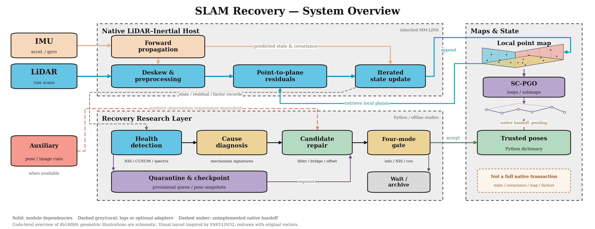

# Transactional Detection, Quarantine, and Verifiable Recovery for Degraded Multi-Sensor SLAM (`slam_recovery`)

Official repository for **`slam_recovery`**: a cross-host transactional recovery framework that protects persistent SLAM maps against intermediate perceptual degradation (`GEO_DEGEN`, `MEAS_CONTAM`, `SYNC_DRIFT`, `LOOP_OUTLIER`, and `AUX_DEGEN`) via delayed-commit quarantine buffering, interpretable mechanism routing, tiered repairers, and a four-mode information–uncertainty gate $\mathcal{D}(t)$.

> **Mainline progress and acceptance:** Read the [two-axis progress standard and checklist](docs/MAINLINE_PROGRESS_STANDARD_20261109.md) before each automatic review. **every auto review needs read and plan to work on main line according to this table**. Its 16/36 prototype and 11/36 paper-evidence scores are a frozen assessment of `7fc67cf`, not a claim about later commits; subsequent reviews must assess current evidence and plan against the same row IDs. See [AGENTS.md](AGENTS.md).



> **Architecture & Visual Bundle**: [Vector SVG](docs/review_20261105/figures/01_architecture.svg) · [PDF](docs/review_20261105/figures/01_architecture.pdf) · [Figure Descriptions](docs/review_20261105/FIGURES.md)

---

## 1. Overview & Key Contributions

Multi-sensor SLAM frequently enters an **untrustworthy intermediate regime** where the estimator has not yet crashed, but incoming measurements or loop constraints have already begun corrupting the persistent map. `slam_recovery` formulates recovery as a **verifiable database-style transaction** over persistent state:

$$\text{Checkpoint} \to \text{Delayed-Commit Quarantine} \to \text{Mechanism Routing} \to \text{Candidate Repair} \to \text{Holdout Validation} \to \mathcal{D}(t)$$

- **Delayed-Commit Quarantine (`slam_recovery/quarantine/`)**: Decouples the provisional live trajectory from the trusted persistent map using a confirmation margin $\Delta t_{\mathrm{margin}} = 2.0\,\mathrm{s}$ and undo-log rollback ($t_{q,\mathrm{start}} = \hat{t}_{\mathrm{onset}} - \Delta t_{\mathrm{margin}}$), eliminating pre-hibernation confirmation tail pollution.
- **Joint Health Detector & Mechanism Signature Router (`slam_recovery/health/`, `slam_recovery/diagnosis/`)**: Combines 6-DoF decoupled/coupled information spectra, NIS-CUSUM innovation monitoring, Leave-One-Sensor-Out (LOSO) conflict, and rotational cross-correlation lag to detect self-consistent near-field occlusions (e.g., floating plastic bags) where covariance-only detectors score $0\%$ recall.
- **Tiered Repairers (`slam_recovery/repair/`)**:
  - *RANSAC Point-Mixture Contaminant Stripping* for near-field planar occluders;
  - *Temporal Offset & Intra-Scan Deskew Compensation* with orthogonal anchor pose-graph protection;
  - *Cumulative Window-Strain GNC Revocation* for perceptual-aliasing loop closures;
  - *Two-Point Boundary-Anchored Cross-Modal Bridge* for severe visual darkness/blur on ORB-SLAM3.
- **Unified Four-Mode Gate $\mathcal{D}(t)$ & Holdout Screening (`slam_recovery/validation/`)**: Evaluates 6-DoF weak-direction Fisher information gain ($\Delta J_v$), genuine cross-scan point-to-plane holdout NIS ($\mathcal{S}_k \to \mathcal{S}_{k-\Delta}$), and sequential Wilson lower bounds before allowing atomic map commit.

---

## 2. Repository Structure

```text
├── slam_recovery/                  # Core Python library, repairers, simulator & experiments
│   ├── core.py                     # State machine, Checkpoint, CandidateMap, and 4-mode gate D(t)
│   ├── health/detector.py          # 6D FIM spectrum + NIS-CUSUM + LOSO joint detector
│   ├── diagnosis/router.py         # Interpretable mechanism signature matrix router
│   ├── quarantine/manager.py       # TrustedMapTransactionManager & undo-log rollback
│   ├── repair/                     # Point-mixture filter, pose-graph bridge, loop/sync repairers
│   ├── validation/                 # 6-DoF point-to-plane FIM, cross-scan holdout NIS & Wilson gate
│   ├── sim/                        # OnlineRecoveryTransactionNode & 3D-mesh arena simulation (S1/S2)
│   ├── experiments/                # E1–E3 evaluation scripts, hall_02 held-out test & JSON manifests
│   └── tests/                      # Unit & regression test suite (including R1–R6 counterexamples)
├── paper_submission_package/       # IEEEtran manuscript source (paper_main.tex), figures & PDF
├── FAST-LIO/ & SC-PGO/             # Instrumented C++ LIO and multi-map PGO host workspaces
├── SLAM_RECOVERY_RESEARCH.md       # Full theoretical modeling, literature review & master plan
├── REVIEW_AND_SIMULATION_PLAN.md   # Audit records, S1–S3 simulation design & acceptance checklist
└── FAST_LIVO2_SHARED_CORE_EXTRACTION.md  # C++ raw reprocessing & Causal Transformer upgrade guide
```

---

## 3. Quick Start & Verification

### 3.1 Run Unit & Audit Regression Tests
```bash
python -m unittest discover -s slam_recovery/tests -v
```

### 3.2 Reproduce Core Benchmarks & Simulation Verification
```bash
# E1: Detection & diagnosis benchmark
python -m slam_recovery.experiments.run_e1_detection_benchmark

# S1 & S2: Counterfactual R4 vs. R5 gate verification & 3D mesh voxel contamination
python -m slam_recovery.sim.run_s1_s2_simulation_experiments

# E2: B0–B6 ablation matrix across FAST-LIO2, LIO-SAM, and MM-LINS
python -m slam_recovery.experiments.run_e2_ablation_matrix

# E3: Second-host transfer on ORB-SLAM3 (hall_01, room_02, room_dark_01, and held-out hall_02)
python -m slam_recovery.experiments.e3_orbslam3.evaluate_e3_orbslam3
python -m slam_recovery.experiments.e3_orbslam3.hall_02.evaluate_hall_02
```

### 3.3 Compile the Paper Manuscript
```bash
cd paper_submission_package
pdflatex -interaction=nonstopmode paper_main.tex
bibtex paper_main
pdflatex -interaction=nonstopmode paper_main.tex
pdflatex -interaction=nonstopmode paper_main.tex
```

---

## 4. Documentation Index

- **[SLAM_RECOVERY_RESEARCH.md](SLAM_RECOVERY_RESEARCH.md)**: Comprehensive problem formulation, mathematical derivations, host adaptation contracts, and experimental design.
- **[REVIEW_AND_SIMULATION_PLAN.md](REVIEW_AND_SIMULATION_PLAN.md)**: Codebase audit history, S1–S3 simulation protocol, and acceptance review of commits `00080c1` & `fb9e655`.
- **[FAST_LIVO2_SHARED_CORE_EXTRACTION.md](FAST_LIVO2_SHARED_CORE_EXTRACTION.md)**: Core architecture extraction from `fast_livo2_shared_cursor` (raw payload reprocessing, Copy-on-Write spatial mutation journal, and Physics-Guided Causal Relative-Attention Transformer).
- **[docs/review_20261105/README.md](docs/review_20261105/README.md)**: Historical bounded counterexample analysis (R1–R6, resolved in `fb9e655`) and redrawn diagnostic figures.
- **[docs/review_20261105_followup/README.md](docs/review_20261105_followup/README.md)**: Follow-up review of `23fbe6d`: 17 upstream tests pass, but nine bounded probes reproduce remaining correctness and evaluation issues. Includes source-pinned findings and reproduction evidence.
- **[Review of `a14bc1c`](docs/review_20261106_a14bc1c/README.md)**: Architecture and paper-figure provenance, transaction boundary probes, and verified fixes following `8a2a541`.
- **[Review of `357c473`](docs/review_20261106_357c473/README.md)**: Fifth-host experiment controls, ablation gate definitions, metric denominators, and held-out site selection.
- **[投稿前修复与验收建议](docs/review_20261106_357c473/repair_plan.md)**：候选缺证据、回滚至空地图、独立验证和单宿主四组对照。
