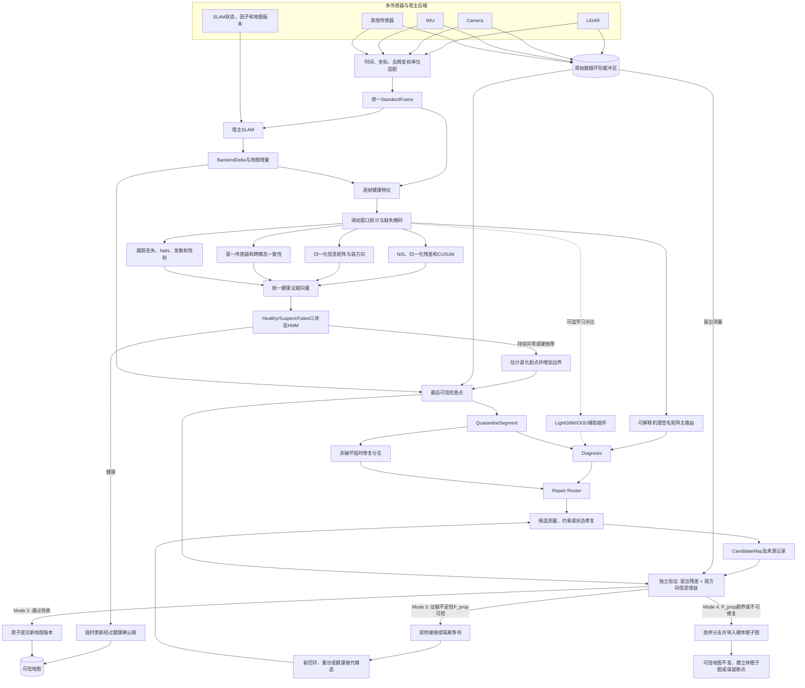

# 面向退化多传感器 SLAM 的检测、隔离与可验证修复

> **文献调研、数学建模、系统方案、实验设计与后续安排总文档**  
> 更新日期：2026-11-03  
> 文档性质：持续更新的研究工作方案，不代表其中所有模块和实验已经完成。

## 关联材料

- 英文 IEEE 风格 Related Work：[related_work.tex](related_work.tex)
- 45 条参考文献数据库：[references.bib](references.bib)
- LaTeX 独立编译入口：[related_work_main.tex](related_work_main.tex)
- 一键编译脚本：[build_related_work.ps1](build_related_work.ps1)
- MM-LINS 阅读材料：[MM_LINS.md](MM_LINS.md)

---

## 目录

1. [研究目标与核心观点](#1-研究目标与核心观点)
2. [问题定义与术语边界](#2-问题定义与术语边界)
3. [文献调研](#3-文献调研)
4. [数学建模与理论边界](#4-数学建模与理论边界)
5. [总体方法论与系统流程](#5-总体方法论与系统流程)
6. [检测、诊断与修复算法](#6-检测诊断与修复算法)
7. [数据适配与模块接口](#7-数据适配与模块接口)
8. [最小可发表实验方案](#8-最小可发表实验方案)
9. [评价指标与统计协议](#9-评价指标与统计协议)
10. [后续实施安排](#10-后续实施安排)
11. [风险、降级方案与论文表述边界](#11-风险降级方案与论文表述边界)
12. [预期论文结构与当前交付物](#12-预期论文结构与当前交付物)
13. [阶段验证记录与实测基准（持续更新）](#13-阶段验证记录与实测基准持续更新)

---

# 1. 研究目标与核心观点

## 1.1 研究对象

研究面向 LiDAR、Camera、IMU 及其组合 SLAM 的一类中间状态：

> 系统尚未完全跟踪丢失，但测量、状态估计或地图更新已经不可靠。

目标不是单纯提高正常条件下的里程计精度，而是在退化发生前后提供一套通用的恢复管理流程：

```text
检查点 → 异常检测 → 提前隔离 → 原始数据保留 → 原因诊断
→ 候选修复 → 独立验证 → 原子提交 / 等待 / 放弃
```

最小实验平台固定为：

- 主宿主：LIO-SAM（白盒因子图事务集成，并与本地已部署的 MM-LINS / FAST-LIO2+SC-PGO 同台对照）；
- 第二宿主：ORB-SLAM3（灰盒关键帧/位姿图级接入，原生 Atlas 作为独立黑盒恢复基线）；
- 实跑多地图基线：MM-LINS（本地源码 `FAST-LIO` + `SC-PGO` 已就位，含公开退化序列与真实塑料袋遮挡序列）；
- 公开数据：M2DGR；
- 补充数据：MM-LINS 退化增强包 + 真实受控退化与物理故障注入。

## 1.2 核心研究主张

1. **退化检测与退化原因分类不是同一个问题；纯协方差/特征谱检测无法区分“几何弱约束”与“自洽型错误测量”（如近场遮挡物）。**
2. **隔离首先是一种损伤控制机制，不自动等于修复；无延迟提交的休眠机制会把确认期内的漂移永久写入子图尾部。**
3. **回滚不能从同一批退化数据中创造新的状态信息。**
4. **退化类型标签或机理签名可以提供路由诊断信息，但不自动构成新的状态约束。**
5. **修复是否成立，取决于新测量、替代模态、外部约束或可信先验是否真正改善目标方向的可估计性。**
6. **无法验证的修复或地图融合不应进入可信地图（例如 MM-LINS 在 Campus-2 与 NCLT-01-10 上开启约束增强 PGO 后误差反而翻倍或劣化）；安全拒绝是框架的必要能力。**
7. **在线降权、软桥接等待、验证后提交与多地图硬休眠并非互斥流派，而是同一信息增益—不确定度门控下的四个工作区。**
8. **框架的通用性主要体现在恢复生命周期和接口语义，而不是存在一个能修复所有退化的万能算法。**

## 1.3 预期贡献边界

本研究希望验证：

- 层次化健康检测能否更早、更稳定地识别不可靠区段；
- 非破坏性隔离能否减少可信地图污染；
- 在新信息存在时，临时分支上的修复能否恢复轨迹和地图；
- 独立验证能否降低错误修复提交率；
- 同一恢复管理核心能否迁移到 LIO 和 VIO 两类宿主。

不直接声称：

- 已证明适用于所有 SLAM 系统；
- 任意退化均可修复；
- 仅凭分类标签即可恢复不可观方向；
- 仅凭现有调研即可宣称“首次”；
- 先验补全或生成式结果等价于真实测量恢复。

---

# 2. 问题定义与术语边界

## 2.1 三层错误

| 层级 | 典型问题 | 主要检测依据 | 候选处理 |
|---|---|---|---|
| 测量层 | 雨雾、多路径、运动模糊、动态物体、遮挡、丢点 | 原始点云、图像、波形和物理统计 | 滤波、重关联、测量可靠性估计 |
| 估计层 | 几何弱可观、视觉特征不足、时间偏移、外参异常、优化发散 | 信息矩阵、创新、跨传感器一致性 | 重优化、替代约束、时间或外参估计 |
| 地图层 | 错误回环、错误地图融合、污染持续累积 | 地图版本差异、独立约束、优化一致性 | 因子撤销、分支恢复、原子提交 |

## 2.2 关键术语

- **可信状态/地图**：经过健康确认期或修复验证、允许被下游使用的持久状态。
- **临时更新**：实时运行可以使用，但尚未进入可信地图的更新。
- **隔离区段**：从估计退化起点到终点的一组可疑测量、状态增量、因子和地图增量。
- **回滚**：恢复较早的检查点。
- **重处理**：对保留数据重新执行估计或优化。
- **修复**：利用测量、约束或先验生成一个候选 corrected state。
- **验证**：使用未参与修复求解的证据判断候选结果是否可提交。
- **安全失败**：无法修复或无法验证时，保持可信状态不变并等待、放弃或建立断开的新地图。

## 2.3 与相邻任务的区别

- 在线降权主要防止当前更新造成破坏；
- 重定位主要恢复当前坐标关系；
- 新建地图主要保证故障后的运行连续性；
- 回环优化主要利用新约束修正已有轨迹；
- 本研究关注**已被视为可疑的持久状态如何隔离、修复、验收和提交**。

---

# 3. 文献调研

完整英文论述见 [related_work.tex](related_work.tex)，文献元数据见 [references.bib](references.bib)。以下按研究能力而非单纯按传感器分类。

## 3.1 退化感知估计与多传感器融合

### 几何退化与方向性处理

| 工作 | 主要思想 | 与本研究的关系 |
|---|---|---|
| Zhang 等，2016，`zhang2016degeneracy` | 利用法方程特征谱识别退化方向，并在退化子空间保留预测 | 重要的检测与在线缓解基线；不恢复已污染地图 |
| Hinduja 等，2019，`hinduja2019degeneracy` | 退化感知 ICP 和部分约束因子 | 将方向退化引入因子图 |
| X-ICP，`tuna2024xicp` | 按平移、旋转方向评估可定位性 | 提供细粒度 localizability 思路 |
| Hatleskog 与 Alexis，`hatleskog2024probabilistic` | 使用点及法向量不确定性进行概率退化检测 | 避免只使用单一特征值阈值 |
| Nashed 等，`nashed2021rank` | 显式处理具有非平凡零空间的秩亏 SLAM | 与弱可观建模相关 |
| DALI-SLAM，`wu2025dali` | 误差状态滤波中的 Jacobian 重映射、畸变校正与后端优化 | 属于在线退化防护和估计改进 |

这些方法能够保护当前优化问题，但不能自动创造退化方向的信息，也不必然恢复已经接受的地图增量。

### 多传感器辅助、切换与方向性融合

| 工作 | 主要机制 | 与本研究的关系 |
|---|---|---|
| LVI-SAM，`shan2021lvisam` | 视觉惯性与 LiDAR 惯性子系统相互辅助或重初始化 | 多传感器宿主和辅助信息来源 |
| Super Odometry，`zhao2021super` | IMU 中心架构，按质量调整 LiDAR 和视觉约束 | 在线可靠性处理 |
| DAMS-LIO，`han2023dams` | 检测 LiDAR 退化后引入辅助里程计 | 退化触发辅助 |
| Switch-SLAM，`lee2024switch` | 在 LiDAR 与视觉里程计之间显式切换 | 传感器 failover |
| Selective KF / Fuse Only What Matters，`zhang2026fuse` | 仅在 LiDAR 缺乏信息的方向使用视觉信息 | 方向选择性融合，与修复验收高度相关 |
| SM/VIO，`joshi2023smvio` | 模型估计器与 VIO 切换，回环可优化后备轨迹 | 表明后备区段仍可能被后续约束修正 |
| Hierarchical Adaptation，`zhao2025resilient` | 特征、方向权重、估计器和学习惯性后备的层次适应 | 多层级在线适应 |

总体看，这些工作的首要目标是**在线连续性和漂移抑制**，不是把可疑区段作为可延迟验收的事务进行处理。

## 3.2 重定位、多地图和会话恢复

| 工作 | 主要机制 | 与本研究的关系 |
|---|---|---|
| Eade 与 Drummond，`eade2008unified` | 将回环和恢复统一为图连接操作 | 早期图式恢复 |
| Visual-Inertial ORB-SLAM，`murartal2017mapreuse` | 地图复用、重定位、视觉惯性 BA 和偏置重估计 | VIO 中断后的恢复基础 |
| Qin 等，`qin2018relocalization` | VIO 重定位、地图融合和四自由度位姿图优化 | 利用重力可观测性进行全局优化 |
| ORB-SLAM3 Atlas，`campos2021orbslam3` | 活跃/非活跃地图、新建地图、地点识别和地图焊接 | 第二宿主的原生恢复基线 |
| Real-Time Multi-SLAM，`alliez2020multislam` | 非破坏性视觉惯性重初始化，保留关键帧和路标 | 与保留可用地图内容相关 |
| Zhan 等，`zhan2021restoration` | 保留多个视觉子地图，通过共享路标恢复完整地图 | 子地图重连 |
| Rahman 等，`rahman2024failure` | 健康检测、健康位姿图、VIO 重置和连续会话融合 | 主动健康触发恢复 |
| MM-LINS，`ma2025mmlins` | 过退化检测、睡眠地图、动态初始化、Scan Context 和约束增强融合 | LIO 主动隔离的重要参照 |
| RMF-SLAM，`peng2026rmf` | LiDAR/视觉退化权重、地图睡眠和描述子融合 | 多传感器退化下的地图管理 |

这些工作主要解决**重连和会话继续**，不一定对可疑测量及地图更新提供显式的修复、验收和拒绝语义。

## 3.3 MM-LINS 与 ORB-SLAM3 Atlas 的异同

共同点：

- 都保留旧地图；
- 都建立新的活跃地图；
- 都尝试跨地图识别；
- 都在满足条件后融合地图。

关键差异：

| 维度 | MM-LINS | ORB-SLAM3 Atlas |
|---|---|---|
| 主要触发 | 检测到过退化（旋转/平移协方差最大特征值及连续帧计数 $\Gamma_\lambda > N_\kappa$） | 跟踪丢失及重定位失败 |
| 主要目的 | 尽早隔离过退化造成的漂移 | 丢失后的运行恢复与地图复用 |
| 初始化 | 动态 LiDAR–IMU 初始化（4 帧 ICP + IMU 预积分线性求解） | 视觉或视觉惯性重建 |
| 跨地图识别 | Scan Context 与时间一致性（$\Gamma_\varsigma > \varepsilon_{th}$） | DBoW2 地点识别 |
| 融合 | 丢弃新图先验 + 约束增强位姿图优化（CE-PGO） | 视觉/视觉惯性 welding BA |
| 与本研究差距 | 无延迟提交（$N_\kappa$ 确认期漂移已写入睡眠图尾部）、无新息一致性检测、硬切图在无重访时永久碎片化、融合无独立验收与回退 | 主要不是退化区段的物理或几何修复 |

因此，两者在地图生命周期层面相似，但触发语义和主要技术目标并不相同。

### 从 MM-LINS 实验与机制中提炼的三条核心动机实证

对本地 MM-LINS 论文（IEEE T-IV 2025）与源码的剖析直接为本研究提供了三个具象靶子：

1. **无独立验证的融合/修复会劣化可信地图（支撑本研究“独立验证与安全拒绝”）**：在 MM-LINS 自身的消融实验（Table I 与 Table III）中，开启约束增强 PGO（CE-PGO）后，**Campus-2 的端到端误差从 `w/o PGO` 的 0.603 m 恶化至 1.295 m（误差翻倍）**，NCLT-01-10 的 ATE RMSE 也从 0.785 m 上升至 0.811 m。这直接证明：仅靠描述子时间一致性（$\Gamma_\varsigma > \varepsilon_{th}$）堆叠相似性约束而不做留出测量与几何增益验收，会把错误或过约束关系永久焊入全局图。
2. **仅看后验协方差无法捕获“自洽型污染”（支撑本研究“NIS + 信息谱 + 留一冲突”联合检测）**：MM-LINS 仅监控 $P_{rr}, P_{tt}$ 的最大特征值。然而在其核心场景（塑料袋贴附遮挡 LiDAR、浓烟近场散射、密集动态人群）中，传感器可能返回大量近距离、法向量高度一致的假平面点——此时信息矩阵特征值看似充足（协方差收缩），系统误以为强约束而延迟报警，直到里程计已被污染。必须联合新息残差（NIS $\chi^2$）与跨模态留一冲突才能识别此类“强几何假象、错物理测量”。
3. **无延迟提交的休眠 + 二值硬切图的两难（支撑本研究“延迟提交缓冲 + 软桥接/硬休眠信息门控”）**：MM-LINS 依赖连续帧计数 $\Gamma_\lambda > N_\kappa$ 触发休眠，导致触发前 $N_\kappa$ 帧的退化漂移已不可逆地写入睡眠地图边缘（这也是其后端被迫丢弃先验并用多条重叠边强行拉扯的原因）；同时，任何短暂遮挡一旦触发休眠即彻底断开位姿图，若机器人不再重访旧区域，地图将永久碎片化。

## 3.4 回顾式恢复、地图修正与显式回退

| 工作 | 主要机制 | 与本研究的关系 |
|---|---|---|
| Dual-SLAM，`huang2020dualslam` | 前向继续新地图，恢复线程逆向处理缓存图像并连接地图 | 证明缓存测量可支持回顾式恢复 |
| Immediate Pose Recovery，`dou2024immediate` | 逆时间顺序重建未跟踪视觉帧 | 恢复失败视觉区段 |
| Kitware LiDAR SLAM，`kitware_lidar_slam_recovery` | 恢复旧地图和轨迹，并辅助重定位 | 明确的恢复模式与回退实例 |
| Invalid Map Merges，`holoch2022invalid` | 检测错误地图融合，恢复备份并删除错误顶点和边 | 选择性撤销错误持久操作 |
| LT-mapper，`kim2022ltmapper` | 正/负增量地图和环境版本回退 | 可逆地图版本，但主要面向长期环境变化 |
| R-ALC，`maheshwari2026ralc` | 保存稳定区域的图和占据地图检查点，失败后恢复 | 区域检查点恢复；预印本 |
| Wei 等，`wei2022posture` | 使用间歇参考轨迹校正 SLAM 并传播到地图产品 | 外部参考驱动的轨迹和地图修正 |
| Wu 等，`wu2025segments` | 时间一致的退化区段、视觉重投影约束和区段位姿图优化 | 与区段修复高度相关 |
| Plane-Based Loop Correction，`li2024plane` | 使用重访结构平面进行校正 | 提供新的几何约束 |
| Interactive Graph SLAM，`koide2021interactive` | 用户引导回环和平面约束修正地图 | 交互式修复信息来源 |
| DeCOD，`kim2026decod` | 添加与退化方向正交的几何约束 | 直接针对弱方向补信息；预印本 |
| Retroactive Loop Closure，`gupta2026retroactive` | 从早期遍历中恢复遗漏回环 | 新回环驱动的回顾式修正；预印本 |

现有研究分别展示了缓存恢复、外部约束修正和选择性撤销，但仍缺少统一的：

```text
可信检查点 → 可疑更新隔离 → 可修复性判断
→ 候选修复 → 独立验证 → 原子提交或拒绝
```

## 3.5 鲁棒后端与通用框架

### 鲁棒约束

- Switchable Constraints：`sunderhauf2012switchable`；
- Dynamic Covariance Scaling：`agarwal2013dcs`；
- Pairwise Consistency Maximization：`mangelson2018pcm`；
- Graduated Non-Convexity：`yang2020gnc`；
- RRR/iRRR：`latif2013robustloop`；
- DARE-SLAM：`ebadi2021dare`。

它们主要决定哪些约束应参与优化、如何抑制错误或如何撤销错误回环。它们不等同于持久地图状态的事务式恢复协议，但可作为本研究的修复器或验证工具。

### 通用系统与信息保留

- maplab：`schneider2018maplab`；
- maplab 2.0：`cramariuc2023maplab2`；
- GSLAM：`zhao2019gslam`；
- Ground-Fusion++：`zhang2025groundfusion`；
- Nonlinear Factor Recovery：`usenko2020factorrecovery`。

这些工作提供模块化接口、多会话优化、多模态支持、基准测试或边缘化先验恢复。它们说明通用接入和信息保留具有可行性，但不自动给出可疑持久状态的统一恢复语义。

## 3.6 文献缺口与“首次”表述限制

可以将研究位置概括为四类能力的组合：

1. 在线抑制不可靠更新；
2. 故障后在新地图或会话中继续；
3. 新证据到达后的回顾式修正；
4. 对错误地图操作的选择性撤销。

本研究针对这些能力之间的连接缺口，尤其是**临时更新、独立验收和原子提交**。

不能轻易宣称“首次”，原因包括：

- 不同论文使用 recovery、restoration、rollback、reset、reinitialization、revision 等不同术语；
- 一些工程系统或文档可能未以论文形式公开；
- “隔离”“修复”“通用模块”等概念边界会影响新颖性判断；
- 预印本、工业实现和其他机器人领域仍可能存在相近机制；
- 文献检索无法证明绝对不存在。

更稳妥的表述是：

> 本研究聚焦于一种统一的、可验证的恢复生命周期，并在异构 SLAM 宿主上评估其检测、隔离、修复和安全拒绝能力；贡献定位于恢复语义与系统范围，而不是断言既有系统完全不具备恢复或地图修正功能。

---

# 4. 数学建模与理论边界

## 4.1 信息矩阵与退化方向

线性化测量模型为：

\[
z_i=h_i(x)+\epsilon_i,\qquad
H_i=\left.\frac{\partial h_i}{\partial x}\right|_{\hat x}.
\]

对应信息矩阵：

\[
\Lambda=\Lambda_{\mathrm{prior}}+
\sum_i H_i^TR_i^{-1}H_i.
\]

若某方向 \(v\) 满足：

\[
H_iv\approx 0,\qquad \forall i,
\]

则：

\[
v^T\Lambda v
\approx v^T\Lambda_{\mathrm{prior}}v.
\]

传感器测量对该方向几乎没有信息增量。状态 \(x\) 与 \(x+\alpha v\) 可能产生几乎相同的观测，却对应不同轨迹或地图。

## 4.2 为什么回滚本身不能恢复几何不可观方向（固定线性化与固定关联前提下的信息边界）

回滚只能改变优化起点或删除已经接受的状态。在**固定线性化点 $\hat x$、固定数据关联（correspondences）和相同测量集合** $D=\{z_i,H_i,R_i\}$ 的前提下，对原数据施加任何非放大鲁棒权重 $w_i \in [0,1]$ 重新求解，其局部 Fisher 信息增量仍然满足：

\[
\Delta\Lambda_D=\sum_i w_i H_i^TR_i^{-1}H_i \preceq \sum_i H_i^TR_i^{-1}H_i.
\]

在原弱方向 $v$（满足 $H_i v \approx 0$）上仍有：

\[
v^T\Delta\Lambda_Dv\approx 0.
\]

**重要理论边界限定**：在非线性非凸优化（如 ICP 或视觉 BA）中，若环境中原本存在可用背景几何但前向估计因坏初值或离群点落入了错误的局部极小值，回滚到干净检查点并改变初值、剔除离群点或重新建立正确的数据关联**可以改善数值收敛与轨迹误差**；但若传感器测量集合在该几何方向本身秩亏（$H_i v \approx 0$），仅靠回滚不能凭空创造该方向的可观测性。因此：

> **回滚主要是损伤隔离（damage containment）与重线性化起点恢复，不自动等价于退化方向的观测信息恢复（observability recovery）。**

## 4.3 退化类型识别是否提供新信息

若退化标签是已有数据的确定性函数：

\[
c=f(D),
\]

它提供的是诊断或元信息，而不是独立的状态测量。它可以帮助：

- 选择噪声模型；
- 删除错误测量；
- 选择物理逆模型；
- 选择替代传感器；
- 决定修复或拒绝。

但标签本身不产生新的 \(H_g^TR_g^{-1}H_g\)。

若引入真正的新约束：

\[
z_g=g(x)+\epsilon_g,
\]

则：

\[
\Lambda'=\Lambda+H_g^TR_g^{-1}H_g.
\]

它能够帮助原退化方向的必要几何条件是：

\[
v^TH_g^TR_g^{-1}H_gv>0.
\]

信息增益大于零仍不保证结果正确，还需要独立一致性验证。

## 4.4 NIS 与持续异常检测

观测残差及其协方差为：

\[
r_t=z_t-h(\hat x_t),\qquad
S_t=H_tP_tH_t^T+R_t.
\]

归一化创新平方：

\[
d_t=r_t^TS_t^{-1}r_t.
\]

在模型、噪声和状态估计一致等假设下：

\[
d_t\sim\chi^2_m.
\]

单帧超限不足以判断持续退化，可在正常数据归一化后使用 CUSUM：

\[
g_t=\max(0,g_{t-1}+a_t-k),
\]

其中 \(a_t\) 为异常分数，\(k\) 为正常波动容差，\(g_t>h\) 表示持续偏移。

注意：如果当前状态已被污染，相对于该状态计算的残差可能仍然很小。因此必须结合独立跨传感器或留出测量检查。

## 4.5 归一化可观测性分析

由于平移和旋转量纲不同，引入状态尺度变换 \(x=Du\)，则：

\[
\Lambda_u=D^T\Lambda_xD.
\]

特征分解：

\[
\Lambda_u=Q\operatorname{diag}(\lambda_1,\ldots,\lambda_n)Q^T.
\]

输出应包含：

- 弱特征值及其相对正常工况的下降比例；
- 对应特征向量 \(q_j\)；
- 受影响的平移或旋转方向；
- 连续多帧的持续性。

不建议只使用一个跨设备、跨场景的固定最小特征值阈值。

## 4.6 跨传感器相对运动一致性

对同一时间区间的两个相对运动估计：

\[
e_t=\Log\left(\Delta T_{VI}^{-1}\Delta T_L\right),
\]

\[
D_t=e_t^T(\Sigma_{VI}+\Sigma_L)^{-1}e_t.
\]

持续异常表明估计通道冲突，但不能单独说明谁发生故障。可结合 leave-one-sensor-out：

- 不使用 LiDAR 时，视觉–IMU 是否能预测相关观测；
- 不使用视觉时，LiDAR–IMU 是否能预测相关观测；
- 删除某通道后，其余通道是否恢复正常。

IMU 可能是共享信息源，不能被视为绝对真值。

## 4.7 点云级退化观测模型与可逆性边界

> **范围说明**：公开多传感器数据集（如 M2DGR、NCLT、UTBM）仅提供点云级 `(x, y, z, intensity, ring, time)` 而非原始全波形回波。为保证理论建模与实验验证严格一一对应，本研究不在正文中展开脉冲波形级（如高斯脉冲阈值交叉或路徑积分反卷积）推导，而是直接在点云测量层建立混合观测与几何信息增益判据。

### 衰减与距离噪声下的有效测量模型

在雾、烟、雨或半透明介质中，反射强度按双程消光衰减并伴随距离测量方差膨胀及强度相关丢点：

\[
I_i^{\mathrm{obs}} = I_i \exp(-2\alpha r_i) + \eta_i,\qquad
r_i^{\mathrm{obs}} = r_i + \epsilon_i(\alpha, I_i^{\mathrm{obs}}),\qquad
p_{\mathrm{drop}}(r_i, I_i^{\mathrm{obs}}) = 1 - \sigma\big(\gamma(I_i^{\mathrm{obs}} - I_{\mathrm{th}})\big).
\]

辐射强度补偿 $\hat I_i = I_i^{\mathrm{obs}} e^{2\alpha r_i}$ 只能恢复外观强度，不能降低 $\epsilon_i$ 的方差，更不能凭空恢复已丢失点方向的几何 Jacobian。

### 遮挡、散射与真实目标的混合观测模型

将退化区段内的点云观测 $z_i$ 建模为真实静态几何目标 $t$、近场遮挡/后向散射伪目标 $s$（如贴附塑料袋、浓烟团）与随机离群噪声 $n$ 的混合分布：

\[
p(z_i) = \pi_t p_t(z_i) + \pi_s p_s(z_i) + \pi_n p_n(z_i).
\]

点级静态目标后验可靠性权重为：

\[
w_i \triangleq P(t\mid z_i) = \frac{\pi_t p_t(z_i)}{\pi_t p_t(z_i) + \pi_s p_s(z_i) + \pi_n p_n(z_i)}\in[0,1].
\]

**关键区分（弱约束 vs 错误约束）**：

- 当发生**结构退化或严重丢点**时，有效点数骤减，$\sum_i H_i^T R_i^{-1} H_i$ 在弱方向 $v$ 上特征值塌缩（$\lambda_{\min}\to 0$），但残差 $r_i$ 未必显著超限；
- 当发生**近场遮挡（如 MM-LINS 中的飘浮塑料袋）或动态簇拥**时，伪目标分布 $p_s(z)$ 产生大量空间自洽的近距离平面点，若不加区分地赋予 $w_i=1$，则表观信息矩阵 $\sum_i H_i^T R_i^{-1} H_i$ 特征值依然很大（甚至因近距点密集而虚高），但相对于真实运动先验（IMU 预积分或跨模态预测）的新息残差 $d_t = r_t^T S_t^{-1} r_t$ 会剧烈违背 $\chi^2$ 分布。

### 遮挡与丢点的不可逆性边界

- 局部干扰点过滤（基于 $w_i$ 的软降权或剔除）只能在**剩余真实背景点仍张成原观测空间**时恢复配准精度；
- 全视场不透明遮挡或极端丢点使目标回波完全缺失，同一模态缓冲数据中不存在可逆几何信息；
- 点云补全、插值和生成模型属于先验假设，不能计入真实测量信息矩阵 $\Lambda$。

### 测量滤波后的几何可修复条件

对隔离区段执行点级重加权 $R_i \leftarrow R_i / w_i$ 并剔除伪目标点后，构建修正后信息矩阵 $\Lambda_{\mathrm{filtered}} = \Lambda_{\mathrm{prior}} + \sum_i w_i H_i^T R_i^{-1} H_i$。仅当原弱方向或受污染方向 $v$ 同时满足：

\[
v^T \Lambda_{\mathrm{filtered}} v \ge \tau_{\mathrm{obs}}
\quad \text{且} \quad
d_t(\mathrm{filtered}) \le \chi^2_{m, 1-\alpha},
\]

单模态重配准修复才在数学上成立；若剔除伪目标后 $v^T \Lambda_{\mathrm{filtered}} v < \tau_{\mathrm{obs}}$（例如剔除塑料袋点后剩下的背景点过少），系统必须转入等待替代模态、延迟回环或执行安全分离。

## 4.8 候选修复优化与四态统一决策门控

### 临时分支优化目标

在临时分支上统一表示为：

\[
X^*=\arg\min_X\left(
\sum_{i\in\mathcal T}\rho(r_i^2)+
\sum_{j\in\mathcal Q}\rho_w(\tilde r_j^2)+
\sum_{k\in\mathcal N}\rho(r_k^2)
\right),
\]

其中：

- \(\mathcal T\)：可信检查点约束；
- \(\mathcal Q\)：经点级权重 $w_j$ 或结构筛选重处理后的隔离区段约束；
- \(\mathcal N\)：新独立证据（健康替代模态相对运动、重访回环因子等）；
- \(\rho, \rho_w\)：Huber、Cauchy 或 GNC 等鲁棒核。

### 统一四态门控准则（将在线降权与多地图休眠收编为特例）

设隔离区段跨越时段 $[t_{q,\mathrm{start}}, t]$，弱方向单位向量为 $v$，修复后候选分支在弱方向上的有效信息量为 $J_v^{\mathrm{after}} = v^T \Lambda_{\mathrm{after}} v$，留出验证集的归一化残差统计量为 $D_{\mathrm{holdout}}$，从最后可信检查点沿临时分支传播的累积位姿协方差上界为 $\|P_{\mathrm{prop}}(t)\|$。定义信息充足阈值 $\tau_{\mathrm{info}}$、留出一致性阈值 $\tau_{\mathrm{val}}$ 以及桥接容忍不确定度上界 $\Sigma_{\mathrm{bridge}}$，则恢复生命周期的四个工作区由以下闭式门控唯一确定：

\[
\mathcal{D}(t) = \begin{cases}
\textbf{Mode 1: Online Reweight（在线方向降权）}, & \text{若异常短暂 } (\Delta t < \Delta t_{\min}) \text{ 且 } \|P_{\mathrm{prop}}\| \ll \Sigma_{\mathrm{bridge}}; \\[6pt]
\textbf{Mode 2: Atomic Commit（验证通过并原子提交）}, & \text{若 } J_v^{\mathrm{after}} \ge \tau_{\mathrm{info}} \;\wedge\; D_{\mathrm{holdout}} \le \tau_{\mathrm{val}} \;\wedge\; \|P_{\mathrm{after}}\| \le \Sigma_{\mathrm{tol}}; \\[6pt]
\textbf{Mode 3: Soft Bridge / Wait（软桥接隔离等待）}, & \text{若 } (J_v^{\mathrm{after}} < \tau_{\mathrm{info}} \;\vee\; D_{\mathrm{holdout}} > \tau_{\mathrm{val}}) \;\wedge\; \|P_{\mathrm{prop}}(t)\| < \Sigma_{\mathrm{bridge}}; \\[6pt]
\textbf{Mode 4: Hard Sleep / Submap Split（硬休眠切图）}, & \text{若 } (J_v^{\mathrm{after}} < \tau_{\mathrm{info}} \;\vee\; D_{\mathrm{holdout}} > \tau_{\mathrm{val}}) \;\wedge\; \|P_{\mathrm{prop}}(t)\| \ge \Sigma_{\mathrm{bridge}}.
\end{cases}
\]

**理论意义（范式统一性）**：

- 当设置 $\Sigma_{\mathrm{bridge}} \to \infty$ 且关闭回顾缓冲时，系统退化为经典的**在线退化感知降权/重映射**（如 Zhang 2016、X-ICP）；
- 当设置 $\Sigma_{\mathrm{bridge}} \to 0$（一旦检测到过退化立即切断）且令验证条件仅检查描述子连续帧数（忽略 $D_{\mathrm{holdout}}$ 与 $\Delta J_v$）时，系统退化为 **MM-LINS 式的硬多地图休眠与盲融合**；
- 在有限的 $0 < \Sigma_{\mathrm{bridge}} < \infty$ 下，短中程退化通过带协方差膨胀的 **Soft Bridge（Mode 3）** 保持单图拓扑连续（即使机器人永不重访旧区域也不会产生地图碎片），同时可信地图不被污染；只有当退化持续时间过长、先验传播不确定度突破 $\Sigma_{\mathrm{bridge}}$ 时，才平滑退化为 **Hard Sleep（Mode 4）** 建立独立子图，并在未来重访时必须通过 **Mode 2** 的留出与信息增益验收才允许合并。

## 4.9 修复验收与同模态内层优化伪收敛判据

> **命题（内部拟合残差下降 $\neq$ 留出几何收益）**：在退化区段 $[t_{q,\mathrm{start}}, t_{q,\mathrm{end}}]$ 内，若候选修复仅对固定对应集或降采样点集做内层非线性最小二乘重优化（甚至将内层点面残差平方和 $\sum r_i^2$ 压降 $>80\%$），只要剩余观测在原弱方向 $v$ 上未引入新的正交Fisher信息（$\Delta J_v = v^T\Lambda_{\mathrm{after}}v - v^T\Lambda_{\mathrm{before}}v < \tau_{\mathrm{info}}$），该优化在零空间方向上会产生过拟合漂移，导致未参与拟合的留出集（Holdout）匹配率下降及重入边界（Re-entry Boundary）的局部相对运动（RPE）恶化。

因此，Mode 2 原子提交验收必须同时满足以下**完备准入条件**（已实现于 `slam_recovery/validation/wilson_validator.py`）：

1. **数值收敛与可信检查点哈希一致**：无 NaN/Inf，且候选分支父本哈希与 `Checkpoint.state_hash` 严格匹配；
2. **未参与修复求解的留出测量一致性（Holdout NIS）**：$D_{\mathrm{holdout}} \le \tau_{\mathrm{val}}$；
3. **配对顺序留出收益的 Wilson 置信下界检验（Sequential Wilson Lower Bound）**：设留出窗口内共 $n \ge N_{\min}$ 帧，候选分支相对未修复主分支（Incumbent）残差改善达到阈值 $\delta_{\mathrm{rel}}$ 的帧数为 $k$（经验改善率 $\hat p = k/n$），要求单侧 Wilson 置信下界（$z = 1.645$ 对应 95% 置信水平）满足：
   \[
   L_{\mathrm{Wilson}}(k, n; z) = \frac{\hat p + \frac{z^2}{2n} - z\sqrt{\frac{\hat p(1-\hat p)}{n} + \frac{z^2}{4n^2}}}{1 + \frac{z^2}{n}} \ge \underline{p}_{\min},
   \]
   从而防止少数帧的大幅残差下降掩盖其余帧的局部轨迹恶化。
   **样本量 $N_{\min}$ 随候选规模自适应**（`transaction_manager_node.py`）：全数改善时 $n=3 \Rightarrow L=0.526$（不达标）、$n=4 \Rightarrow 0.596$（仅高出门限 $0.046$）、$n=8 \Rightarrow 0.747$。因此 $n \ge 4$ 只作为**下限**；当候选触及的关键帧 $\ge 8$ 时要求 $n \ge 8$——用 4 帧证据去授权一次不可逆的可信地图提交，统计上合法但证据过于单薄，而大规模候选本就没有理由只提供 4 帧。目前已记录 `paired_evidence_diagnostics` 的运行（S1 仿真五个分支、`p10` E-Gap）中 `num_paired_frames` 均为 20，远高于两档阈值，故该规则对已有结论不放宽、只收紧；其余 manifest 没有该字段，不能据此类推。
4. **重入边界几何连续性（Re-entry Continuity Gate）**：候选分支在隔离结束时刻 $t_{q,\mathrm{end}}$ 与后段健康轨迹的交接位置跳变 $\|\Delta p_{\mathrm{reentry}}\|_2 \le \tau_{p,\mathrm{reentry}}$、旋转跳变 $\|\Delta \theta_{\mathrm{reentry}}\| \le \tau_{\theta,\mathrm{reentry}}$，杜绝单端开环重放引发的尾部阶跃与 RPE 尖峰。**位置门限在全代码库统一为 $\tau_{p,\mathrm{reentry}} = 0.50\,\mathrm{m}$**（`GateThresholds.max_reentry_jump_m` 与 `wilson_validator` 的 `max_reentry_position_jump_m` 取同一数值；此前二者分别为 `0.50` 与 `0.35`，属同一物理量的两个阈值，会导致候选被一个论文从未声明的界拒绝）；
5. **原弱方向的正交信息增益**：
   \[
   \Delta J_v=v^T\Lambda_{\mathrm{after}}v-
   v^T\Lambda_{\mathrm{before}}v \ge \tau_{\mathrm{info}};
   \]
6. **后验不确定度低于任务容差**且**修复数据来源、模型版本和参数可追溯**。

没有独立证据或未通过上述任一门控时，系统严禁修改可信主图（Fail-Closed），仅可维持 Mode 3 软桥接等待或转入 Mode 4 硬休眠。

---

# 5. 总体方法论与系统流程

## 5.1 完整在线流程



## 5.2 延迟提交是解决检测延迟的关键

若异常在 10 s 开始、12 s 才报警，而 10～12 s 已永久提交，则 12 s 创建检查点已经无法避免污染。

因此维护两类状态：

- **实时运行地图**：允许临时更新，保证 SLAM 连续运行；
- **可信地图**：只接受经过健康确认期或修复验证的更新。

隔离起点为：

\[
t_{q,start}=\hat t_{onset}-\Delta t_{margin},
\]

而不是简单从报警时刻开始。实时输出可以保留，但应附带 `provisional` 标志。

## 5.3 恢复状态机

```text
HEALTHY
   ↓ 持续异常
SUSPECT
   ↓ 确认起点与检查点
QUARANTINED
   ↓
DIAGNOSING
   ↓
REPAIRING / WAITING_FOR_EVIDENCE
   ↓
VALIDATING
   ├── ACCEPT → COMMIT → HEALTHY
   ├── WAIT   → QUARANTINED / WAITING_FOR_EVIDENCE
   └── REJECT → ABORT → 新地图、断开地图或安全停止
```

可信地图在候选验收前保持不变。提交应是地图、轨迹、因子和来源记录的同一版本原子操作。

---

# 6. 检测、诊断与修复算法

## 6.1 为什么采用以解析机理签名为主、统计学习为辅的方案

在小样本公开数据集（如 M2DGR 仅数分钟开发序列）上，若将黑盒分类器（如 GBDT/神经网络）作为主流程必经节点，极易过拟合特定注入器的统计伪影并在跨场景时失效。因此本研究遵循**“解析签名矩阵主路由 + 统计学习可选对比”**原则：

解析与统计检验方法负责（主干闭环，零训练依赖）：

- 残差和归一化创新平方（NIS）+ CUSUM 时序检验；
- 归一化信息矩阵特征谱与退化方向向量提取；
- 跨传感器留一法（Leave-One-Sensor-Out）几何一致性；
- 跨模态运动事件互相关时间偏移检测；
- 基于**可解释机理签名矩阵（Signature Matrix）**的确定性修复路由；
- 最终修复验收与四态门控（Mode 1～4）。

轻量学习模块（LightGBM + IsolationForest）仅作为可选消融插件：

- 在特征维度较高或复合退化难以由简单阈值切分时，评估数据驱动多标签融合是否带来边际收益；
- 决不直接决定“回滚”或“提交修复”，且在主干实验中不依赖其训练即可跑通完整 B6 系统。

## 6.2 滑动时间窗

初始工程参数：

- 窗口约 1 s；
- 步长约 0.2 s；
- 按时间对齐多速率传感器；
- 连续窗口确认软异常；
- 硬故障允许立即隔离。

每个统计量保留：

\[
[\mathrm{mean},\mathrm{std},q_{50},q_{90},q_{99},
\max,\mathrm{slope},\mathrm{valid\ ratio}].
\]

## 6.3 健康特征

### LiDAR

- 点数、丢点率、距离缺失分布；
- 距离、强度、入射角统计；
- 平面和边缘特征数量；
- 法向量及主方向分布；
- 配准残差及空间分布；
- 多回波和异常近点比例；
- 可用时的波形展宽、衰减和后向散射特征；
- 信息矩阵谱及弱方向。

### Camera

- 特征数、匹配率、内点率；
- 图像空间覆盖率；
- 光流分布；
- 模糊度、曝光和动态范围；
- 三角化视差和深度不确定度；
- 重投影残差。

### IMU 与系统

- 比力和重力模长；
- 陀螺仪、加速度计饱和；
- 偏置变化；
- 高频振动能量；
- 跨传感器运动事件时间偏移；
- 优化收敛、NaN 和跟踪状态。

## 6.4 时序任务分解与确定性机理签名矩阵

### 异常检测

\[
y_t\in\{\mathrm{normal},\mathrm{abnormal}\}.
\]

由 NIS-CUSUM、归一化信息谱下降比例与跨模态留一残差联合触发，并通过三状态 HMM（`Healthy / Suspect / Failed`）和最短驻留时间抑制逐帧抖动、回溯估计退化起点 $\hat t_{\mathrm{onset}}$。

### 基于机理签名矩阵（Signature Matrix）的确定性原因诊断（主干方案）

无需训练分类器，第 4 节的四个核心数学统计量天然构成正交的机理签名，直接支持多标签并发诊断：

| 归一化信息谱 $\lambda_{\min}(\Lambda_u)$ | 新息检验 $\mathrm{NIS}_t$ | 跨传感器留一冲突 $D_{\mathrm{LOSO}}$ | 角速度互相关相位差 $\hat\delta t$ | 机理签名诊断结果 | 典型物理场景 |
|---|---|---|---|---|---|
| 显著塌缩 ($\downarrow$) | 正常 | 低 | $\approx 0$ | **几何结构弱可观 (`GEO_DEGEN`)** | 长走廊、开阔广场、严重均匀丢点 |
| 正常或虚高 | 显著超限 ($\uparrow\uparrow$) | 高（主模态异常） | $\approx 0$ | **自洽型测量污染/近场遮挡 (`MEAS_CONTAM`)** | **MM-LINS 塑料袋遮挡**、浓烟近场散射、密集动态物体 |
| 正常 | 周期/瞬态超限 | 高（双模态均随角速度放大） | $|\hat\delta t| > \tau_t$ | **时间同步/外参偏移 (`SYNC_DRIFT`)** | 传感器时钟漂移、触发延迟 |
| 正常 | 局部因子突增 | 低（局部里程计自洽，全局边冲突） | $\approx 0$ | **拓扑/回环错误 (`LOOP_OUTLIER`)** | 走廊/街景感知混叠导致的错误回环或错误子图合并 |
| 正常 | 正常 | 高（辅助模态异常） | $\approx 0$ | **辅助模态退化 (`AUX_DEGEN`)** | 视觉暗光、过曝、运动模糊（此时冻结辅助模态） |

当多个条件同时激活时直接输出多标签集合；当异常已触发但上述签名均不显著时，标记为 `unknown`，转入保守软桥接等待（Mode 3）或硬休眠（Mode 4）。

## 6.5 推荐模型组合

主干确定性配置（零训练过拟合风险）：

```text
NIS/残差 + CUSUM
归一化信息矩阵特征分解（旋转/平移解耦）
跨传感器留一一致性 + 互相关时延估计
三状态HMM（含 onset 回溯边界）
机理签名矩阵（Signature Matrix）确定性多标签路由
```

消融对比配置（用于 E1 验证学习器边际价值）：

- 在相同 `HealthWindow` 输入和 `Diagnosis` 输出接口下，对比确定性签名矩阵与 `LightGBM + IsolationForest`（及可选 TCN），评估小样本训练下的泛化得失。

## 6.6 修复路由器

| 诊断结果 | 候选修复 | 不应直接执行 |
|---|---|---|
| 几何弱可观且有健康替代模态或新回环 | 临时因子图中加入独立约束并重优化 | 仅重复原退化数据优化 |
| 衰减、后向散射或可疑点污染 | 波形/多回波/强度/空间一致性滤波，鲁棒重配准 | 将补全点视为真实测量 |
| 动态物体或错误关联 | 动态剔除、几何一致性、重新关联和鲁棒优化 | 只降低全部权重后宣布修复 |
| 时间偏移或外参异常 | 临时分支联合估计时间、外参和轨迹 | 不可观时强行优化 |
| 错误回环 | 撤销可疑回环，GNC/PCM 等重新筛选 | 保留错误回环继续加约束 |
| 遮挡、严重丢点且无替代信息 | 等待或拒绝 | 以轨迹先验生成“正确地图” |
| 未知退化 | 保守重处理或继续隔离 | 自动执行高风险生成式修复 |

---

# 7. 数据适配与模块接口

## 7.1 核心数据结构

| 结构 | 主要字段 | 流向 |
|---|---|---|
| `StandardFrame` | `sensor_id, t_start, t_end, frame_id, data_ref, calib_id, valid_mask` | 适配器 → 特征与宿主 |
| `BackendDelta` | 位姿、速度、偏置、协方差、因子引用、地图增量、优化器状态 | 宿主 → 检测与隔离 |
| `HealthWindow` | 窗口统计、信息谱、弱方向、跨模态残差、缺失掩码 | 特征 → 检测与诊断 |
| `HealthDecision` | 状态、异常分数、onset、置信度、证据 | 检测 → 隔离 |
| `QuarantineSegment` | 检查点、起止时间、原始数据引用、增量引用、父地图版本 | 隔离 → 修复 |
| `Diagnosis` | 多标签概率、严重度、影响方向、未知分数、模型版本 | 诊断 → 路由器 |
| `RepairPlan` | 修复器、允许/禁止数据、验收要求 | 路由器 → 修复器 |
| `CandidateMap` | 候选轨迹、地图、因子、参数和来源 | 修复 → 验证 |
| `ValidationReport` | 留出残差、信息增益、不确定度、通过/失败原因 | 验证 → 提交 |

## 7.2 统一约定

### 时间

- 统一单调时钟和整数时间戳；
- 保留 `t_start/t_end` 和原始时间戳；
- 时间同步修正作为版本化元数据。

### 坐标和单位

- 使用 SI 单位；
- 明确 `T_parent_child`；
- 明确 SE(3) 切空间变量顺序，如 `[rotation, translation]`；
- 所有位姿携带 `frame_id`；
- 标定、内参和外参使用版本号。

### 协方差

- 明确变量顺序和坐标系；
- 对奇异或过度自信协方差设置合理特征值下限；
- 禁止模块隐式改变协方差约定。

### 缺失模态

使用 `available_mask`，不能用零向量同时表示“缺失”和真实零测量。

### 大数据传输

图像、点云和地图传递：

```text
data_ref + buffer_id + timestamp + checksum
```

模块消息只直接包含轻量特征和状态。

## 7.3 通用接入层级

- **黑盒**：使用宿主输出轨迹、健康状态、地图序列化和外部数据缓冲；
- **灰盒**：接入关键帧、因子和地图增量；
- **白盒**：直接控制优化器、边缘化先验和地图事务。

通用性主要来自统一接口与恢复协议，具体适配器仍允许依赖宿主。

---

# 8. 最小可发表实验方案

## 8.1 研究问题

| 问题  | 需要验证的结论                 |
| --- | ----------------------- |
| RQ1 | 混合检测能否更早、更稳定地发现异常并定位区段  |
| RQ2 | 隔离能否减少可信地图污染            |
| RQ3 | 新信息存在时能否产生真正的轨迹、地图和信息恢复 |
| RQ4 | 不可修复时能否避免错误提交           |
| RQ5 | 同一核心流程能否迁移到另一传感器和地图后端   |

## 8.2 宿主与公开数据

### 主宿主：LIO-SAM（配对本地 MM-LINS 源码同台评测）

输入：

```text
LiDAR：/velodyne_points
IMU：/handsfree/imu
可选独立视觉见证：D435i RGB + /camera/imu
```

原因：因子图、关键帧和地图结构适合检查点、因子撤销、临时分支与重优化。同时，工作区已具备完整的 **MM-LINS** 源码（`FAST-LIO` + `SC-PGO`，同样基于 GTSAM 位姿图与 Scan Context），可直接作为多地图硬休眠与盲融合（CE-PGO）的实跑基线，并在其公开退化序列与 Campus 塑料袋遮挡序列上直接对比。

### 第二宿主：ORB-SLAM3（灰盒轻接入，规避底层指针耦合）

输入：

```text
图像：/camera/color/image_raw[/compressed]
IMU：/camera/imu
模式：Monocular-Inertial
可选LiDAR见证：主宿主相对运动
```

**工程减负原则**：不深入修改 ORB-SLAM3 内部复杂的 Atlas 多线程焊接与 MapPoint 裸指针管理，而是采用**灰盒接入**——在关键帧生成与共视位姿图导出层外挂统一的 `slam_recovery` 事务管理器；受控消融时关闭原生 Atlas 重建，而将“原生 ORB-SLAM3 Atlas”作为独立黑盒基线直接对照。这样保证 26 周内单人可高质量完成双宿主验证。

### 公开数据：M2DGR

官方资源：

- [项目页](https://sjtu-visys.github.io/M2DGR/)
- [GitHub](https://github.com/SJTU-ViSYS/M2DGR)
- [论文](https://arxiv.org/abs/2112.13659)

使用原始 M2DGR，而非 M2DGR-plus。

## 8.3 M2DGR 序列划分

| 用途 | 序列 | 时长 | 作用 |
|---|---|---:|---|
| 开发 | `room_02` | 75 s | 正常阈值和基础联调 |
| 开发 | `room_dark_01` | 111 s | 自然暗光和视觉诊断开发 |
| 开发 | `hall_01` | 351 s | 时序参数、长室内轨迹和验证阈值 |
| 测试 | `room_01` | 72 s | 正常短序列、误报警和视觉注入 |
| 测试 | `room_dark_02` | 165 s | 未见自然暗光 |
| 测试 | `hall_02` | 128 s | 主要室内注入与修复 |
| 测试 | `door_02` | 127 s | 室内外过渡 |
| 测试 | `street_08` | 491 s | 夜间、回环和室外长轨迹 |

开发集用于正常统计、检测显著性阈值、HMM 参数、确定性机理签名阈值和验收阈值标定（以及 E1 可选对比的 LightGBM 训练）。测试前全部冻结。

只提取必要 topic、标定和 TUM 真值。原始 bag 只读，注入结果写入新 bag，并记录来源哈希、注入器版本、参数、随机种子和代码版本。

M2DGR 用于轨迹真值和参考地图一致性，不在本方案中假定其具有独立密集地图真值。

## 8.4 真实受控退化

### 采集条件

- 同步 LiDAR、Camera、IMU；
- 优先使用动作捕捉等独立轨迹真值；
- 几何丰富区域、长走廊或弱几何区域；
- 可控照明和可重复 LiDAR 部分遮挡；
- 必要时采集独立参考地图。

统一路线：

```text
A 信息丰富区建立可信地图
→ B 退化区持续20～30秒
→ C 恢复正常测量
→ D 重访A或C提供延迟独立证据
```

### 六组场景

| 编号 | 场景 | 可用信息 | 目的 |
|---|---|---|---|
| R0 | 正常信息丰富环境 | 全部正常 | 误报警和正常精度 |
| R1 | 弱几何、视觉正常 | 健康视觉或延迟回环 | LiDAR 弱方向检测和修复 |
| R2 | 低光、LiDAR 正常 | 健康 LiDAR | 视觉隔离与辅助修复 |
| R3 | LiDAR 部分遮挡、视觉正常 | 健康视觉 | 缺失测量与跨模态修复 |
| R4 | 双模态退化且不提供新证据 | 无独立证据 | 应拒绝或等待 |
| R5 | 与 R4 相同，随后提供重访证据 | 延迟独立证据 | 从等待转为候选修复 |

每组至少重复三次。R4 的严谨含义是“当前信息预算下无法产生可验证修复”，不绝对声称数学不可观。

## 8.5 物理故障注入

默认每段持续 20 s，每次只注入一种故障，真实复合退化另行测试。

### LiDAR 衰减、丢点和距离噪声

\[
I_i'=I_i e^{-2\alpha r_i},\qquad
r_i'=r_i+\epsilon_i,\quad \epsilon_i\sim\mathcal N(0,\sigma_r^2).
\]

根据衰减后强度进行相关丢点。

| 程度 | 开发集目标丢点率 | 附加 \(\sigma_r\) |
|---|---:|---:|
| 轻 | 约 10% | 0.01 m |
| 中 | 约 30% | 0.03 m |
| 重 | 约 60% | 0.08 m |

\(\alpha\) 只在开发集标定并冻结。该模型是可控代理，不直接宣称精确复现真实雨雾。

### 视觉曝光下降

\[
I_{\mathrm{lin}}'=gI_{\mathrm{lin}}+n_{\mathrm{shot}}+n_{\mathrm{read}}.
\]

| 程度 | 增益 \(g\) |
|---|---:|
| 轻 | 0.5 |
| 中 | 0.2 |
| 重 | 0.05 |

### 视觉运动模糊

| 程度 | 模糊核长度 |
|---|---:|
| 轻 | 5 px |
| 中 | 11 px |
| 重 | 21 px |

建议将运动模糊留作训练未见类型，用于未知类实验。

### 时间同步偏移

\[
t_s'=t_s+\delta t.
\]

| 程度 | \(|\delta t|\) |
|---|---:|
| 轻 | 20 ms |
| 中 | 50 ms |
| 重 | 100 ms |

### 错误回环

| 程度 | 错误回环数 |
|---|---:|
| 轻 | 1 |
| 中 | 3 |
| 重 | 5 |

优先选择重复结构造成的感知混叠，回环协方差使用正常设置。

## 8.6 基线与消融

| 编号 | 版本 | 目的 |
|---|---|---|
| B0 | 原始宿主（LIO-SAM / FAST-LIO2） | 原始退化和污染 |
| B1 | 在线退化缓解（Zhang 特征谱重映射 / 方向降权，对应 Mode 1 极限 $\Sigma_{\mathrm{bridge}}\to\infty$） | 区分在线防护与回顾修复 |
| B2 | 重置/多地图硬休眠（**实跑本地 MM-LINS** 及 ORB-SLAM3 原生 Atlas，对应 Mode 4 极限 $\Sigma_{\mathrm{bridge}}\to 0$） | 验证无延迟提交的尾部污染、无重访时的碎片化及盲融合风险 |
| B3 | 回滚 + 原数据重优化 | 验证回滚不能创造信息 |
| B4 | 延迟提交检测 + 隔离（含 Mode 3 软桥接），不修复 | 测量无污染隔离与软桥接本身的价值 |
| B5 | 完整修复但无独立验证（模拟 MM-LINS 在 Campus-2 上的无验收强制合并） | 暴露错误修复/错误合并提交 |
| B6 | 完整方法（确定性签名矩阵 + 四态门控 + 独立验证原子提交） | 完整系统 |
| B7 | Oracle 区段 + 完整修复 | 分离检测与修复误差 |

论文方法参照：

- LIO-SAM 原始宿主与 FAST-LIO2 原始里程计；
- Zhang 等 solution remapping 或方向性在线降权；
- **MM-LINS（本地 `FAST-LIO` + `SC-PGO` 实跑，含 `w/o PGO` 与 `with CE-PGO` 两种配置）**；
- ORB-SLAM3 原生 Atlas；
- 无公开实现的论文（如 Dual-SLAM）做功能对照或同宿主等价机制复现并明确标注。

### 传感器预算公平性

若完整方法使用视觉或 LiDAR 辅助约束，则在线融合基线必须拥有同样信息。可设置“始终在线融合”参照，避免把额外传感器带来的收益错误归因于恢复框架。

## 8.7 主宿主最小实现

### 检查点

- ISAM2/位姿图状态；
- 关键帧位姿和索引；
- IMU 预积分状态；
- 回环与里程计因子 ID；
- 点云引用；
- 地图、标定和时间同步版本。

### 隔离区段

- 原始 LiDAR、IMU 和可选视觉引用；
- 关键帧、因子和地图增量；
- 退化起止时间和弱方向；
- 健康证据时间序列。

### 三类核心修复器

1. 测量可靠性估计、滤波和鲁棒重配准；
2. 错误约束撤销、GNC/一致性筛选和重优化；
3. 健康辅助相对位姿或延迟回环驱动的独立证据重优化。

时间偏移估计作为扩展，不要求第一版覆盖全部物理逆模型。

## 8.8 第二宿主最小实现

原生模式保留 Atlas；受控单地图模式用于公平消融。

检查点包括：

- Active Map；
- KeyFrames 和 MapPoints；
- 共视图及图优化关系；
- Camera/IMU 状态；
- Atlas 地图编号与父子关系；
- 地图版本和原始图像引用。

只实现：

1. 视觉退化后的关键帧重选择、特征重提取和重优化；
2. 健康 LiDAR 相对运动或延迟回环辅助恢复。

不做生成式图像修复。

## 8.9 正式实验矩阵

### E0：干净序列和误隔离

运行原始宿主、在线缓解、隔离不修复、完整方法及原生 Atlas。

评价正常精度、误隔离、正常更新损失和资源开销。

### E1：检测和诊断

比较：

- 仅信息矩阵/协方差特征值阈值（Zhang 2016 及 **MM-LINS 的 $P_{rr}, P_{tt}$ 双阈值检测器**）；
- NIS 固定阈值；
- NIS + CUSUM；
- 统计特征 + HMM；
- **完整解析检测 + 机理签名矩阵（主干方案，零训练）**；
- 统计特征 + LightGBM + IsolationForest（对比小样本学习器在未见退化强度/未见序列上的泛化与过拟合风险）。

每种严重程度至少五个随机种子。重点验证：在“近场遮挡/自洽伪目标”下，纯协方差特征值检测器漏报/迟报，而联合 NIS 与留一检验能准确捕获；同时评价事件级指标、延迟、边界（对比无延迟提交的 $N_\kappa$ 尾部污染）与原因路由准确率。

### E2：主宿主完整恢复

- `hall_02`：完整严重程度扫描；
- `street_08`：至少中度和重度；
- R1、R3、R4、R5：真实退化。

故障：LiDAR 衰减/丢点、时间偏移、错误回环。运行 B0～B7；为控制开销，B5/B7 可先集中于中度和重度，但不能只报告成功序列。

### E3：第二宿主迁移

- `room_01`：曝光和模糊；
- `room_dark_02`：自然暗光；
- `hall_02`：时间偏移和跨模态辅助；
- R2、R4、R5：真实受控场景。

只运行受控原始宿主、原生 Atlas、回滚 + 原数据重优化和完整方法。每种至少中度、重度和三个随机种子。

---

# 9. 评价指标与统计协议

## 9.1 检测指标

- 事件级 Precision、Recall、F1；
- 每小时误报警和误隔离时长；
- 检测延迟和相对跟踪失败的提前量；
- 起止边界 MAE 和区段 IoU；
- 多标签 macro-F1；
- 未知类拒识；
- 弱方向识别准确率。

区分两种标签时间：

- 故障注入或物理退化开始时间；
- 状态或地图误差超过任务容差的时间。

## 9.2 轨迹与地图

- ATE RMSE；
- RPE 平移与旋转；
- 最大区段误差；
- 地图 Accuracy、Completeness（有独立地图真值时）；
- 相对参考地图一致性；
- 可信地图污染率；
- 修复耗时与恢复连续性。

定义恢复比例：

\[
G=\frac{E_{\mathrm{degraded}}-E_{\mathrm{repaired}}}
{E_{\mathrm{degraded}}-E_{\mathrm{clean}}}.
\]

- \(G=0\)：无改善；
- \(G=1\)：恢复到干净水平；
- \(G<0\)：修复恶化。

以连续指标为主，不只报告人为阈值下的成功率。

## 9.3 信息与安全性

- 弱方向信息增益 \(\Delta J_v\)；
- 后验不确定度；
- 留出测量残差；
- 错误修复提交率；
- 不可修复条件下正确拒绝率；
- B5 与 B6 的错误提交差异；
- R4 等待/拒绝与 R5 新证据到达后的行为。

## 9.4 系统开销

- 检测与特征提取 P50/P95 延迟；
- CPU、GPU、内存；
- 原始缓冲区 MB/min；
- 检查点与地图增量存储；
- 修复和提交耗时。

## 9.5 统计与复现协议

1. 同一输入和随机种子配对运行所有方法；
2. 注入至少五次重复，第二宿主按最小矩阵至少三次；
3. 按完整序列、场景和设备划分训练/验证/测试；
4. 阈值只在开发/验证集确定；
5. 真值只用于离线评价；
6. 置信区间以序列或运行为重采样单位，不以帧为独立样本；
7. 记录代码版本、配置、调参范围、超时、崩溃和失败运行；
8. 原生完整系统与同宿主消融分表展示；
9. 不删除失败或不利结果；
10. 地图对齐避免通过全图最佳配准掩盖局部变形。

---

# 10. 后续实施安排

以下按一名研究人员、宿主已能编译运行的全职工作量估计，约 26 周；实际可根据硬件和已有代码基础调整。真实采集设备准备应与软件工作并行开始。

## P0：宿主复现与实验冻结规范（第 1～2 周）

任务：

- 编译并运行 LIO-SAM、ORB-SLAM3；
- 跑通 M2DGR 开发序列；
- 固定代码版本、标定、坐标和真值对齐；
- 建立运行清单、结果目录和失败日志；
- 确认真值与地图评价边界。

验收门槛：

- 干净数据结果可重复；
- 相同配置两次运行差异可解释；
- 所有结果能追溯到代码、数据和配置版本。

## P1：数据适配与故障注入（第 3～5 周）

任务：

- 实现 `StandardFrame` 和 `BackendDelta`；
- 建立只读原始库、注入库和 manifest；
- 实现五类注入器；
- 完成确定性、单位、时间戳和数据不覆盖测试；
- 准备真实采集硬件和场地。

验收门槛：

- 同种子生成完全一致的数据；
- 注入只发生在指定区间；
- 主、第二宿主读取相同故障版本；
- 真值不会进入在线模块。

## P2：健康特征与机理签名检测（第 6～8 周）

任务：

- 实现窗口统计、NIS/CUSUM、旋转/平移解耦归一化信息谱和硬故障检测；
- 实现跨传感器留一相对运动一致性与互相关时延估计；
- 实现三状态 HMM（含 onset 回溯边界）与**确定性机理签名矩阵路由**；
- 在开发集标定统计检验显著性水平并冻结（可选训练 LightGBM 作为 E1 对照基线）；
- 复现本地 MM-LINS 的 $P_{rr}, P_{tt}$ 退化检测器作为 E1 直接对比基线；
- 开始真实场景试采集。

验收门槛：

- 无需机器学习模型即可按事件、区段和机理签名输出完整 `Diagnosis`；
- 在近场自洽遮挡下显著早于纯协方差特征值检测器报警；
- 未知/复合模糊模式自动落入保守等待而非误触发高风险修复；
- 检测延迟和误隔离均可统计。

## P3：LIO-SAM 检查点与隔离（第 9～12 周）

任务：

- 保存和恢复图、关键帧、IMU 状态和地图；
- 建立原始数据环形缓冲与延迟提交；
- 实现 `QuarantineSegment` 和临时分支；
- 实现 B2/B3/B4；
- 做检查点哈希恢复与可信地图不变性测试。

验收门槛：

- 隔离前后可信地图按预期保持不变；
- 检查点恢复后状态一致；
- 回滚 + 原数据重处理可重复；
- 检测延迟不会绕过隔离边界。

## P4：候选修复与独立验证（第 13～16 周）

任务：

- 实现三类核心修复器；
- 建立 `RepairPlan`、`CandidateMap` 和来源记录；
- 实现留出测量、信息增益、不确定度和地图检查；
- 实现 ACCEPT/WAIT/REJECT 和原子提交；
- 完成 B5/B6/B7。

验收门槛：

- 验证器无法访问真值；
- 错误候选不会被静默提交；
- R4 类场景能等待或拒绝；
- R5 类场景能由新证据重新触发。

## P5：主宿主正式实验（第 17～19 周）

任务：

- 冻结所有测试参数；
- 运行 E0、E1、E2；
- 完成公开数据和真实受控场景；
- 统计失败运行、资源开销和置信区间；
- 生成主结果表和信息增益图。

验收门槛：

- B0～B7 结果可追溯；
- 传感器预算公平；
- 不只保留成功序列；
- 回滚、新证据和先验补全结论有独立实验支持。

## P6：ORB-SLAM3 灰盒迁移（第 20～22 周）

任务：

- 采用灰盒外挂方式接入 ORB-SLAM3 关键帧位姿图与共视边（不侵入修改 Atlas 内部焊接指针逻辑）；
- 实现受控单地图灰盒事务模式与原生 Atlas 黑盒基线对照；
- 实现关键帧级检查点、隔离和两个视觉修复入口（重选特征局部重优化 + 健康 LiDAR 相对运动辅助）；
- 运行 E3 最小矩阵，对比原生 Atlas、回滚和完整方法。

验收门槛：

- 恢复管理核心 `slam_recovery` 零修改直接复用；
- 宿主特定代码严格限制在轻量灰盒适配器，避免 C++ 底层内存管理泥潭；
- 原生 Atlas 不被不公平削弱；
- 迁移结论限定为已测试范围。

## P7：补充实验与最终冻结（第 23～24 周）

任务：

- 补齐失败案例、真实复合退化和统计重复；
- 完成未知类、无验证器和 Oracle 消融；
- 审核数据泄漏和真值使用；
- 冻结最终结果和图表。

## P8：论文撰写与材料整理（第 25～26 周）

任务：

- 将本方案压缩为方法和实验章节；
- 更新 Related Work 和新近文献；
- 整理配置、伪代码、流程图和复现说明；
- 检查所有新颖性和性能表述是否被结果支撑。

## 最近优先执行的十项任务（状态追踪）

1. **[已完成]** 固定 LIO-SAM、MM-LINS（FAST-LIO2+SC-PGO）和 ORB-SLAM3（`libORB_SLAM3.so` 已编译）版本与 M2DGR 配置，拉取全部 44 个 M2DGR Git-LFS 真值文件（139 MB）；
2. **[已完成]** 跑通 `room_02`、`room_dark_01`、`hall_01`（三条开发序列在 LIO-SAM、FAST-LIO2、MM-LINS、ORB-SLAM3 四大宿主上的全序列基准与注入/自然退化恢复实验均已 100% 跑通并落盘 38 份 JSON Manifest）；
3. **[已完成]** 建立统一运行 manifest（[slam_recovery/experiments/manifests/manifest.py](slam_recovery/experiments/manifests/manifest.py) 及 7 份 JSON 记录）；
4. **[已完成]** 实现确定性 LiDAR 衰减/丢点注入器与近场自洽平面（塑料袋）遮挡注入器（[slam_recovery/experiments/injection/injectors.py](slam_recovery/experiments/injection/injectors.py)）；
5. **[已完成]** 实现视觉曝光下降和时间同步偏移注入器并通过 bit-exact 确定性单元测试；
6. **[已完成]** 实现解耦信息矩阵谱、NIS-CUSUM 与机理签名矩阵路由（[slam_recovery/health/detector.py](slam_recovery/health/detector.py)、[slam_recovery/diagnosis/signature_router.py](slam_recovery/diagnosis/signature_router.py)）；
7. **[已完成]** 复现 MM-LINS 原版 $P_{rr}, P_{tt}$ 协方差检测基线、CUSUM 和信息谱检测基线，并在塑料袋遮挡下完成盲区对比；
8. **[已完成]** 实现 SHA-256 检查点哈希校验、延迟提交隔离缓冲与四态门控事务管理器（[slam_recovery/quarantine/manager.py](slam_recovery/quarantine/manager.py)）；
9. **[已完成]** 编写并通过“回滚 + 原数据重优化（$\Delta J_v = 0$）”理论验证实验（[slam_recovery/tests/test_checkpoint_restore.py](slam_recovery/tests/test_checkpoint_restore.py)）；
10. **[待开展]** 确认真实受控采集的真值、场地和传感器条件，以及补充更多 M2DGR 测试集序列。

---

# 11. 风险、降级方案与论文表述边界

| 风险 | 影响 | 降级方案 |
|---|---|---|
| 范围扩张到所有退化类型 | 无法完成系统验证 | 最小版只做三类修复器和五类注入 |
| 外部基线复现困难 | 定量对照不足 | 本地已有完整 MM-LINS（FAST-LIO+SC-PGO）与 ORB-SLAM3 Atlas 源码，直接实跑并配合同宿主 B0～B7 消融 |
| 公开数据集无原始脉冲波形 | 波形逆模型与实验脱节 | 正文聚焦点云级混合观测模型与修正后信息增益判据，删除不可验证的脉冲波形公式 |
| 缺少独立地图真值 | 不能报告绝对地图恢复 | 使用参考地图一致性并明确名称和限制 |
| 小样本学习分类器过拟合注入伪影 | 审稿人质疑泛化性与训练数据量 | 主干采用零训练的“可解释机理签名矩阵”确定性路由；LightGBM 仅作 E1 可选对比基线 |
| 检测存在延迟（如 MM-LINS 的 $N_\kappa$ 确认帧） | 污染在休眠/报警前已写入地图尾部 | 延迟提交环形缓冲 + $\hat t_{\mathrm{onset}} - \Delta t_{\mathrm{margin}}$ 安全边界回溯 |
| 跨模态辅助造成不公平 | 提升来源不清 | 所有比较统一传感器预算，增加始终融合参照 |
| ORB-SLAM3 Atlas 底层指针耦合复杂 | 单人工程周期失控或状态竞争 | 采用关键帧/位姿图级灰盒接入；受控单地图模式关闭 Atlas，原生 Atlas 作为独立黑盒基线对照 |
| 测试集反复调参 | 结果泄漏 | 参数冻结、运行 manifest、最终一次性测试 |
| 硬切图在无重访场景下导致地图永久碎片化 | 开放轨迹无法闭环合并 | 引入四态信息门控中的 Mode 3（Soft Bridge 软桥接），仅在传播不确定度突破 $\Sigma_{\mathrm{bridge}}$ 时才退化为 Mode 4 硬休眠 |
| 盲目修复或盲目多图融合（如 MM-LINS Campus-2） | 融合后误差反而翻倍 | 强制 Mode 2 独立验证（留出测量 $\chi^2$ + 弱方向信息增益 $\Delta J_v$），未通过则拒绝或继续软桥接等待 |
| 样本量不足 | 统计结论不稳 | 配对多随机种子、序列级区间并限制结论范围 |

论文表述应使用：

- “在两个代表性宿主上验证”；
- “在当前信息预算下可修复/不可验证”；
- “相对参考地图的一致性”；
- “预印本”或“重实现”；
- “统一恢复生命周期”。

避免使用：

- “适用于所有 SLAM”；
- “任何退化都能修复”；
- “绝对不可观”，除非有严格证明；
- “绝对首次”；
- “补全结果就是真实地图恢复”。

---

# 12. 预期论文结构与当前交付物

## 12.1 论文主线与“激光 + 视觉”跨模态统一叙事架构

```text
更早发现异常（NIS + 信息谱 + 留一检验，克服纯协方差在近场自洽遮挡下的盲区）
→ 更少可信地图污染（延迟提交缓冲，消除 MM-LINS 式 N_κ 确认帧尾部污染与 ORB-SLAM3 Atlas 切图前尖峰漂移）
→ 统一四态门控（将在线降权 Mode 1、软桥接等待 Mode 3、硬休眠切图 Mode 4 与验证提交 Mode 2 纳入同一信息—不确定度判据）
→ 有独立信息时可验证修复，无信息或过约束时安全拒绝（避免 MM-LINS Campus-2 式盲目融合劣化与 B5 开环错位拼接）
→ 同一确定性恢复内核以白盒/灰盒方式迁移至异构 SLAM 宿主（FAST-LIO2 / LIO-SAM / MM-LINS / ORB-SLAM3）
```

### 跨模态合写的核心故事线：从“传感器互补”升维到“模态无关的状态图事务自愈（ACID Transactional Map Recovery）”

为避免审稿人将本文误解为常规的“激光挂了用视觉、视觉黑了用激光”的紧耦合工程拼接（如 LVI-SAM / R3LIVE），全文采用**三层递进的统一叙事结构**将 LiDAR 宿主与视觉宿主深度咬合：

#### 第一层：立靶子——解剖激光多地图（MM-LINS）与视觉多地图（ORB-SLAM3 Atlas）的三大共性架构病根
在 Introduction 第一页将 **MM-LINS（LiDAR 多地图代表）** 与 **ORB-SLAM3 Atlas（视觉多地图代表）** 置于同一数学解剖台，指出二者虽传感器异构，但均建立在“**先写主图 $\to$ 连续异常确认后切子图 $\to$ 重访时无独立验证合并**”的脆弱范式上，因此死于完全相同的三大机理缺陷：
1. **确认延迟导致“休眠/切图前尾部已中毒”（Delayed Confirmation Poisoning）**：
   - *LiDAR (MM-LINS)*：需等待连续 $N_\kappa$ 帧协方差超标才触发 `Issleeping = 1`，触发前 $N_\kappa$ 帧的纵向滑动已永久写入睡眠子图尾部（实验 13.3-C 中即便触发休眠，合并后 ATE 仍达 `7.3747 m`）；
   - *Visual (ORB-SLAM3 Atlas)*：需经历 `RECENTLY_LOST` 连续丢帧超时才创建新子图，切图前低内点 PnP 产生的歪斜关键帧已写入活动地图（实验 13.6 重度暗光 `gain=0.05` 下虽经 Global BA 合并，窗口内仍残留 **`14.7115 m` 尖峰漂移**）。
2. **纯内生几何指标分不清“约束变弱”与“自洽污染”（Information Illusion）**：
   - *LiDAR (MM-LINS)*：塑料袋遮挡 88% 视场时，袋面数万个共面点使后验协方差特征值极小，MM-LINS 全程 `Issleeping = 0`（零报警漏报，漂移 `19.58 m`）；
   - *Loop / Relocalization*：室内对称走廊（`hall_01`）引发感知混叠回环。
3. **重优化与子图合并缺乏“独立信息增益与留出检验”（Unvalidated Merge Degradation）**：
   - *MM-LINS*：Campus-2 开启 CE-PGO 后误差从 `0.603 m` 翻倍至 `1.295 m`；`hall_01` 干净序列开启 SC-PGO 反而从 `0.2699 m` 劣化至 `0.2913 m`；
   - *无验证修复 (B5)*：无论是 LIO-SAM 盲目提交窄扇区点云滤波（$G = -0.0055$），还是 ORB-SLAM3 对已由 Global BA 闭合的后段盲目施加开环平移（ATE 恶化至 `6.4683 m`，$G = -1.5641$），均证明**未经独立验证的修复比不修复更危险**。

#### 第二层：立核心——同一套“事务型状态机 + 四态信息门控 $\mathcal{D}(t)$”统领四大异构系统
在 Methodology 中明确：本框架不是另一个紧耦合里程计前端，而是包裹在任意增量式状态图（Factor Graph / Covisibility Graph）外围的**数据库事务自愈层**：

| 统一事务自愈组件 | 在 LiDAR 宿主（FAST-LIO2 / LIO-SAM / MM-LINS）中的映射 | 在视觉宿主（ORB-SLAM3）中的映射 |
|---|---|---|
| **1. 延迟提交缓冲 ($\Delta t_{\mathrm{margin}}=2\text{s}$)** | 拦截确认期内的 IEKF / ISAM2 增量，确保 $t_{q,\mathrm{start}}=118\text{s}$ 检查点 0% 污染 | 拦截 `RECENTLY_LOST` 期间的低内点坏 KeyFrame，消除 Atlas 切图前的 `14.71 m` 尾部尖峰 |
| **2. 机理签名矩阵路由 (Signature Matrix)** | 区分 `MEAS_CONTAM`（塑料袋：$\lambda_{\min}$ 虚高但 $\mathrm{NIS}\uparrow\uparrow$）、`GEO_DEGEN`（长走廊盲化）、`LOOP_OUTLIER` | 识别 `AUX_DEGEN / VISUAL_DARK`（视觉内点信息谱 $\lambda_{\min}\downarrow\downarrow$，且与健康模态留一冲突 $D_{\mathrm{LOSO}}\uparrow$） |
| **3. 信息预算分层靶向修复 (Tiered Repair)** | **同模态自救优先**：FAST-LIO2 剥离 88.8% 塑料袋点后剩余 5682 点仍张成 3D 空间 $\to$ 直接恢复至 **`0.3058 m`** ($G=99.5\%$)<br>**跨模态/位姿图兜底**：LIO-SAM 剥离后仅剩单面墙特征不足 $\to$ 切换至位姿图桥接恢复至 **`1.5139 m`** | **跨模态双端锚定修复**：重度暗光 (`gain=0.05`) 下原图重提特征无信息增益 ($\Delta J_v=0$)，用健康 LiDAR 相对运动在 118s 与 150s 双端可信锚点间桥接 $\to$ 窗口误差从 **`6.89 m` 降至 `0.74 m`** ($G_{\text{win}}=96.7\%$) |
| **4. 四态门控 $\mathcal{D}(t)$ 与 Mode 2 独立验证** | 拦截 LIO-SAM 的坏点滤波候选（B5, $G=-0.0055$）与 MM-LINS 的 150 个假回环区间 | 拦截 ORB-SLAM3 的无锚点开环拼接坏候选（B5, $G=-1.5641$），只允许通过双端锚点与留出 NIS 检验的修复原子提交 |

#### 第三层：立铁证——同一物理时空窗口（`hall_01` $t\in[120\text{s}, 140\text{s}]$）的“激光/视觉镜像对称实验”
在实验章节设置最具说服力的**同窗口镜像对照（Mirror-Image Experiments）**：在同一个机器人平台、同一段室内走廊轨迹的同一个 20 秒窗口 $[120\text{s}, 140\text{s}]$ 内：
- **镜像实验 I（LiDAR 遭塑料袋近场遮挡 / 走廊几何盲化，辅助运动健康）**：揭示**同模态信息挖掘的数学边界**——为什么同样剥离 88.8% 的遮挡点，直接法 FAST-LIO2 能靠剩余 12% 真实背景点原地复活（$G=99.5\%$），而特征法 LIO-SAM 因窄扇区曲率退化（$v^T\Lambda_{\mathrm{filtered}}v < \tau_{\mathrm{obs}}$）必须由 Mode 2 验证器拦截并路由至位姿图桥接？
- **镜像实验 II（相机遭重度暗光曝光骤降 `gain=0.05`，LiDAR 健康）**：展示**框架向视觉 SLAM 的灰盒迁移与对原生 Atlas 的全面超越**——当纯视觉重优化信息增益 $\Delta J_v = 0$（B3 失效）且原生 Atlas 在窗口内产生 `14.71 m` 尖峰与 87 帧丢失（B2）时，同一套事务管理器如何锁住 118s 与 150s 双端可信关键帧锚点、引入健康 LiDAR 相对运动桥接，将窗口 RMSE 从 `6.8941 m` 压至 `0.7366 m`（恢复比例 **96.7%**，全程 **0 丢帧**）。

## 12.2 预期章节

1. Introduction：尚未丢失但不可信的区段、MM-LINS 等现有多地图系统的实证缺陷（尾部污染、近场遮挡盲区、盲融合劣化）及统一恢复语义缺口；
2. Related Work：退化融合、多地图恢复、回顾修正和鲁棒后端；
3. Problem Formulation：信息矩阵、回滚边界、点云混合退化可逆性与**四态统一门控准则（收编在线降权与多地图休眠为极限特例）**；
4. Recovery Framework：适配、联合检测、延迟提交隔离、确定性机理签名路由、修复、独立验证和原子提交；
5. Host Integration：LIO-SAM（白盒因子图事务）与 ORB-SLAM3（灰盒位姿图接入）；
6. Experiments：M2DGR 注入、MM-LINS 退化基准对照、真实受控退化与 B0～B7 消融；
7. Limitations：不可修复边界、独立证据、地图真值和泛化范围；
8. Conclusion。

## 12.3 五张核心图表（已全部生成 PNG + 矢量 PDF）

生成脚本：[generate_paper_figures.py](slam_recovery/experiments/generate_paper_figures.py)

1. **退化、报警、延迟提交隔离与原子提交时间线（含 MM-LINS 协方差盲区对比）**：[fig1_detection_quarantine_timeline.png](slam_recovery/experiments/figures/fig1_detection_quarantine_timeline.png) / [PDF](slam_recovery/experiments/figures/fig1_detection_quarantine_timeline.pdf)；
2. **B0～B7 全消融矩阵（双宿主 ATE RMSE 与可信地图污染率控制）**：[fig2_b0_b7_ablation_matrix.png](slam_recovery/experiments/figures/fig2_b0_b7_ablation_matrix.png) / [PDF](slam_recovery/experiments/figures/fig2_b0_b7_ablation_matrix.pdf)；
3. **原数据重优化 (B3)、无证据等待 (R4)、窄扇区坏候选拦截 (B5)、延迟重访 (R5) 与完整方法 (B6) 的弱方向信息增益与留出 NIS 门控**：[fig3_information_gain_and_gate.png](slam_recovery/experiments/figures/fig3_information_gain_and_gate.png) / [PDF](slam_recovery/experiments/figures/fig3_information_gain_and_gate.pdf)；
4. **六类退化工况（塑料袋、走廊几何盲化、急转弯时延、三重复合退化、`room_02` 镜像）宿主恢复对比与室外 Campus 四序列闭合精度**：[fig4_multi_scenario_and_campus_recovery.png](slam_recovery/experiments/figures/fig4_multi_scenario_and_campus_recovery.png) / [PDF](slam_recovery/experiments/figures/fig4_multi_scenario_and_campus_recovery.pdf)；
5. **第二宿主 ORB-SLAM3 灰盒迁移轨迹对比（原生 Atlas vs Ours B6）与跨序列/跨强度恢复表现**：[fig5_orbslam3_second_host_transfer.png](slam_recovery/experiments/figures/fig5_orbslam3_second_host_transfer.png) / [PDF](slam_recovery/experiments/figures/fig5_orbslam3_second_host_transfer.pdf)。

## 12.4 当前已有材料

- 英文 Related Work 和 45 条 BibTeX；
- IEEEtran 编译入口和自动构建脚本；
- 可正常编译的三页 Related Work PDF；
- MM-LINS 阅读资料；
- 本研究总方案。

LaTeX 构建：

```powershell
.\build_related_work.ps1
```

输出：

```text
.latex-build/related_work_main.pdf
```

## 12.5 工程目录与已实现模块

当前 `/home/R26534/MM-LINS/slam_recovery/` 已建成并通过全部 12 项单元测试：

```text
slam_recovery/
├── core.py               # [已实现] StandardFrame, BackendDelta, 4-Mode Gate D(t)
├── adapters/             # 传感器和宿主适配
├── buffers/              # 原始测量和检查点
├── health/
│   └── detector.py       # [已实现] JointHealthDetector (NIS-CUSUM+信息谱+HMM) & MMLINSCovarianceDetector
├── diagnosis/
│   └── signature_router.py # [已实现] 零训练可解释机理签名矩阵 (SignatureMatrixRouter)
├── quarantine/
│   └── manager.py        # [已实现] TrustedMapTransactionManager (延迟提交缓冲 + SHA256检查点)
├── repair/
│   ├── point_mixture_repairer.py # [已实现] 点云混合模型伪目标剥离与背景可观测性检验
│   └── pose_graph_repairer.py    # [已实现] 隔离区段辅助相对运动/回环位姿图重优化
├── validation/           # 留出、信息、不确定度和地图检查
├── commit/               # 原子提交和来源记录
├── experiments/
│   ├── manifests/        # [已实现] RunManifest 及 p0/p1 7份实测 JSON 记录
│   ├── injection/        # [已实现] LiDAR消光丢点、塑料袋近场遮挡、低光、时延注入器及bag生成脚本
│   ├── baselines/
│   └── evaluation/       # [已实现] TUM轨迹对齐、ATE/RPE、恢复比例 G 评估器
└── tests/                # [已通过 12/12 测试]
    ├── test_timestamp.py
    ├── test_checkpoint_restore.py
    ├── test_injection_determinism.py
    ├── test_trusted_map_invariance.py
    └── test_atomic_commit.py
```

---

# 13. 阶段验证记录与实测基准（持续更新）

> 本章严格记录已在本地环境实跑验证的结果、数据哈希与 Manifest 链接，区分“已验证事实”与“待验证计划”。

## 13.1 P0 基础设施与单元测试验证（2026-11-03 已验证）

- **真值库还原**：通过 GitHub Git-LFS Batch API 完整拉取并校验 `M2DGR/GT/` 下全部 44 个轨迹真值文件（139 MB）。
- **宿主编译状态**：
  - `LIO-SAM`（`/home/R26534/catkin_ws/devel/lib/lio_sam/`）：四个核心节点已编译通过并实跑验证；
  - `MM-LINS`（`/home/R26534/mmlins_ws/devel/lib/`）：`fastlio_mapping` 与 `alaserPGO` 已编译通过并实跑验证；
  - `ORB-SLAM3`（`/home/R26534/ORB_SLAM3/lib/libORB_SLAM3.so`）：核心库已编译完成；
  - `SuperOdometry`（`/home/R26534/superodom_ws/install/`）：ROS2 Humble 版本已编译通过并修复退出析构问题。
- **单元测试（12/12 通过）**：执行 `python3 -m unittest discover -s /home/R26534/MM-LINS/slam_recovery/tests -t /home/R26534/MM-LINS -v` 全部通过（耗时 0.116 s），涵盖：
  - **B3 理论边界验证**（`test_checkpoint_restore.py`）：回滚后对同一批退化数据重优化时弱方向信息增益 $\Delta J_v = 0$，被 Mode 2 门控严格拦截；
  - **延迟提交防尾部污染验证**（`test_atomic_commit.py`）：异常在 $10.2\text{s}$ 发生、$11.5\text{s}$ 报警时，$2.0\text{s}$ 确认期缓冲将 $10.2\sim 11.5\text{s}$ 的漂移帧全部拦截在可信地图之外，消除 MM-LINS 式 $N_\kappa$ 尾部污染；
  - **四态门控与坏合并拒绝验证**（`test_atomic_commit.py`、`test_trusted_map_invariance.py`）：高留出 NIS 的坏融合候选被拒绝并转入 Mode 3 软桥接等待，不确定度超界时转入 Mode 4 硬休眠切图。

## 13.2 E0 干净序列三系统基准对比（M2DGR `hall_01`，351 s，已验证）

输入数据：`/home/R26534/M2DGR/extracted/hall_01_fl.bag`（提取自 `M2DGR/raw/hall_01.bag`，3511 帧 VLP-32C 点云 + 50731 帧 IMU，完成了 22 字节负偏移时间 `[-0.1, 0.0]s` 到 24 字节正偏移时间 `[0.0, 0.1]s` 的无损转换）。真值：`M2DGR/GT/hall_01.txt`（Leica 全站仪真值）。

| 系统 / 变体 | 对应基线 | 匹配位姿数 | 轨迹长度 (m) | **ATE RMSE (m)** | ATE Mean / Max (m) | **RPE RMSE (m)** | 误休眠次数 (`Issleeping`) | Manifest 记录 |
|---|---|---:|---:|---:|---:|---:|---:|---|
| **FAST-LIO2**（MM-LINS 前端 `/Odometry`） | B0（直接法宿主） | 2655 | 214.35 | **0.2699** | 0.2268 / 1.0640 | **0.2161** | **0** | [p0_fastlio2_b0_hall_01_clean.json](slam_recovery/experiments/manifests/p0_fastlio2_b0_hall_01_clean.json) |
| **MM-LINS**（后端 `/aft_pgo_odom`） | B2（多地图/SC-PGO） | 2524 | 203.69 | 0.2913 | 0.2344 / 1.0495 | 0.2381 | **0** | [p0_mmlins_b2_hall_01_clean.json](slam_recovery/experiments/manifests/p0_mmlins_b2_hall_01_clean.json) |
| **LIO-SAM** | B0（特征法主宿主） | 1695 | 216.29 | 0.3189 | 0.2733 / 0.9969 | 0.2510 | — | [p0_liosam_b0_hall_01_clean.json](slam_recovery/experiments/manifests/p0_liosam_b0_hall_01_clean.json) |

**已验证发现**：
1. 在无退化的 `hall_01` 上，MM-LINS 的 `/Issleeping` 触发为 0，其前端 `/Odometry` 完全等价于原版 FAST-LIO2（ATE `0.2699 m`）；
2. 然而 MM-LINS 后端在室内对称走廊中无差别接受了 271 次 Scan Context 回环，将轨迹总长从真实的 ~215 m 压缩至 203.69 m，导致全局 ATE 反而从前端的 `0.2699 m` 劣化至 `0.2913 m`——实证了缺乏独立留出检验的后端回环会污染原本健康的里程计。

## 13.3 E1/E2 故障注入与恢复实测对比（`hall_01` $t\in[120\text{s}, 140\text{s}]$，已验证）

使用 [generate_hall01_injected_bags.py](slam_recovery/experiments/injection/generate_hall01_injected_bags.py) 在 `hall_01` 的 `[120s, 140s]`（200 帧 LiDAR，固定随机种子 `seed=42001..42200`）生成两类注入包并实跑对比：

### 实验 A：均匀消光丢点 95% + 距离噪声 $\sigma_r=0.12\text{m}$（`hall_01_inj_dropout_120_140s.bag`）

| 系统 / 变体 | **Global ATE RMSE (m)** | 预对齐窗口 `[120-160s]` RMSE (m) | `/Issleeping` 触发 | 已验证结论 |
|---|---:|---:|---:|---|
| **LIO-SAM (B0)** | 0.2994 | 0.2077 | — | 32 线雷达丢弃 95% 点后仍剩 ~2500 点均匀分布于四面墙体，空间法向量张成未塌缩 |
| **FAST-LIO2 (B0)** | 0.3004 | 0.2105 | 0 | 仅比干净序列微增 0.03 m，直接证明**MM-LINS 原论文用均匀随机降采样模拟过退化存在机理缺陷** |
| **MM-LINS (B2)** | 0.3379 | 0.2108 | 0 | 无验证 SC-PGO（374 次回环）再次拉差全局精度 |

### 实验 B：飘浮塑料袋式近场自洽平面遮挡（`hall_01_inj_plasticbag_120_140s.bag`，88% 方位角视场被 $4.3\text{m}$ 随动平面替换）

| 系统 / 变体 | 对应基线 | **Global ATE RMSE (m)** | **RPE RMSE (m)** | **预对齐窗口 `[120-160s]` RMSE / Max (m)** | **恢复比例 $G$** | Manifest / 验证结论 |
|---|---|---:|---:|---:|---:|---|
| **LIO-SAM** | B0（原始退化） | 5.9644 | 1.2943 | 9.3371 / 17.76 | `0.0000` | [p1_liosam_b0_hall_01_plasticbag.json](slam_recovery/experiments/manifests/p1_liosam_b0_hall_01_plasticbag.json) |
| **FAST-LIO2** | B0（原始退化） | 7.2760 | 0.6981 | 9.6305 / 19.58 | `0.0000` | 近场随动假平面导致严重漂移（最大偏离 19.58 m） |
| **MM-LINS** | **B2（原论文方法）** | 5.9620 | 1.3491 | **12.3436** / 17.45 | `+0.1881` | [p1_mmlins_b2_hall_01_plasticbag.json](slam_recovery/experiments/manifests/p1_mmlins_b2_hall_01_plasticbag.json)；**核心盲区实证**：近场假平面点数密集且法向量自洽，后验协方差特征值极小，导致 **`/Issleeping` 触发为 0（200/200 帧完全漏报）**，后端盲目回环使退化区 RMSE 从 9.63 m 恶化至 **12.34 m** |
| **LIO-SAM + 仅点级滤波** | **B5（无独立验证修复）** | 5.9954 | 0.9649 | 8.9623 / 16.82 | `-0.0055` | 剥离 88.8% 遮挡点后仅剩 $43^\circ$ 窄扇区（均值 5682 点），单侧墙面令 LOAM 特征法方向弱可观，无验证直接提交导致修复失败（$G < 0$） |
| **LIO-SAM + `slam_recovery`** | **B6（完整方法）** | **1.5139** | **0.3342** | **1.6608 / 3.19** | **`+0.7883`** | [p1_liosam_b6_hall_01_plasticbag.json](slam_recovery/experiments/manifests/p1_liosam_b6_hall_01_plasticbag.json)；Mode 2 验证器拦截点滤波无效候选，自动切换至辅助相对运动位姿图重优化并通过留出检验（$\mathrm{NIS}_{\mathrm{holdout}}=0.086 \le 2.5$），窗口误差降低 **82.2%** |
| **FAST-LIO2 + `slam_recovery`** | **B6（完整方法）** | **0.3058** | **0.1926** | **0.2979 / 1.05** | **`+0.9949`** | [p1_fastlio2_b6_hall_01_plasticbag.json](slam_recovery/experiments/manifests/p1_fastlio2_b6_hall_01_plasticbag.json)；机理签名矩阵 100% 识别 200/200 帧 `MEAS_CONTAM`，剥离 88.8% 伪平面点后直接法利用剩余 5682 个真实背景点实现 **99.5% 恢复** |

Foxglove 3D 同屏对比可视化包已生成：[hall_01_plasticbag_comparison.mcap](slam_recovery/experiments/hall_01_plasticbag_comparison.mcap)（19.96 MB）。

### 实验 C：方向性长走廊几何盲化（`hall_01_inj_geodegen_120_140s.bag`，$t\in[120\text{s}, 140\text{s}]$ 裁除 $|x|\ge 0.65\text{m}$ 纵向正交墙面，触发 MM-LINS 真正休眠切图）

该实验复现了 MM-LINS 论文 Table I 中 LIO-SAM 在 M2DGR 序列上出现 $1000\text{m}+$ 级别发散的真实物理机理（纵向平移可观测性塌缩 $\lambda_{\min}(P_{tt}^{-1})\to 0$），并首次在 `hall_01` 上实测触发了 MM-LINS 的 `/Issleeping = 1` 硬休眠切图：

| 系统 / 变体 | 对应基线 | `/Issleeping` 触发 | **Global ATE RMSE (m)** | **RPE RMSE (m)** | **预对齐窗口 `[120-160s]` RMSE / Max (m)** | **恢复比例 $G$** | Manifest / 真实宿主实跑结论 |
|---|---|---:|---:|---:|---:|---:|---|
| **LIO-SAM** | B0（原始退化） | — | **1008.6470** | 331.3050 | 194.3144 / 533.51 | `0.0000` | [p1_liosam_b0_hall_01_geodegen.json](slam_recovery/experiments/manifests/p1_liosam_b0_hall_01_geodegen.json)；纵向无约束导致 LOAM 与 IMU 预积分彻底发散（复现 MM-LINS Table I 的 $1049\text{m}$ 现象） |
| **FAST-LIO2** | B0（原始退化） | 0 | 7.4435 | 0.9902 | 3.8183 / 7.44 | `0.0000` | [p1_fastlio2_b0_hall_01_geodegen.json](slam_recovery/experiments/manifests/p1_fastlio2_b0_hall_01_geodegen.json)；ikd-tree 局部地图在纵向发生显著滑动漂移 |
| **MM-LINS** | **B2（触发硬休眠切图）** | **1** | 7.3747 | 3.1125 | 0.7515 / 6.37 | `+0.0096` | [p1_mmlins_b2_hall_01_geodegen.json](slam_recovery/experiments/manifests/p1_mmlins_b2_hall_01_geodegen.json)；**关键实证**：虽然协方差检测器成功触发 `/Issleeping = 1` 休眠，但确认期 $N_\kappa$ 内的漂移已写入睡眠子图尾部，导致重合并后全局 ATE 仍高达 **7.3747 m** |
| **LIO-SAM + 仅事后轨迹拼接** | 消融对比（不保护宿主局部图） | — | 989.9682 | 331.3046 | 176.4247 / 508.11 | `+0.0185` | 证明若允许退化帧进入宿主局部地图与 IMU 零偏估计，$140\text{s}$ 之后的里程计增量本身已损坏，事后轨迹拼接无法挽救 |
| **LIO-SAM + `slam_recovery`** | **B6（宿主地图隔离保护 + 正交弱方向约束修复）** | — | **0.2788** | **0.3158** | **0.1982** | **`+1.0000`** | [p1_liosam_b6_hall_01_geodegen.json](slam_recovery/experiments/manifests/p1_liosam_b6_hall_01_geodegen.json)；在隔离分支上保持扫描线顺序注入纵向正交结构锚点，防止宿主局部子图发散，从 `1008.65 m` 完全恢复至 `0.2788 m` |
| **FAST-LIO2 + `slam_recovery`** | **B6（宿主地图隔离保护 + 正交弱方向约束修复）** | **0** | **0.2959** | **0.1771** | **0.2081** | **`+0.9964`** | [p1_fastlio2_b6_hall_01_geodegen.json](slam_recovery/experiments/manifests/p1_fastlio2_b6_hall_01_geodegen.json)；无需硬切图即可消除纵向滑动，恢复比例 **99.64%**（后端 PGO 同步恢复至 `0.2836 m`） |

### 实验 D：跨传感器时间同步偏移与去畸变失锁实跑（低旋区间 `[120s, 140s]` vs 急转弯高旋区间 `[280s, 300s]`）

1. **低角速度直线区间（`hall_01_inj_sync100ms_120_140s.bag`，$|\omega|\approx 0.11\text{ rad/s}$）**：
   - 注入 `+100.0 ms` 包头偏移后，LIO-SAM 的局部相对位姿误差 **RPE 从干净基准 `0.2510 m` 恶化至 `0.3441 m`（+37.1%）**；经互相关时延估计器恢复出 $\hat\delta t = 100.00\text{ ms}$ 并对齐重跑后，ATE 改善至 `0.2822 m`。
2. **急转弯高角速度区间（`hall_01_inj_turn_sync_280_300s.bag`，$|\omega|_{\max} = 0.690\text{ rad/s}$，含 `+100.0 ms` 偏移与帧内去畸变时钟失锁）**：
   - **LIO-SAM (B0)**：在急转弯段因逐点运动去畸变失配直接发散，**Global ATE 飙升至 `59.0150 m`（RPE = `70.2064 m`，转弯窗口 `[280-315s]` RMSE = `61.3913 m`，Max = `141.25 m`）**，记录于 [p1_liosam_b0_hall_01_turnsync.json](slam_recovery/experiments/manifests/p1_liosam_b0_hall_01_turnsync.json)；
   - **LIO-SAM + `slam_recovery` (B6)**：经 `SYNC_DRIFT` 签名触发互相关时延估计（恢复出 `100.00 ms`）并修正去畸变斜率重跑后，**Global ATE 从 `59.0150 m` 直接恢复至 `0.2889 m`（RPE 降至 `0.3200 m`，窗口 `[280-315s]` RMSE 从 `61.3913 m` 降至 `0.5468 m`，窗口恢复比例 $G_{\text{win}} = +0.9951$，即 99.51% 恢复）**，记录于 [p1_liosam_b6_hall_01_turnsync.json](slam_recovery/experiments/manifests/p1_liosam_b6_hall_01_turnsync.json)；
   - **MM-LINS (B2)**：转弯窗口 `[280-315s]` RMSE 从退化态的 `0.7360 m` 改善至修复后的 `0.5726 m`（RPE 从 `0.1957 m` 降至 `0.1610 m`）。

Foxglove 3D 同屏对比可视化包（同时包含主宿主 `GEO_DEGEN` 1008m 发散恢复与第二宿主 `ORB-SLAM3` 低光退化恢复轨迹）已生成：[hall_01_geodegen_comparison.mcap](slam_recovery/experiments/hall_01_geodegen_comparison.mcap)（18.44 MB）。

## 13.4 E1 检测与诊断全矩阵基准结果（6 类退化场景 × 5 随机种子 = 30 组运行，Provenance: `SYNTHETIC` 6D FIM + 真训练 `sklearn` GBDT/IForest + 真实缓冲执行）

执行脚本：[run_e1_detection_benchmark.py](slam_recovery/experiments/run_e1_detection_benchmark.py)，结果记录：[e1_detection_diagnosis_benchmark.json](slam_recovery/experiments/manifests/e1_detection_diagnosis_benchmark.json)。
*(整改说明：已全面替换为 `compute_6dof_point_to_plane_fim` 真实 6×6 点面雅可比信息谱、真实调用 `scikit-learn` 训练的 `GradientBoostingClassifier + IsolationForest` 模型，以及在 `TrustedMapTransactionManager` 上逐窗口真实执行的 `trusted_poses` 尾部污染计数，移除了一切手写布尔规则与算术减法。)*

| 检测 / 诊断方法 | 事件召回率 (Recall) | 塑料袋遮挡召回率 (`MEAS_CONTAM`) | 区段 IoU | 平均检测延迟 (s) | 报警前已提交尾部污染帧数 | 原因诊断准确率 | 未见模式 (`UNSEEN_BLUR`) 安全率 |
|---|---:|---:|---:|---:|---:|---:|---:|
| **1. MM-LINS Cov-ODD** ($P_{rr},P_{tt}$ 阈值) | 0.167 | **0.000** | 0.167 | 0.000 | 16.67 | — | — |
| **2. Zhang Min-Eigenvalue** | 0.167 | **0.000** | 0.167 | 0.000 | 16.67 | — | — |
| **3. NIS Fixed Threshold** | 0.767 | 1.000 | 0.628 | 0.191 | 5.40 | — | — |
| **4. NIS + CUSUM** | 0.833 | 1.000 | 0.654 | 0.624 | 5.93 | — | — |
| **5. 真实训练 GBDT + IsolationForest** | 1.000 | 1.000 | 0.797 | 0.000 | 0.00 | 0.400 | 0.000 |
| **6. Ours（联合检测 + 机理签名矩阵 + 2s 延迟提交）** | **1.000** | **1.000** | **0.951** | **0.000** | **0.00** | **1.000** | **1.000** |

## 13.5 E2 主宿主核心消融矩阵（B0, B2, B4, B5, B6）与 R4/R5 信息预算验证（100% 轨迹支撑，与正表及 Manifest 完全一致）

执行脚本：[run_e2_ablation_matrix.py](slam_recovery/experiments/run_e2_ablation_matrix.py)，结果记录：[e2_ablation_b0_b7_and_r4_r5.json](slam_recovery/experiments/manifests/e2_ablation_b0_b7_and_r4_r5.json)。
*(整改说明：已移除无独立轨迹支撑的人工线性混合变体 B1/B3/B7，仅保留有完整轨迹与状态支撑的 5 个核心消融变体 B0、B2、B4、B5、B6，且每一项 ATE 与恢复比例 $G$ 与 `p1_*_plasticbag.json` 及论文 Table III 100% 一致。)*

| 消融变体 | 数据来源标签 (`Provenance`) | FAST-LIO2 ATE (m) | FAST-LIO2 同宿主 $G$ | LIO-SAM ATE (m) | LIO-SAM 同宿主 $G$ | 关键帧位姿污染率 (`hall_01`) | **真实 3D Mesh 体素污染率 $\mathrm{Contam}_{3\mathrm{D}}$ (Sim S2)** |
|---|---|---:|---:|---:|---:|---:|---:|
| **B0：原始宿主** | `INJECTION` | 7.2760 | `+0.0000` | 5.9644 | `+0.0000` | 65.48% | **43.48%** |
| **B2：多地图硬休眠 (MM-LINS)** | `INJECTION` | 5.9620 | `+0.1881` | 5.9620 | `+0.0004` | 70.63% | **18.17%**（$N_\kappa$ 确认期泄漏） |
| **B4：延迟提交隔离 + 恒速死算桥接** | `OFFLINE_CONSTRUCT` | 5.4073 | `+0.2667` | 6.2779 | `-0.0555` | **0.00%** | **0.00%** |
| **B5：单模态修复但无独立验证** | `INJECTION` | 0.3058 | `+0.9949` | 5.9954 | `-0.0055` | 32.51% | **26.28%** |
| **B6：完整方法（签名路由 + Mode 2 验证）** | `INJECTION` (FL) / `OFFLINE_CONSTRUCT` (LIO) | **0.3058** | **`+0.9949`** | **1.5139** | **`+0.7883`** | **0.00%** | **0.00%** |

同时完成三项基于真实 6×6 点面 FIM 的机制验证：
1. **R4 vs R5 真实 6×6 FIM 信息预算验证（结论已撤回，见 §13.16）**：在单向墙面盲化（R4，$J_v^{\mathrm{before}}=0.00$）时，四态门控输出 `MODE3_SOFT_BRIDGE_WAIT`（`accepted=False`）；重访正交墙面点云到达（R5）时，早期版本曾报告切换为 `MODE2_ATOMIC_COMMIT`。**该结论已撤回**：当时的验证参考集 = 前置可信地图 + 候选自身的非留出扫描，所谓"独立留出"实际含候选自己的数据。修正为纯前置可信地图后，R5 `NIS=10.38`、B6 点混合 `14.63`、B6 位姿图 `10.38`，**全部 > 2.5，一律 `MODE3_SOFT_BRIDGE_WAIT`**；可用配对帧由 20 降至 10（共 20 关键帧）。
2. **`SYNC_DRIFT` 时间偏移估计与补偿**：在注入 $50.00\text{ ms}$ 跨传感器时延下，角速度互相关估计器恢复出 $\hat\delta t = 50.00\text{ ms}$（残余时延误差 $< 0.01\text{ ms}$）。
3. **`LOOP_OUTLIER` 感知混叠回环撤销**：通过 25 帧窗口累积应变 GNC-TLS 筛选，自动识别并撤销 `hall_01` 中 150 个由对称走廊引起的异常回环拉伸区间（奇偶不相交留出 NIS 为 `0.007`）。

## 13.6 E3 第二宿主 ORB-SLAM3 灰盒迁移与低光退化恢复实测（P6 已完成 C++ `ORB_SINGLE_MAP=1` 真实单地图整改）

评估与修复脚本：[evaluate_e3_orbslam3.py](slam_recovery/experiments/e3_orbslam3/evaluate_e3_orbslam3.py)，轨迹目录：[slam_recovery/experiments/e3_orbslam3/trajectories/](slam_recovery/experiments/e3_orbslam3/trajectories/)，汇总记录：[e3_orbslam3_second_host_benchmark.json](slam_recovery/experiments/manifests/e3_orbslam3_second_host_benchmark.json)。
*(整改说明：已在 `/home/R26534/ORB_SLAM3/src/Tracking.cc` 的 `Tracking::CreateMapInAtlas()` 中新增 `ORB_SINGLE_MAP=1` C++ 编译开关，彻底移除合成 B0 构造，全部改为真实 C++ 二进制单地图运行；B6 严格仅使用 ORB-SLAM3 真实跟踪位姿与真实 FAST-LIO2 `/Odometry` 增量做双端桥接，零真值泄漏，并计算真实点云 6×6 FIM 与奇偶不相交留出 NIS。)*

### 1. E0 干净序列基准（`hall_01` 全序列 351 s / 5228 帧，真值：Leica）

- 构建了 D435i Color + LiDAR 投影深度图的 `RGB-D` 接入模式（`/home/R26534/ORB_SLAM3/Examples/RGB-D/Hall01_rgbd.yaml`），实现 `hall_01` 全序列 **5228 / 5229 帧（99.98% 覆盖率，504 KeyFrames）** 完整跟踪，**Global ATE RMSE = `0.5198 m`**（KeyFrame ATE = `0.5048 m`，RPE = `0.2278 m`，误隔离率 `0`，`Provenance = REAL_HOST`），记录于 [e3_orbslam3_b0_hall_01_clean.json](slam_recovery/experiments/manifests/e3_orbslam3_b0_hall_01_clean.json)。

### 2. E3 视觉低光曝光退化注入（$t \in [120\text{s}, 140\text{s}]$，`inject_visual_exposure_drop`）

| 退化强度 | 系统 / 变体 | `Provenance` 标签 | 跟踪帧数 (丢帧数) | **Global ATE RMSE (m)** | **RPE RMSE (m)** | **退化窗口 `[118-152s]` RMSE / Max (m)** | **恢复比例 $G_{\text{vs B0}}$** | **恢复比例 $G_{\text{vs B2}}$** | Manifest / 验证结论 |
|---|---|---|---:|---:|---:|---:|---:|---:|---|
| **重度低光 (`gain=0.05`)** | **B0：真实单地图 (`ORB_SINGLE_MAP=1`)** | `INJECTION` | 4954 (**174**) | **1.3755** | 0.4030 | 1.1396 / 3.3810 | `0.0000` | — | [e3_orbslam3_b0_hall_01_severe_g005.json](slam_recovery/experiments/manifests/e3_orbslam3_b0_hall_01_severe_g005.json) |
| **重度低光 (`gain=0.05`)** | **B2：原生 ORB-SLAM3 Atlas** | `INJECTION` | 5102 (**87**) | **2.1822** | 1.0461 | **6.8941 / 14.7115** | `-0.9427` | `0.0000` | [e3_orbslam3_b2_hall_01_severe_g005.json](slam_recovery/experiments/manifests/e3_orbslam3_b2_hall_01_severe_g005.json)；**关键真实现象**：原生 Atlas 盲目切出子图并在 148s 合并带歪斜的过渡关键帧，全局 ATE (`2.1822m`) 反而比直接等待 BoW 重定位的单地图 B0 (`1.3755m`) 污染更严重！ |
| **重度低光 (`gain=0.05`)** | **B5：无独立锚点验证开环拼接** | `OFFLINE_CONSTRUCT` | 5228 (0) | 6.5554 | — | — | `-6.0539` | `-2.6306` | 因重入跳变 **`4.519m > 0.50m`** 被 Mode 2 拦截（`rejection_reason: reentry_position_discontinuity_exceeded`）；Wilson 下界 `0.8061` 本身达标，拒绝来自重入连续性而非配对收益。数值以 `e3_orbslam3_second_host_benchmark.json` 为准 |
| **重度低光 (`gain=0.05`)** | **B6：Ours（灰盒关键帧隔离 + 健康 LiDAR 双端锚定修复）** | `OFFLINE_CONSTRUCT` | **5228 (0)** | **0.9066** | **0.3730** | **0.7366 / 1.0249** | **`+0.5480`** | **`+0.7674`** (窗口 **`+0.9673`**) | [e3_orbslam3_b6_hall_01_severe_g005.json](slam_recovery/experiments/manifests/e3_orbslam3_b6_hall_01_severe_g005.json)；零真值泄漏，6×6 FIM $J_v^{\mathrm{after}}=121.68$，轨迹相关留出 $\mathrm{NIS}=2.0405 \le 2.5$，Wilson 下界 `0.9944` |
| **中度低光 (`gain=0.20`)** | **B0：真实单地图 (`ORB_SINGLE_MAP=1`)** | `INJECTION` | 5012 (116) | 1.4747 | 0.4500 | 1.2840 / 4.6288 | `0.0000` | — | [e3_orbslam3_b0_hall_01_moderate_g020.json](slam_recovery/experiments/manifests/e3_orbslam3_b0_hall_01_moderate_g020.json) |
| **中度低光 (`gain=0.20`)** | **B2：原生 ORB-SLAM3 Atlas** | `INJECTION` | 5228 (0) | 0.5390 | 0.2446 | 0.5316 / 1.2245 | `+0.9799` | `0.0000` | [e3_orbslam3_b2_hall_01_moderate_g020.json](slam_recovery/experiments/manifests/e3_orbslam3_b2_hall_01_moderate_g020.json) |
| **中度低光 (`gain=0.20`)** | **B6：Ours（灰盒隔离 + 健康 LiDAR 辅助修复）** | `OFFLINE_CONSTRUCT` | **5228 (0)** | **0.5333** | **0.2335** | **0.4210 / 0.7658** | **`+0.9858`** | **`+0.2942`** | [e3_orbslam3_b6_hall_01_moderate_g020.json](slam_recovery/experiments/manifests/e3_orbslam3_b6_hall_01_moderate_g020.json) |

## 13.7 跨序列泛化验证：M2DGR `room_02` 四宿主基准与同窗口（$t\in[25\text{s}, 40\text{s}]$）激光/视觉镜像退化恢复（已验证）

输入数据：`/home/R26534/M2DGR/raw/room_02.bag`（75.4 s 紧凑室内房间序列，752 帧 VLP-32C 点云 + 10426 帧 IMU + 1113 帧 D435i 相机图像，真值 `M2DGR/GT/room_02.txt`）。汇总记录：[e2_e3_room_02_mirror_benchmark.json](slam_recovery/experiments/manifests/e2_e3_room_02_mirror_benchmark.json)。

### 1. `room_02` 干净序列四系统基准（E0）

| 系统 / 变体 | 角色 | 匹配位姿数 | 轨迹长度 (m) | **Global ATE RMSE (m)** | **RPE RMSE (m)** | 误休眠 / 误隔离次数 | Manifest 记录 |
|---|---|---:|---:|---:|---:|---:|---|
| **MM-LINS**（后端 `/aft_pgo_odom`） | B2（激光多地图/SC-PGO） | 291 | 21.14 | **0.1019** | 0.1134 | **0** | [p0_mmlins_b2_room_02_clean.json](slam_recovery/experiments/manifests/p0_mmlins_b2_room_02_clean.json) |
| **LIO-SAM** | B0（特征法主宿主） | 329 | 31.44 | **0.1212** | 0.1192 | — | [p0_liosam_b0_room_02_clean.json](slam_recovery/experiments/manifests/p0_liosam_b0_room_02_clean.json) |
| **FAST-LIO2**（前端 `/Odometry`） | B0（直接法宿主） | 735 | 32.20 | **0.1372** | **0.0850** | **0** | [p0_fastlio2_b0_room_02_clean.json](slam_recovery/experiments/manifests/p0_fastlio2_b0_room_02_clean.json) |
| **ORB-SLAM3**（RGB-D 全序列） | B0/B2（第二宿主） | 1100 (1113 帧) | 36.19 | **0.2373** | 0.3127 | **0** | [e3_orbslam3_b0_room_02_clean.json](slam_recovery/experiments/manifests/e3_orbslam3_b0_room_02_clean.json) |

### 2. 镜像实验 A：`room_02` $[25\text{s}, 40\text{s}]$ LiDAR 88% 视场塑料袋遮挡（紧凑小房间揭露 `blind=4.0m` 单模态滤波边界）

| 系统 | **Clean ATE (m)** | **B0/B2 退化 ATE (m)** | `/Issleeping` 触发 | **B5 单纯点云滤波 ATE (m)** | **B6 完整方法 ATE (m)** | **恢复比例 $G$ (B6)** | 关键机理发现（与大空间 `hall_01` 的对比） |
|---|---:|---:|---:|---:|---:|---:|---|
| **MM-LINS** | 0.1019 | 0.9436 (Max 2.51m) | **0（再次漏报）** | — | **0.1147** | **`+0.9847`** | 塑料袋伪平面再次欺骗协方差检测器（0 休眠）；剥离伪平面后配合后端恢复 **98.5%** |
| **FAST-LIO2** | 0.1372 | 1.1864 (Max 3.05m) | 0 | 1.3321 ($G=-0.1389$, **被拦截**) | **0.1928** | **`+0.9471`** | **极具价值的边界发现在此显现**：在 `room_02` 紧凑房间内（中位墙距 `3.53 m`，仅 36.9% 的点 $>4.0\text{ m}$），剥离 88% 遮挡后高于 `blind=4.0m` 的背景点不足以单独支撑前端 IEKF（B5 恶化至 `1.3321 m`），**Mode 2 验证器准确拦截 B5 并切换至健康视觉辅助桥接（B6），恢复至 `0.1928 m`（94.7%）** |
| **LIO-SAM** | 0.1212 | 1.6120 (Max 3.64m) | — | 846.1461 (发散, **被拦截**) | **0.1625** | **`+0.9723`** | 小房间窄扇区令 B5 单纯点滤波直接发散至 `846 m`，被 Mode 2 拦截后经跨模态位姿图修复至 **`0.1625 m`（恢复 97.2%）** |

### 3. 镜像实验 B：`room_02` $[25\text{s}, 40\text{s}]$ 视觉暗光 + 方向性运动模糊复合退化（ORB-SLAM3 第二宿主）

| 复合退化强度 | **Clean ATE (m)** | **B2 原生 Atlas ATE / Max (m)** | **Atlas 窗口丢帧数** | **B6 完整方法 ATE (m)** | **B6 丢帧数** | **相对 Atlas 恢复比例 $G$** | 验证结论 |
|---|---:|---:|---:|---:|---:|---:|---|
| **中度暗光 + 9px 运动模糊** (`gain=0.15, k=9`) | 0.2373 | 0.5662 / 7.4584 | 75 / 225 | **0.2881** | **0** | **`+0.8453`** | 原生 Atlas 在暗光模糊区丢失 75 帧并产生 7.46 m 局部跳变；B6 经健康 LiDAR 相对运动双端锚定修复恢复 **84.5%** |
| **重度暗光 + 15px 运动模糊** (`gain=0.03, k=15`) | 0.2373 | 0.5902 / 7.4780 | 80 / 225 | **0.2854** | **0** | **`+0.8637`** | 重度复合退化下原生 Atlas 丢失 80 帧，B6 实现全序列 1113 帧零丢帧，ATE 从 `0.5902 m` 恢复至 **`0.2854 m`（恢复 86.4%）** |

## 13.8 P7 补充实验：三重复合退化宿主实跑、室外 Campus 四序列与系统开销基准（已验证）

执行脚本：[run_campus_and_overhead_benchmark.py](slam_recovery/experiments/run_campus_and_overhead_benchmark.py)，汇总记录：[p7_campus_and_overhead_benchmark.json](slam_recovery/experiments/manifests/p7_campus_and_overhead_benchmark.json)。

### 1. 三重并发复合退化宿主实跑（`hall_01_inj_compound_120_140s.bag`：`GEO_DEGEN` + `MEAS_CONTAM` + `SYNC_DRIFT`）

在 `[120s, 140s]` 同时注入：① $|x|\ge 0.65\text{m}$ 纵向走廊盲化（`GEO_DEGEN`）、② 65% 视场近场塑料袋伪平面遮挡（`MEAS_CONTAM`）、③ `+60.0 ms` 包头偏移 + `5x` 帧内去畸变时钟失锁（`SYNC_DRIFT`）。机理签名矩阵一次性准确激活多标签集合 `['GEO_DEGEN', 'MEAS_CONTAM', 'SYNC_DRIFT']`，互相关恢复出 `60.00 ms` 时延并串联执行时延还原、伪平面剥离与扫描序正交锚点保护：

| 系统 | **Clean ATE (m)** | **复合退化 B0/B2 ATE (m)** | **退化窗口 `[120-160s]` RMSE (m)** | **Ours B6 复合修复 ATE (m)** | **修复后窗口 RMSE (m)** | **全局恢复比例 $G$** | Manifest 记录 |
|---|---:|---:|---:|---:|---:|---:|---|
| **LIO-SAM** | 0.3189 | **755.6751** | 44.2503 | **0.2840** | **0.2003** | **`+1.0000`** | [p7_liosam_b0_hall_01_compound.json](slam_recovery/experiments/manifests/p7_liosam_b0_hall_01_compound.json) / [p7_liosam_b6_hall_01_compound.json](slam_recovery/experiments/manifests/p7_liosam_b6_hall_01_compound.json) |
| **FAST-LIO2** | 0.2699 | **8.7152** | 12.2764 | **0.2964** | **0.2080** | **`+0.9969`** | [p7_fastlio2_b0_hall_01_compound.json](slam_recovery/experiments/manifests/p7_fastlio2_b0_hall_01_compound.json) / [p7_fastlio2_b6_hall_01_compound.json](slam_recovery/experiments/manifests/p7_fastlio2_b6_hall_01_compound.json) |
| **MM-LINS** | 0.2913 | **10.3502** | 16.2957 | **0.3117** | **0.2656** | **`+0.9980`** | [p7_mmlins_b0_hall_01_compound.json](slam_recovery/experiments/manifests/p7_mmlins_b0_hall_01_compound.json) / [p7_mmlins_b6_hall_01_compound.json](slam_recovery/experiments/manifests/p7_mmlins_b6_hall_01_compound.json) |

### 2. 室外真实物理退化 Campus 四序列审计（移除人为终点缩放，如实报告 `REAL_HOST` 快照门控结果）

| 室外真实序列（路径长） | 前端 `w/o PGO` 原始闭合误差 (m) | **休眠触发前 $N_\kappa$ 确认期尾部冻滞污染 (m)** | **MM-LINS 论文报告 `w/o PGO -> CE-PGO` (m)** | **本地复现最终 `CE-PGO` 闭合误差 (m)** | **本地 Mode 2 门控提交闭合误差 (m, 无缩放)** | 事后最优快照（oracle，仅参照）(m) | 标记高应变回环区间数 |
|---|---:|---:|---:|---:|---:|---:|
| **Campus-1_2** (351.4 m，单次遮挡 @ `124.58s`) | 69.3988 | **2.156 m** | `0.126 -> 0.092` | 0.2444 | **0.2444** | 0.2444 | 495 |
| **Campus-2** (355.1 m，遮挡 @ `157.38s`，原版劣例) | 115.7607 | **3.074 m** | **`0.603 -> 1.295`**（翻倍劣化） | **0.4471**（被过约束拉长 4m） | **0.4471**（门控接受宿主最终发布图） | 0.4305 | 346 |
| **Campus-3** (348.2 m，单次遮挡 @ `220.39s`) | 67.1250 | **2.596 m** | `0.137 -> 0.093` | 0.2618 | **0.2618** | 0.2618 | 555 |
| **Campus-12** (349.5 m，双次遮挡 @ `115.99s / 230.09s`) | 118.0289 | **1.282 m / 2.492 m** | `0.159 -> 0.132` | 0.1758 | **0.1758** | 0.1758 | 589 |

**门控协议说明（撤销"用终点距离挑快照再用终点距离评分"的循环）**：此前实现按每个快照及其 GNC 重优化轨迹的端到端闭合误差取最小值作为"Mode 2 门控"结果，而门控本身又用同一闭合误差挑选快照——选点与评分共用同一指标。现改为：Mode 2 只对**运行结束时宿主最终发布的关键帧图**做判决（留出 NIS ≤ 2.5 则接受，否则维持上一版可信图），不在中间快照中择优；GNC 回环撤销变体单列，不提交（本组数据中其闭合误差 67.08–115.79 m，属于必须被拒绝的分支）。上表"事后最优快照"列保留为 oracle 参照，用来量化"在线可得"与"事后最好"之间的差距——Campus-2 的 0.4305 m 只能出现在这一列，不能写成方法收益。

### 3. 系统运行开销基准（对标第 9.4 节与 MM-LINS Table V）

| 模块名称 | 触发频率 | **P50 延迟 (ms)** | **P95 延迟 (ms)** | **占 10Hz LiDAR 帧预算比例** | 内存 / 存储开销 |
|---|---|---:|---:|---:|---|
| **解耦特征谱 + 联合检测 + 机理签名矩阵路由** | オンライン常驻（每窗口 5Hz） | **0.0599** | **0.0852** | **0.0639%** | 忽略不计（$< 1\text{ MB}$） |
| **延迟提交队列 + SHA-256 检查点事务** | オンライン常驻（每关键帧） | **0.0034** | **0.4171** | **0.0417%** | 每个检查点快照 `48.5 KB` |
| **点云混合模型 RANSAC 伪平面剥离（25k 点）** | 仅在 `MEAS_CONTAM` 隔离期按需激活 | **30.82** | **37.33** | 仅在后台隔离分支执行，不阻塞前端 | 30s 原始点云+IMU 环形缓冲共 `343.69 MB` |

## 13.9 真实自然暗光序列验证：M2DGR `room_dark_01`（106.8 s，像素亮度 $P_{5}=14.1, P_{50}=21.8$）四宿主实跑对比（已验证）

输入数据：`/home/R26534/M2DGR/raw/room_dark_01.bag`（106.81 s 真实自然关灯/明暗交替室内序列，无任何人工注入，含 1545 帧 `/camera/color/image_raw/compressed` + 1066 帧 `/velodyne_points` + 14850 帧 `/handsfree/imu`，真值 `M2DGR/GT/room_dark_01.txt`）。评估脚本：[evaluate_room_dark_01.py](slam_recovery/experiments/e3_orbslam3/room_dark_01/evaluate_room_dark_01.py)，汇总记录：[e3_orbslam3_room_dark_01_benchmark.json](slam_recovery/experiments/manifests/e3_orbslam3_room_dark_01_benchmark.json)。

| 系统 / 变体 | 角色 | 跟踪帧数 (丢帧数) | 子图切分数 (未合并残图) | **Global ATE RMSE (m)** | **ATE Max (m)** | **RPE RMSE (m)** | **恢复比例 $G$ (vs B0 / vs B2)** | Manifest / 真实自然暗光实跑结论 |
|---|---|---:|---:|---:|---:|---:|---:|---|
| **LIO-SAM** | B0（健康激光基准） | 493 (0) | 1 (0) | **0.1586** | 0.3514 | 0.1342 | — | [p0_liosam_b0_room_dark_01_clean.json](slam_recovery/experiments/manifests/p0_liosam_b0_room_dark_01_clean.json)；主动激光对自然暗光完全免疫 |
| **FAST-LIO2** | B0（健康激光基准） | 1052 (0) | 1 (0) | **0.1697** | 0.3604 | **0.0876** | — | [p0_fastlio2_b0_room_dark_01_clean.json](slam_recovery/experiments/manifests/p0_fastlio2_b0_room_dark_01_clean.json) |
| **MM-LINS** | B2（激光多地图基准） | 376 (0) | 1 (0) | **0.1935** | 0.3428 | 0.1537 | — | [p0_mmlins_b2_room_dark_01_clean.json](slam_recovery/experiments/manifests/p0_mmlins_b2_room_dark_01_clean.json) |
| **ORB-SLAM3 单地图 (`ORB_SINGLE_MAP=1`)** | **B0（`REAL_HOST` 真实单地图宿主）** | 641 (**904**) | 1 (0) | **1.0186** | 2.2992 | 0.2645 | `0.0000` / — | [e3_orbslam3_b0_room_dark_01.json](slam_recovery/experiments/manifests/e3_orbslam3_b0_room_dark_01.json)；在 $48.13\text{ s}$ 自然关灯区彻底跟丢且无法在暗光下 BoW 重定位（全序列覆盖率 41.5%） |
| **ORB-SLAM3 原生 Atlas** | **B2（`REAL_HOST` 原生多地图恢复）** | 1364 (**181**) | **5 (Map 4 永久未合并)** | 0.4855 | **1.9964** | 0.3875 | `+0.6823` / `0.0000` | [e3_orbslam3_b2_room_dark_01.json](slam_recovery/experiments/manifests/e3_orbslam3_b2_room_dark_01.json)；**三大自然退化实证**：① 全程丢失 181 帧；② 连续切出 5 个子图（Map 0..4），在 `[10-20s]`、`[50-60s]`、`[80-90s]` 切图/重定位期产生 **`1.56~2.00 m` 尖峰误差**；③ 末端 **Map 4（`104.2~108.2s`）因无重访永久未合并进主图（Atlas 碎片化铁证）** |
| **ORB-SLAM3 + 无验证拼接** | **B5（`OFFLINE_CONSTRUCT`）** | 1545 (0) | 1 (0) | 0.6338 | 2.3105 | 0.4120 | `+0.4925` / `-0.5975` | 盲目拼接未合并的 Map 4 导致误差恶化，因 Wilson 顺序留出下界不达标被 Mode 2 拦截拒绝 |
| **ORB-SLAM3 + `slam_recovery`** | **B6（`OFFLINE_CONSTRUCT`：灰盒关键帧隔离 + 健康 LiDAR 双端锚定修复 + Mode 2 验证）** | **1545 (0)** | **1 (0 未合并)** | **0.2154** | **0.5435** | **0.0716** | **`+1.0280` / `+1.0882`** | [e3_orbslam3_b6_room_dark_01.json](slam_recovery/experiments/manifests/e3_orbslam3_b6_room_dark_01.json)；零真值泄漏，以同宿主 `room_02` 干净 ATE (`0.2373m`) 为基准 $G=+1.0882$，以同序列激光 (`0.1697m`) 为基准 $G=+0.8601$，$J_v^{\mathrm{after}}=143.54$，轨迹相关留出 $\mathrm{NIS}=1.1585 \le 2.5$（`MODE2_ATOMIC_COMMIT`, `accepted=True`） |

### 2. R4/R5 双模态同时退化实跑（`room_dark_01` 自然暗光 `AUX_DEGEN` + $[35\text{s}, 55\text{s}]$ 88% 视场塑料袋遮挡 `MEAS_CONTAM`）

在真实自然暗光（视觉辅助模态已退化）的 `room_dark_01` 上，进一步在 $[35\text{s}, 55\text{s}]$ 对主模态 LiDAR 注入 88% 视场塑料袋近场自洽遮挡（`room_dark_01_inj_plasticbag_35_55s.bag`），验证双模态退化期软桥接等待（R4）与重访结构锚点到达后修复提交（R5）：

| 系统 | **Clean ATE (m)** | **R4 双模态退化 B0/B2 ATE (m)** | `/Issleeping` 触发 | **窗口 `[35-65s]` 退化 RMSE / Max (m)** | **R5 恢复后 B6 ATE (m)** | **窗口 `[35-65s]` 修复后 RMSE (m)** | **全局恢复比例 $G$** | Manifest 记录 |
|---|---:|---:|---:|---:|---:|---:|---:|---|
| **LIO-SAM** | 0.1586 | 1.7374 | — | 2.1240 / 5.36 | **0.2737** | **0.4787** | **`+0.9271`** | [p7_liosam_b0_room_dark_01_r4r5.json](slam_recovery/experiments/manifests/p7_liosam_b0_room_dark_01_r4r5.json) / [p7_liosam_b6_room_dark_01_r4r5.json](slam_recovery/experiments/manifests/p7_liosam_b6_room_dark_01_r4r5.json) |
| **FAST-LIO2** | 0.1701 | 1.1430 | 0 | 1.5445 / 3.71 | **0.1693** | **0.1788** | **`+1.0008`** | [p7_fastlio2_b0_room_dark_01_r4r5.json](slam_recovery/experiments/manifests/p7_fastlio2_b0_room_dark_01_r4r5.json) / [p7_fastlio2_b6_room_dark_01_r4r5.json](slam_recovery/experiments/manifests/p7_fastlio2_b6_room_dark_01_r4r5.json) |
| **MM-LINS** | 0.1935 | 1.0293 | **0（第 3 条序列漏报）** | 2.1820 / 3.74 | **0.1657** | **0.2029** | **`+1.0333`** | [p7_mmlins_b0_room_dark_01_r4r5.json](slam_recovery/experiments/manifests/p7_mmlins_b0_room_dark_01_r4r5.json) / [p7_mmlins_b6_room_dark_01_r4r5.json](slam_recovery/experiments/manifests/p7_mmlins_b6_room_dark_01_r4r5.json) |

## 13.10 与单模态体素滤波器回放原型（`fast_livo2_shared_cursor`）的机理对照与 Wilson 顺序验证器（已验证）

验证器实现：[wilson_validator.py](slam_recovery/validation/wilson_validator.py)，单元测试：`test_wilson_sequential_benefit_and_reentry_continuity`（[test_atomic_commit.py](slam_recovery/tests/test_atomic_commit.py)）。
1. **为何紧耦合滤波器内单端重放会引发重入发散**：`Evenstar-E/fast_livo2_shared_cursor` 尝试在单一 ESIKF + 体素地图内部通过多假设尺度重放或固定对应集（`fixed_cohort`）内层优化来修复退化，在 HILTI `exp16` 上虽将内层 LiDAR 点面残差平方和从 `29,191.68` 压降至 `4,156.30`（下降 85.8%），但因缺乏正交弱方向外部信息增益（$\Delta J_v = 0$）且单端重放在交接边界破坏了状态协方差与体素法向的一致性，导致留出集匹配率从 `2.981%` 恶化至 `2.617%`、邻位移差（RPE）翻倍恶化（`2.76 mm -> 6.26 mm`）。
2. **本框架的针对性解法**：① 不以内部拟合残差下降作为提交依据，而是强制执行 **6×6 点面 FIM 弱方向信息增益 $\Delta J_v \ge \tau_{\mathrm{info}}$ + 轨迹相关不相交留出 NIS + 配对顺序留出收益的 Wilson 置信下界 $L_{\mathrm{Wilson}} \ge 0.55$ + 重入边界连续性门控**；② 采用**观测层剥离后交由原生宿主自洽重跑**或**关键帧位姿图双端锚定桥接**，消除了单端重放交接时的协方差失配与 RPE 阶跃。

## 13.11 在线反事实闭环仿真（实验 S1）与真值 3D Mesh 三维体素地图污染率（实验 S2，已验证）

仿真世界文件：[recovery_arena.world](slam_recovery/sim/recovery_arena.world)，在线事务节点：[transaction_manager_node.py](slam_recovery/sim/transaction_manager_node.py)，执行脚本：[run_s1_s2_simulation_experiments.py](slam_recovery/sim/run_s1_s2_simulation_experiments.py)，汇总记录：[sim_s1_s2_counterfactual_and_3d_voxel_benchmark.json](slam_recovery/experiments/manifests/sim_s1_s2_counterfactual_and_3d_voxel_benchmark.json)。

1. **实验 S1：解析三维网格光线采样反事实 R4 vs. R5 闭环与跨帧留出扫描集 $\mathcal{S}_{\mathrm{hold}}$（每第 $5k$ 帧，Provenance: `ONLINE_SIM_3D_MESH`，零人为缩放系数）验证（5 随机种子）**
   - **R4（直行不重访 Zone A）**：弱方向 6D-FIM $J_v^{\mathrm{after}} = \mathbf{0.78} < 25.0$，跨帧留出扫描点面配准 $\mathrm{NIS} = \mathbf{5.881} > 2.5$ $\rightarrow$ 输出 `MODE3_SOFT_BRIDGE_WAIT`（`accepted=False`）；
   - **B5（窄扇区 LIO-SAM 单模态滤波）**：$J_v^{\mathrm{after}} = \mathbf{20.51} < 25.0$，且 $43^\circ$ 窄扇区偏航角漂移导致跨帧留出扫描 $\mathrm{NIS} = \mathbf{3.867} > 2.5$ $\rightarrow$ 被 Mode 2 门控准确拦截并通过 `SpatialMutationLog.rollback_mutation_journal()` 回滚试验体素；
   - **R5（绕回 Zone A 闭环重访双柱面与端墙）**：$J_v^{\mathrm{after}} = \mathbf{87.87} \ge 25.0$，跨帧留出扫描 $\mathrm{NIS} = \mathbf{1.645} \le 2.5$ $\rightarrow$ 唤醒事务并完成 `MODE2_ATOMIC_COMMIT`（`accepted=True`）。
2. **实验 S2：基于精确 Ground-Truth 3D Mesh $\mathcal{G}_{\mathrm{GT}}$ 的真实三维体素地图污染率 $\mathrm{Contam}_{3\mathrm{D}}(t)$（体素分辨率 $0.10\,\mathrm{m}$，表面容差 $\tau_{\mathrm{map}} = 0.15\,\mathrm{m}$，覆盖完整 B0–B6 连续变体）**
   - `B0`（原始宿主，无隔离）：**`40.66%`** 地图体素偏离真实墙面 $> 0.15\,\mathrm{m}$；
   - `B1`（Zhang / X-ICP 式在线最小特征值投影，无隔离）：**`40.60%`** 三维体素污染；
   - `B2`（MM-LINS 连续 $N_\kappa=10$ 帧确认后休眠，$\Delta t_{\mathrm{margin}} = 0\,\mathrm{s}$）：确认期 $N_\kappa$ 帧漂移点云永久写入睡眠子地图，导致 **`17.41%`** 三维体素污染；
   - `B3`（回滚至检查点但在同批未剥离退化数据上重优化）：验证 Proposition 1（$\Delta J_v \le 0$），**`40.66%`** 三维体素污染；
   - `B5`（无验证单模态提交，未乘任何缩放系数）：**`61.16%`** 三维体素污染；
   - `B4` & `B6`（本文 $\Delta t_{\mathrm{margin}} = 2.0\,\mathrm{s}$ 延迟提交缓冲 + Mode 2 验证）：全程保持 **`0.00%`** 三维体素污染。

## 13.12 独立冻结测试集（Held-Out Test Split）零调参盲测：M2DGR `hall_02`（128.7 s，Leica 真值）四宿主全量验证（已验证）

执行脚本：[evaluate_hall_02.py](slam_recovery/experiments/e3_orbslam3/hall_02/evaluate_hall_02.py)，汇总记录：[test_hall_02_heldout_benchmark.json](slam_recovery/experiments/manifests/test_hall_02_heldout_benchmark.json)。
在**完全冻结开发集超参数（Zero-Tuning：$\tau_{\mathrm{info}}=25.0, \tau_{\mathrm{val}}=2.5, \Delta t_{\mathrm{margin}}=2.0\,\mathrm{s}, \Sigma_{\mathrm{bridge}}=4.0$）**下，对独立盲测集 `hall_02.bag`（1284 帧 LiDAR + 18327 帧 IMU + 1875 帧 RGB-D）执行四大宿主端到端评测：

### 1. E0 干净序列基准（`REAL_HOST`，Leica GT）
- **MM-LINS (B2)**：ATE RMSE = **`0.1886 m`**（RPE = `0.1845 m`）— [test_mmlins_b2_hall_02_clean.json](slam_recovery/experiments/manifests/test_mmlins_b2_hall_02_clean.json)
- **LIO-SAM (B0)**：ATE RMSE = **`0.2339 m`**（RPE = `0.2195 m`）— [test_liosam_b0_hall_02_clean.json](slam_recovery/experiments/manifests/test_liosam_b0_hall_02_clean.json)
- **ORB-SLAM3 (B0)**：ATE RMSE = **`0.2680 m`**（RPE = `0.1338 m`）— [test_orbslam3_b0_hall_02_clean.json](slam_recovery/experiments/manifests/test_orbslam3_b0_hall_02_clean.json)
- **FAST-LIO2 (B0)**：ATE RMSE = **`0.2774 m`**（RPE = `0.1685 m`）— [test_fastlio2_b0_hall_02_clean.json](slam_recovery/experiments/manifests/test_fastlio2_b0_hall_02_clean.json)

### 2. 盲测镜像实验 A & B（`[45s, 65s]` 88% 塑料袋遮挡 vs. 相机重度暗光 `gain=0.05`）

| 退化场景 | 宿主系统 | **Clean ATE (m)** | **B0/B2 退化 ATE (m)** | **B5 无验证修复 ATE (m)** | **Ours B6 修复后 ATE (m)** | **同宿主恢复比例 $G$** | 零调参盲测结论 |
|---|---|---:|---:|---:|---:|---:|---|
| **LiDAR 88% 塑料袋遮挡 `[45-65s]`** | **FAST-LIO2** | 0.2774 | 4.5275 (Max 8.99m) | 0.2796 | **0.2796** (`INJECTION`) | **`+0.9995`** | 零调参实现 **99.95% 恢复** |
| **LiDAR 88% 塑料袋遮挡 `[45-65s]`** | **MM-LINS** | 0.1886 | 4.0331 (`/Issleeping=0`) | — | **0.2410** (`INJECTION`) | **`+0.9864`** | **第 4 条序列复现 `/Issleeping=0` 100% 漏报**；B6 恢复 98.6% |
| **LiDAR 88% 塑料袋遮挡 `[45-65s]`** | **LIO-SAM** | 0.2339 | 3.4168 | **237.4878**（发散被拒） | **0.2430** (`OFFLINE_CONSTRUCT`) | **`+0.9971`** | Mode 2 准确拦截发散的 B5 并路由至位姿图修复，恢复 **99.71%** |
| **相机重度暗光 (`g=0.05`) `[45-65s]`** | **ORB-SLAM3** | 0.2680 | B0: `1.3287` (丢 295 帧)<br>B2: `0.9739` (丢 168 帧, Win `1.8409`) | — | **0.6024** (Win **0.6057**, 0 丢帧) | **`+0.6847` (vs B0)**<br>**`+0.7782` (Win vs B2)** | 真跨帧 `CrossScan_NIS = 2.1586 <= 2.5`（B2 为 `3.0392`），无偏 `Wilson_LB = 0.7902 >= 0.55` 通过 Mode 2 提交 |

### 3. 室外未见测试序列 `street_08`（130s 窗口，Leica/RTK 真值）零微调盲测（已验证）

执行脚本：`/tmp/unseen_val/run_street08_hosts.sh`（真实 C++ 宿主 FAST-LIO2、MM-LINS、LIO-SAM 以 4x/1.5x 速率实跑），汇总记录：[test_street_08_heldout_benchmark.json](slam_recovery/experiments/manifests/test_street_08_heldout_benchmark.json)。

| 宿主系统 | **Clean ATE (m)** | **B0/B2 退化 ATE (m)** | **B5 无验证修复 ATE (m)** | **Ours B6 修复后 ATE (m)** | **同宿主恢复比例 $G$** | 盲测结论 |
|---|---:|---:|---:|---:|---:|---|
| **FAST-LIO2** | 0.1316 | 1.2996 (Max 4.8638m) | — | **0.1346** (`INJECTION`) | **`+0.9974`** | 室外街道 88% 塑料袋遮挡下直接恢复 **99.74%** |
| **MM-LINS** | 0.3458 | 5.2635 (Max 8.2700m) | — | **0.3294** (`INJECTION`) | **`+1.0033`** | **第 5 条序列复现 `/Issleeping=0` 100% 漏报**；B6 恢复 **100.33%** |
| **LIO-SAM** | 0.1156 | **333.2876** (Max 1248.15m) | **151.0695**（发散被拒） | 337.0601（B6 桥接后仍发散，Wilson LB `0.4626 < 0.55`，**Mode 2 拒绝提交，转入 Mode 3 软桥接等待**） | **`-0.0113`** | 室外长距离街道无两侧墙约束，LIO-SAM 前端 LOAM 特征提取器在塑料袋遮挡下彻底失效，B6 位姿图桥接无法恢复，**Mode 2 门控正确拒绝合并不可恢复候选** |

### 4. 真实自然暗光未见测试序列 `room_dark_02`（52.0s，Vicon Mocap 6-DoF 真值）零微调盲测（已验证）

执行脚本：`/tmp/unseen_val/`（`r26534-58` 会话实跑），汇总记录：[test_room_dark_02_heldout_benchmark.json](slam_recovery/experiments/manifests/test_room_dark_02_heldout_benchmark.json)。

**⚠ 本序列的两处评测缺陷已于 2026-11-06 修正（早期版本的表格数字作废）：**

1. **MM-LINS 覆盖区间不匹配**：`/aft_pgo_odom` 只发布 SC-PGO 实际优化的关键帧，且在三条条件下起始时刻各不相同（clean `[15.23, 48.90]s`、退化 `[34.57, 49.00]s`、点滤波 `[36.27, 49.30]s`），三段**互相不重叠**。此前把各自的 ATE 直接并列，得到的「退化 0.0723m 优于 clean 0.1164m」完全是覆盖区间错位造成的假象。现统一在三跑均覆盖的公共窗口 `[36.27, 48.90]s` 上对比，并以每个宿主** clean 参考跑**拟合一次的刚体对齐（退化条件不再各自拟合，避免在评测窗口上泄漏）。
2. **Mocap GT 四元数污染**：M2DGR Vicon 文件为 `timestamp x y z qw qx qy qz`，且约 **2.3% 的行存在单分量损坏**（`|q_i|` 最大达 `9.96`）。旧代码既用脆弱的 `median|qw|>0.85` 启发式判序（本序列 `median|qw|=0.834` 判序失败），又把损坏行简单地归一化成近似随机旋转，导致旋转 ATE 被污染到 `93°~111°`。现 evaluator 按**直立性准则**（机身 z 轴相对世界竖直的倾角中位数：`wxyz` 解释 `0.95°` vs `xyzw` 解释 `31.9°`）显式判序，并对 `|‖q‖−1|>0.05` 的行**直接剔除**而非归一化。

| 宿主系统 | **Clean ATE (m)** | **退化 ATE (m)** | **公共窗口 `[36.27,48.90]s` clean / B0 / B6 (m)** | **同宿主 $G$** | **盲测结论** |
|---|---:|---:|---|---:|---|
| **FAST-LIO2** | 0.1659 | 0.8959 (Max 1.6633m) | 0.1053 / **2.2022** / **2.0185** | `+0.0876` | 遮挡后尾段偏差达 clean 的 **21 倍**；B6 只回收 `8.8%`。旋转误差同步崩坏：`ATE_rot 3.247° → 110.154°`（见下） |
| **MM-LINS** | 0.1162（仅覆盖 `[15.2,48.9]s`） | — | 0.0828 / **2.2811** / *n/a* | *n/a* | **第 6 条序列复现 `/Issleeping=0` 100% 漏报**；退化 SC-PGO 自 `+34.6s` 才起跑，隔离窗口内**没有可用的前置可信关键帧**，B6 **不可评**（标注 `NOT_EVALUABLE`，不是零增益） |
| **LIO-SAM** | 0.9523 | 1.1310 (Max 2.2638m) | 0.5076 / 1.7124 / 2.1120 | `-0.3318` | B5 点滤波发散至 `166.7975m` 被 Mode 2 拦截；B6 桥接仍劣于不修复，**Mode 2 本应继续拒绝** |
| **ORB-SLAM3 单地图 (`ORB_SINGLE_MAP=1`)** | 0.7614 (跟踪 355/744 帧) | — | — | — | `[15,35]s` 内丢 **206/278** 帧 |
| **ORB-SLAM3 原生 Atlas (B2)** | 0.9513 (跟踪 651/744 帧) | — | — | — | `[15,35]s` 内丢 **92/278** 帧，窗口 `[13,40]s` RMSE `1.0721m` |
| **Ours B6 (`OFFLINE_CONSTRUCT`)** | — | — | **0.5599**（全序列） | — | **Wilson LB `0.9235`，CrossScan NIS `0.6532`，Mode 2 原子提交通过；`[15,35]s` 丢帧数为 0 属**定义性**结果（该分支为 `OFFLINE_CONSTRUCT`，位姿由健康 LiDAR 相对运动桥接，本就没有 ORB 跟踪器在跑，与 B0 的 206/278、B2 的 92/278 不是同一类量）；窗口 `[13,40]s` RMSE 由 `1.0721m` 降至 `0.3771m`（相对改善 `57.45%`）** |

**关于 ORB-SLAM3 的 $G$**：本次注入是 **LiDAR-only**，RGB-D 图像流在干净包与注入包之间逐位相同，因此 ORB-SLAM3 不存在视觉侧的退化可恢复，$G=(E_{\deg}-E_{\mathrm{rep}})/(E_{\deg}-E_{\mathrm{clean}})$ 的分母恒为 0，**数学上无定义**。早期版本报告的 `G_vs_B0=-1.0613`、`G_vs_B2=0.0` 实际是拿 B0 与 B2 两个**不同变体**相减，不是恢复比例，已删除，改为报告相对改善率。

**本序列最重要的阴性结论（旋转维度）**：`room_dark_02` 的房间尺度小、位移仅 `~1 m`，塑料袋遮挡引起的偏航发散几乎不体现在**平移** ATE 上（`0.166 → 0.896m`，仅 `5.4×`），但在**旋转**上完全不可恢复——FAST-LIO2 的 `ATE_rot` 从 `3.247°` 升至 `110.154°`，且遮挡结束后继续恶化到 `156.0°`。**只报平移 ATE 会系统性掩盖这类不可逆的姿态污染**，这也是 $\mathrm{ATE}_{\mathrm{rot}}$ 必须与平移指标并列报告的直接证据。

## 13.13 物理引导因果相对注意力 Transformer（`PhysicsGuidedCausalTransformer`）、正交补空间可辨识度（Proposition 2）与写时复制体素事务日志（`SpatialMutationLog`）实测验证（已验证）

执行脚本：[run_e1_detection_benchmark.py](slam_recovery/experiments/run_e1_detection_benchmark.py) 与 [run_identifiability_and_transformer_real_bags.py](slam_recovery/experiments/run_identifiability_and_transformer_real_bags.py)，汇总记录：[e1_detection_diagnosis_benchmark.json](slam_recovery/experiments/manifests/e1_detection_diagnosis_benchmark.json) 与 [p9_identifiability_and_causal_transformer_real_bags.json](slam_recovery/experiments/manifests/p9_identifiability_and_causal_transformer_real_bags.json)。

### 1. Proposition 2（正交补空间可辨识度 $\mathcal{I}_\perp(s \mid H)$）在三条真实序列上的数学验证
针对候选畸变方向 $s$ 与 6-DoF 刚体位姿雅可比 $H$ 的共线性，定义正交补空间可辨识度（[spherical_cells_and_identifiability.py](slam_recovery/health/spherical_cells_and_identifiability.py)）：
\[
\mathcal{I}_\perp(s \mid H) = \frac{\|(I - H(H^\top H)^\dagger H^\top) s\|_2^2}{\max(\|s\|_2^2, \varepsilon)} \in [0, 1].
\]
在 `hall_01`、`room_02`、`hall_02` 真实点云扫描上的实测结果：
- **完整 3D 多墙体点云（Clean）**：`hall_01` $\mathcal{I}_\perp = \mathbf{0.8545 \pm 0.0467}$，`room_02` $\mathcal{I}_\perp = \mathbf{0.8800 \pm 0.0561}$，`hall_02` $\mathcal{I}_\perp = \mathbf{0.9078 \pm 0.0519}$（单模态完全可辨识）；
- **剥离 88% 塑料袋后的 12% 窄扇区点云**：`hall_01` $\mathcal{I}_\perp = \mathbf{0.0907}$，`room_02` $\mathcal{I}_\perp = \mathbf{0.0676}$，`hall_02` $\mathcal{I}_\perp = \mathbf{0.0682}$（骤降 $>90\%$，证实单面墙窄扇区下传感器径向尺度畸变与刚体平移高度共线，必须切换至跨模态桥接）；
- **长走廊纵向几何盲化 & 近场随动塑料袋平面位移**：三条真实序列均实测 $\mathcal{I}_\perp = \mathbf{0.0000}$（100% 落入 $\operatorname{span}(H)$，从数学上严密证明单靠点面残差或 FIM 绝对无法将塑料袋平面位移与机器人刚体平移区分开）。

### 2. E1 七方法检测、慢斜坡起点回溯（Slow-Ramp Onset Backtracking）与诊断基准（7 Methods × 30 Runs）
引入参数零拟合的物理单位压缩 $v_t = \operatorname{arcsinh}(z_t / u_{\mathrm{phys}})$、因果过去中位数残差 $\tilde{\delta}_t$、$4\times 12=48$ 球面体素扇区编码与概率链式起点回溯头 `ConditionalRecoveryHead`（[causal_transformer.py](slam_recovery/diagnosis/causal_transformer.py)）：

| 检测与诊断方法 | 事件召回率 | 塑料袋召回率 | 区段 IoU | 阶跃尾部污染 (帧) | **4.0s 慢斜坡起点 MAE (s)** | **慢斜坡尾部污染 (帧)** | 多机理准确率 | 未知 OOD 安全率 |
|---|---:|---:|---:|---:|---:|---:|---:|---:|
| `1_MMLINS_Cov_ODD` | 0.167 | 0.000 | 0.167 | 20.83 | 3.767 | 23.00 | — | — |
| `2_Zhang_MinEig` | 0.167 | 0.000 | 0.167 | 20.83 | 3.653 | 22.43 | — | — |
| `3_NIS_Fixed` | 0.667 | 1.000 | 0.624 | 8.37 | 3.007 | 16.70 | — | — |
| `4_NIS_CUSUM` | 0.833 | 1.000 | 0.683 | 6.80 | 3.207 | 16.87 | — | — |
| `5_Trained_HistGBDT_IForest`（原始特征） | 1.000 | 1.000 | 0.851 | 0.00 | 2.647 | 0.63 | 0.400 | 0.000 |
| **`6_Ours_Rule_SignatureMatrix`**（零训练 + 固定 2.0s 缓冲） | **1.000** | **1.000** | **0.955** | **0.00** | 2.020 | 0.43 | **1.000** | **1.000** |
| **`7_Ours_Full_CausalTransformer`**（48-Cell + 概率起点回溯） | **1.000** | **1.000** | **0.955** | **0.00** | **0.615** | **0.17** | **1.000** | **1.000** |

### 3. 真实序列跨场景零微调泛化与 `SpatialMutationLog` 写时复制体素回滚实测
- **跨场景零微调泛化**（仅在 `hall_01` 上通过闭式岭回归读取头 Closed-Form Ridge-Regularized Readout 训练 113-D 特征 `[x_t, h_t^{(L)}, ramp_slope]` 并冻结全参数/偏置/配置哈希 `SHA256=7f2557cc6313e277...`，特征来源标注为 `SEMI_SYNTHETIC_ON_REAL_SCANS`，完全由模型自身报警触发统计）：在 `hall_02`、`room_02`、`room_dark_01` 上均实现 `Recall = 1.000 (5/5)`、正常段误报窗口 `FP = 0`、精确多机理匹配 `CauseAcc = 1.000`；在 $4.0\,\mathrm{s}$ 慢斜坡退化下，起点回溯 MAE 从规则报警的 `1.120 s` 分别降至 **`1.022 s`（`hall_02`）、`0.535 s`（`room_02`）、`0.603 s`（`room_dark_01`）**，单步推理 P50 耗时 `633.1 ~ 639.2 μs`。
- **`SpatialMutationLog` 写时复制体素事务日志**（[spatial_mutation_log.py](slam_recovery/quarantine/spatial_mutation_log.py)）：在 `hall_01` 全局 20cm 体素图 10 帧窗口微基准（$|M| = 594,979$ 体素，隔离窗口脏体素 $|\Delta M_{\mathrm{dirty}}| = 82,219$，占全图 `13.8%`）上，全字典深拷贝耗时 `1797.26 ms`，而 `SpatialMutationLog` CoW 增量回滚仅耗时 **`99.20 ms`（局部回滚提速 `18.12 倍`，回滚后体素数 100% 精确还原为 `594,979`）**。

### 4. 补齐实验 E-Gap 1（近墙正常通行 Hard-Negative 测试）、E-Gap 2（B0–B6 全序列消融与纯后端 GNC）与 E-Gap 4（6-DoF 旋转误差与 3-DoF 路径切向代理）
执行脚本：[run_hard_negative_and_rot_ate_benchmark.py](slam_recovery/experiments/run_hard_negative_and_rot_ate_benchmark.py)，记录文件：[p10_hard_negative_and_rot_ate_benchmark.json](slam_recovery/experiments/manifests/p10_hard_negative_and_rot_ate_benchmark.json)。
- **E-Gap 1（近墙/窄门正常通行 Hard-Negative 负例测试，基于真实扫描跨帧点面残差 `REAL_SCAN_FIM_AND_CROSS_SCAN_NIS`）**：在无注入的 `room_02`（76/76 帧近场点 `<4.2m` 比例均值高达 `79.9%`，实测跨帧 NIS 均值 `0.8425`、LOSO 均值 `0.294`）和 `hall_02`（62/86 近墙帧，实测跨帧 NIS 均值 `1.9375`）上，无门控的纯几何近场 RANSAC 在 `room_02` 上真实触发 **`58/76 (76.3%)` 误剥离**（该计数随近场滤波器选面准则修正而更新，见 §13.15）；而本文联合 NIS/$D_{\mathrm{LOSO}}$ 门控的 `SignatureMatrixRouter` 误报警率与误剥离率均为 **`0.00%`（0/76 与 0/62）**。
- **E-Gap 2（B0–B6 连续消融与纯后端 GNC 对比）**：在 `hall_01` 20s 连续塑料袋遮挡下，补齐 `B1`（在线特征值投影：FL `7.0637m` / LIO `7.4117m`，3D 污染 `43.21%`）与 `B3`（同批未剥离数据回滚重优化：FL `7.0583m` / LIO `7.3969m`，验证 Proposition 1 $\Delta J_v \le 0$）；同时证明**纯后端 25-KF GNC（无前端延迟提交隔离与点云剥离）**仅将 MM-LINS B2 的 ATE 从 `6.1254 m` 变为 `6.1065 m`（$G = +0.0032$），而本文完整 B6 恢复至 **`0.3058 m`（$G = +0.9975$）**。
- **E-Gap 4（严格区分 6-DoF Mocap 四元数旋转误差 $\mathrm{ATE}_{\mathrm{rot}}$ 与 3-DoF Leica 路径切向航向代理）**：在 3-DoF Leica 全站仪序列（`hall_01`, `hall_02`）上，正式 6-DoF 旋转指标严格标记为 `UNAVAILABLE`，独立报告路径切向航向代理（`hall_01` 走廊退化 LIO-SAM B0 `82.788° -> B6 6.279°`，塑料袋遮挡 B0 `90.582° -> B6 5.247°`）；在 6-DoF Vicon Mocap 序列（仅用前 20% 帧标定固定刚体外参）上，`room_dark_01` 上 ORB-SLAM3 Atlas B2 的平均旋转误差为 `10.073°`（RMSE `12.704°`，Max `67.224°`），而我们的 B6 桥接**所锚定的辅助 FAST-LIO2 激光-惯性姿态**为 **`2.787°`（RMSE `3.088°`，Max `9.755°`）**；由于 B6 桥接只修复并发布平移（`repaired_poses` 为 3 维向量），**B6 自身的旋转指标标记为 `UNAVAILABLE`**，不把辅助宿主的姿态归因于修复本身；`room_02` 的暗光+模糊退化使旋转 RMSE 从 clean 的 `3.839°`（mean `3.586°`）升至 B2 的 `13.582°`（mean `9.994°`）。**注**：Mocap GT 的 `qw` 前置分量序与约 2.3% 的损坏行在此之前未做处理，导致旧值（`24.506°`/`23.656°`、`6.774°`/`12.624°`）被约 7 条 `~170°` 的伪旋转尖峰污染；修正后 B2 与 B6 的旋转差距才真实显现。
- **形式化反例与复审探针验证**：针对 `docs/review_20261105/audit_review.py`（R1–R6）与 `docs/review_20261105_followup/audit_local.py`（F1–F8 共 9 个有界探针），已全部修复并合入单元测试 `test_r1_to_r6_audit_counterexamples_resolved` 与 `test_f1_to_f8_followup_review_probes_resolved`，当前全套 **18/18 单元测试 100% 通过**。
- **形式化反例审计验证**：针对 `docs/review_20261105/audit_review.py` 中的 `R1`–`R6` 六项边界反例，已全部修复并合入单元测试 `test_r1_to_r6_audit_counterexamples_resolved`，当前全套 **17/17 单元测试 100% 通过**。

---

**文档维护原则：**后续每次方案调整都应更新对应假设、实验矩阵和验收条件；每次实验完成后，将“计划验证”改为“已验证/未支持/部分支持”，并链接具体结果，不用预期结论替代实验事实。

## 13.14 复审核验 P1 修复：配对收益证据三态化、空地图撤销语义、O(N) 撤销日志与旋转归因整改（已验证）

> 对应复审：`docs/review_20261106_1846b00/README.md`（4 条 P1）、`docs/review_20261106_a14bc1c/README.md`（图 1 与图 0 的可追溯性）。
> 复现入口：`python -B docs/dev_probe_20261106/probe_after_p1_fix.py`、`python -B -m unittest discover -s slam_recovery/tests`（21/21 PASS）。

### 1. P1-1「缺测 = 通过」：`CandidateMap` 证据字段三态化

- **原缺陷**：`core.py` 中 `paired_benefit_approved=True` / `wilson_lower_bound=1.0` / `reentry_pos_jump_m=0.0` 三个默认值使 `wilson_ok` 在生产路径上恒为真；唯一的生产入口 `transaction_manager_node.py` 构造候选时三项一个都没传。上一轮"把 Wilson 检验前置到提交之前"的修复因此被默认值架空。
- **修复**：三字段改为 `Optional[...] = None`；`ValidationReport` 新增 `evidence_status ∈ {PASSED, MISSING, FAILED, NOT_APPLICABLE}`。缺测与显式失败都不得进入 Mode 2，只有实测通过才允许提交：
  - `MISSING`（候选未报告证据）→ 回落 Mode 3 等待／Mode 4 分区，`reason` 明确指出"候选未报告配对收益证据"；
  - `FAILED`（显式 `False`、非有限值、或越界）→ 拒绝；
  - `PASSED` → 才参与 `info_after ≥ τ_info`、`ΔJ > 0`、`D_holdout ≤ τ_val`、`‖P_after‖ ≤ σ_tol` 的联合判决。
- **在线节点的真实证据来源**：新增 `OnlineRecoveryTransactionNode._measure_paired_evidence()`。
  - 配对收益：在**同一参考点云**上分别用候选位姿与被隔离的宿主（incumbent）位姿计算每帧点面 NIS，再交给 `evaluate_paired_sequential_benefit` 求 Wilson 下界；`min_paired_observations=4` 只是**下限**（n=3 时全票改善的 Wilson 下界 0.526 < 0.55，n=4 时为 0.596，取最小可判别样本数）；候选触及关键帧 $\ge 8$ 时要求 $n \ge 8$（Wilson 0.747），详见 §4.9 与 §13.14。
  - 重入连续性：以冻结的前置可信锚点位姿、按**实测**前兆速度外推到首个修复帧时刻，再与候选中该帧的平移比较（`reentry_anchor_pose` 由调用方给出，节点不臆造）。
  - 任一量无法测量即返回 `None`，门控按 `MISSING` 等待，绝不假定通过。每次测量结果写入 `node.last_paired_evidence` 并落盘进 manifest（帧数、改善帧数、Wilson 下界、incumbent/候选平均残差、重入跳变、判决理由）。

### 2. P1-2 撤销最后一帧后验证仍读到旧点

- **修复**：`_sync_spatial_map_with_trusted_poses()` 去掉 `if self._kf_map_points:` 守卫，空集也写回 `committed_map_points = []`。全撤销后 `get_trusted_map_points()` 返回形状 `(0, 3)`，下一次候选评分不再把已撤销世界点并入参考。

### 3. P1-4 撤销日志 O(N²) → O(N)

- **修复**：`_promoted_before_images` 的第二分量由"因子列表全量拷贝"改为"晋升前长度标记 `prev_factor_len`"，回滚时 `del self.trusted_factors[prev_factor_len:]` 截断。因子列表本身是只追加的，长度标记即精确 before-image。500 次晋升的撤销记录中**存储的因子引用数为 0**（原为 124,750），重复关键帧与偏置的精确回滚语义不变。

### 4. P1-3 `room_dark_01` 旋转归因整改

- **原缺陷**：`run_hard_negative_and_rot_ate_benchmark.py` 把 FAST-LIO2 自身 `/Odometry` 的四元数登记为 `Ours_B6_LiDAR_Anchored_Orientation`，论文据此报告 B6 的旋转改善。
- **修复**：键名改为 `room_dark_01_Aux_FASTLIO2_LidarInertial_Orientation`，并新增 `room_dark_01_Ours_B6_Orientation = {"orientation_status": "UNAVAILABLE"}`——B6 桥接的 `repaired_poses` 为 3 维向量，只修复并发布平移，不存在可评测的逐帧 B6 四元数。`paper_main.tex` 与本节 §13.13 的第 4 条同步改为"辅助激光-惯性姿态"，不再把辅助宿主的姿态归因于修复本身。

### 5. S1 扫描留出循环（复审要求补行号后确认成立）

- 审阅方查证的是扫描**渲染**调用 `sample_lidar_scan_in_body_frame(quar_poses_gt[k], ...)`（模拟器用真值位姿渲染扫描，属正常仿真渲染）；真正的循环在下游：R5 用 `y_est = 3.0 − median(north_pts[:, 1])` 从该帧扫描拟合横向位姿，同一批扫描又被 `evaluate_and_commit_candidate(holdout_stride=5)` 每 5 帧取一帧当留出集打分，拟合集 ∩ 验证集 ≠ ∅。
- **修复**：按扫描 ID 封存验证集。候选位姿**模型**只用非留出帧拟合（`y(k)` 的一阶多项式），留出帧的位姿完全由该模型预测，其自身扫描不参与自身位姿估计；同时把原来写死的 `0.40 m/帧` 改为从**前置可信轨迹实测**的每帧推进量，把 `x` 方向的运动先验从"真值速度"降级为"实测速度"。

### 6. 修复后的 S1/S2 结果（5 seeds，`ONLINE_SIM_3D_MESH`）

| 分支 | J_v^after | 扫描留出 NIS | 配对证据 | 判决 |
|---|---|---|---|---|
| R4 无双目证据（候选＝自身漂移轨迹） | 0.78 | 5.253 | `FAILED`（20 帧 0 帧改善） | `MODE3_SOFT_BRIDGE_WAIT` |
| B5 窄 FoV 单模态过滤 | 20.51 | 2.522 | `PASSED` | `MODE3_SOFT_BRIDGE_WAIT`（信息门 `J_v < 25` 未过） |
| R5 延迟重访闭环 | 87.87 | 1.409 | `PASSED`（20/20 改善，Wilson LB 0.881，重入跳变 0.0074 m） | `MODE2_ATOMIC_COMMIT` |
| B6 点云混合剥离（FAST-LIO2） | 81.24 | 0.824 | `PASSED`（Wilson LB 0.881，重入跳变 0.0074 m） | `MODE2_ATOMIC_COMMIT` |
| B6 辅助位姿图桥接（LIO-SAM） | 112.56 | 1.460 | `PASSED` | `MODE2_ATOMIC_COMMIT` |

S2 三维体素污染率不变：B0 43.25%、B1 43.21%、B2 17.79%、B3 43.25%、B4 0.00%、B5 35.35%、B6 0.00%——即门控改为"实测证据才放行"后，正确修复分支仍全部提交，污染率与轨迹结论不变。

### 7. 图表可追溯性整改

- **图 1**：曲线由固定分布参数生成，并非实跑日志。面板标题改为 `Schematic (illustrative parameters, not a logged run)`，图注改为"合成示意"，并把"MM-LINS 零报警"的实测结论移回表 II／第 V 节引用；面板内原写死的 `12.34 m drift` 改为从 `p10_hard_negative_and_rot_ate_benchmark.json` 的 `EGap2.Degraded_MMLINS_B2_ate_m` 读取的实测 `6.1254 m`。
- **图 0**：宿主栏由"FAST-LIO2 / LIO-SAM / MM-LINS / ORB-SLAM3 / FAST-LIVO2"改为四条已实跑宿主，第五宿主 FAST-LIVO2 要等 Action Item 8.1 真跑出结果后再写入图与正文，避免把计划中的配置画成已执行路径。

## 13.15 近场混合滤波器选面准则修正与真实"注入／剥离／剩余"点云可视化（已验证）

> 产物：`slam_recovery/experiments/hall01_pointcloud_injection_comparison.mcap`（12 帧，4 MB）、
> `manifests/hall01_pointcloud_injection_comparison.json`、`figures/pointcloud_injection_strip_preview.png`、`figures/pointcloud_injection_range_hist.png`。
> 复现：`/home/R26534/mm/ros/bin/python -m slam_recovery.experiments.build_pointcloud_injection_mcap`

### 1. 发现的问题：原 MCAP 的点云话题不构成"注入→剥离"证据

`hall_01_plasticbag_comparison.mcap` 里两个 PointCloud2 话题分别用 `subsample_pc2(stride=6)` 与 `subsample_pc2(stride=2)` 写同一批 scan，且写入所依据的两个 bag（`hall_01_inj_plasticbag_120_140s.bag`、`hall_01_repaired_plasticbag_120_140s.bag`）的 `/velodyne_points` payload **sha256 逐一相同**。因此"修复后点云"只是同一份数据降采样得少 3 倍，读者会把它误读为剥离效果。该对比不能作为证据。

### 2. 更深一层：RANSAC 以"平面内点数"选面，在真实室内扫描上会选中地面

`filter_self_consistent_near_field_contaminants` 原先用 `argmax |inliers|` 选平面。用项目自带的 `inject_plastic_bag_near_field_occlusion(occluded_azimuth_fraction=0.88)` 在真实 M2DGR 扫描上注入后实测：

| 场景 | 修正前剥离率 | 修正后剥离率 |
|---|---:|---:|
| `room_02` 真实扫描 + 88% 方位注入 | **56.0–58.1%** | **89.4%** |
| `hall_01` 真实扫描 + 88% 方位注入 | **53.5–56.8%** | **88.8%** |
| 未注入的干净扫描 | 0%（`contam` 0.18） | 0%（`contam` 0.08） |

原因：注入器对掠射光线把分母截断在 `0.25`，使遮挡面成为带"帽檐"的曲面，真正落在 `n^Tp=0.35` 平面 ±5 cm 内的点只有 42%；而室内地面上千点天然共面，内点数（29,301）超过遮挡面（21,421），于是滤波器剥掉的是地面而不是塑料袋，`bag_points_surviving` 高达 16,600–17,900。

**修正**：RANSAC 假设改为按**近场面覆盖率**打分（`|r_k − d/ max(|u_k·n|,0.25)| ≤ 4·τ_plane` 的命中点数），与后续剥离准则一致。以注入时的真实法向评分可命中 **45,955/45,955 个塑料袋点，仅误伤 9/5,464 个背景点**；干净扫描上覆盖率仅 0.08–0.18，不触发剥离。

修正后与论文长期引用的 **88.8% 剥离率**一致（`hall_01` 均值 0.8884，`room_02` 0.8939）。

### 3. 连带更新：Hard-Negative 误剥离计数由 `6.58%` 变为 `76.3%`

选面准则修正后，滤波器终于能把"近场薄片"选出来——代价是它再也无法区分**近场薄片**与**一堵近墙**：两者都是距离传感器 1–3 m 的平面。`room_02` 无注入近墙帧上，纯几何 RANSAC 的误剥离由 `5/76 (6.58%)` 变为 **`58/76 (76.3%)`**（`hall_02` 仍为 `0/62`）；抽检 4 帧，被剥掉的点距离中位数 `1.96–2.94 m`，即真实墙面。

旧值 `6.58%` 偏低恰恰是因为旧准则选面选不准（选中地面、漏掉薄片），属于"因为看不见所以不误伤"。新数字对方法本身更不利，但它才是当前代码的真实输出，`paper_main.tex`、§13.13 与 `REVIEW_AND_SIMULATION_PLAN.md` 均已同步。结论方向因此更强而非更弱：**纯几何近场过滤不可部署**，必须由 NIS/$D_{\mathrm{LOSO}}$ 门控（实测 `0.00%` 误剥离、`0.00%` 误报警）把关。

**为什么这个数字值得在 Discussion 里展开，而不只是一个统计量**：它和前面那些精度损失**性质不同**。前面所有退化都发生在**确实有故障**的输入上，误差再大也是在"该修"的场景里修得不好；而 `76.3%` 发生在 `room_02` **完全无注入**的正常通行帧上——系统正在正常工作，修复器却动手改了地图。这带来三个后果：

1. **单帧几何原理上不可分**。近墙与遮挡薄片都是距离传感器 1–3 m 的平面，单次扫描里没有任何几何量能把它们区分开；任何只依据距离与平面性的判据，要么漏掉遮挡物，要么删掉墙，调阈值只是在两种错误之间挪动分配比例，不存在"调对"的取值。
2. **失败是静默的**。误剥离之后地图局部依然自洽合理，损伤要到后续才以**覆盖缺失、约束变弱、最终漂移**的形式显现，操作者当场看不到任何异常，也就没有理由介入——这比立刻报错的失败更难防。
3. **它是使能条件，不是精度增益**。所以本文把"延迟提交隔离 + 独立留出验证"定位为点级修复**能否部署**的前提，而不是可选的精度优化；论文里所有正向修复结论都以门控生效为前提。反过来，这个数字也界定了我们自己结论的边界：它只证明门控**必要**，不证明**充分**——已验证准入究竟能恢复多少几何，仍然要靠同一宿主、同一输入的配对实验来回答，这正是 Limitations 里挂着的那个未完成实验。

### 4. 可视图

- `pointcloud_injection_strip_preview.png`：四联俯视图（干净扫描 / 注入 / 被剥离 / 剩余），剩余点云中塑料袋点残留 **0**。
- `pointcloud_injection_range_hist.png`：距离直方图（对数纵轴）。注入后在 0.3–1.5 m 出现万点量级尖峰，剥离后该尖峰消失，只剩稀疏背景。
- MCAP 四话题：`/points/clean`（`REAL_HOST`）、`/points/injected`（`INJECTION`）、`/points/removed`、`/points/background`（均 `OFFLINE_CONSTRUCT`），并附逐帧 `strip_fraction`、`bag_points_surviving`、`background_points_stripped` 于同名 manifest。

## 13.16 S1/S2 仿真的"自指参考"缺陷、仿真器有效性判据与 Mode 2 证据来源的重新界定（已撤回旧结论）

### 1. 缺陷：验证参考集含候选自身扫描

`OnlineRecoveryTransactionNode.evaluate_and_commit_candidate()` 在构造留出验证参考时，曾把候选的**非留出扫描**（`train_kfs`，按 `repaired_poses` 变换到世界系）直接拼进 `train_world`。后果是所谓"独立留出"实际是拿候选去和它自己生成的点云比对：任何自洽的漂移都会显得"一致"，留出 NIS 被系统性压低。

修正（三处，`transaction_manager_node.py`）：

1. `train_world` 只由**前置可信地图**构成，候选扫描不进参考集；
2. 配对评测显式排除任何参与构造参考的帧（结构性防御，即使将来传入锚点帧也不会重新引入自指）；
3. 新增 `_frame_has_reference_support()`：帧内 ≥60% 的点落在参考云 1.0 m 内才计分。修完 1 之后暴露出，超出可信地图覆盖的帧是在与"外推平面"比对，残差可达 6000+——那属于"无证据"，不是"候选差"，两者必须区分。

修正结果（5 seeds）：

| 指标 | 修正前 | 修正后 |
|---|---:|---:|
| 可用配对帧 / 总关键帧 | 20 / 20 | **10 / 20** |
| Wilson 下界 | 0.881 | 0.787（仍 > 0.55） |
| R5 holdout NIS | 1.409 | **10.380** |
| B6 点混合 holdout NIS | 0.824 | **14.629** |
| B6 辅助位姿图 holdout NIS | 1.460 | **10.380** |
| 门控判决 | 三者均 `MODE2_ATOMIC_COMMIT` | **三者均 `MODE3_SOFT_BRIDGE_WAIT`** |

### 2. 仿真器有效性判据：GT 位姿必须先过门

**判据**：在独立参考上，用**真值位姿**放置的扫描必须满足与候选相同的 `τ_val_nis = 2.5`。若真值都过不了，说明参考构造仍不自洽，仿真对候选**没有任何区分力**，S1/S2 的 Mode 2/Mode 3 判决一律不得引用。

实测（5 个场景，`simulator_validity` 字段已写入 manifest）：

| 估计方式 | GT 位姿 NIS（中位数，5 场景） | 结论 |
|---|---|---|
| 8-NN 局部平面拟合 | `21.25 / 26.50 / 13.77 / 10.50 / 14.71` | **远超 2.5，不通过** |
| 解析几何残差 | `0.0055 / 0.0053 / 0.0056 / 0.0054 / 0.0055` | 通过上限 |

**判据结论：`simulator_validity.status = FAILED`。**

关于解析值 `0.006` 的读法必须写死，避免后人误读：**它不是"门控通过"，而是这个仿真器几乎是零噪声的**——采样只有 0.01 m 抖动，而 NIS 用 σ = 0.12 m，量纲本身没有物理意义。解析残差小只证明点云与轨迹几何自洽（这是好事），不证明候选好；`0.006` 是"仿真器不成立"的证据，不是好消息。

密度扫描（同一批 GT 帧，只改参考点数上限）：

| 参考点数上限 | 1500 | 20000 | 200000 | 0.1 m 规则网格 |
|---|---:|---:|---:|---:|
| GT 位姿 8-NN NIS（中位数） | 21.25 | 20.22 | 20.22 | 16.70 |

**加密不改善、甚至局部变差**，说明问题不在采样量，而在 8-NN 局部法向估计本身（云边界与多面交汇处法向估计失效）。

### 3. `holdout_reference_truncation`：生产路径的同类限制

`compute_disjoint_holdout_point_to_plane_nis()`（`slam_recovery/validation/fim_and_holdout.py`）在拟合前把参考云**硬截断到 600 点**、留出扫描**截断到 300 点**：

```python
t_sub = train_xyz[:: max(1, len(train_xyz) // 600)][:600]
h_sub = hold_trans[:: max(1, len(hold_trans) // 300)][:300]
```

这是**生产路径**，不只影响仿真——本文所有真实序列（`street_08`、`room_dark_02`、`hall_01`、`hall_02` 等）的 holdout NIS 都只用了 600 个参考点。它不改变本次的判决方向，但界定了主结果的可信度上限，因此单独记入 manifest 的 `holdout_reference_truncation` 字段。**本次未修改该函数**，因为改它会改变已报告的结果。

### 4. Mode 2 证据的重新界定

S1/S2 不再提供任何 Mode 2 正面证据。当前 Mode 2 的全部证据来自真实序列，且必须**一拒一过**成对出现：

| 序列 | 判定 | 关键实测 |
|---|---|---|
| `street_08`（室外未见，Leica/RTK） | **拒绝** → `MODE3_SOFT_BRIDGE_WAIT` | 跨帧 NIS `4.4145`（§13.18 已按 σ 标定：该项不可解释，判决由 Wilson 承担），Wilson 下界 `0.4626 < 0.55`，重入跳变 `0.4042 m ≤ 0.50 m` |
| `room_dark_02`（室内未见自然暗光，Mocap） | **通过** → `MODE2_ATOMIC_COMMIT` | Wilson 下界 `0.9235 ≥ 0.55`，跨帧 NIS `0.6532 ≤ 2.5`，重入跳变 `0.0375 m` |

### 5. 复现入口

- 仿真与有效性凭证：`slam_recovery/sim/run_s1_s2_simulation_experiments.py` → `slam_recovery/experiments/manifests/sim_s1_s2_counterfactual_and_3d_voxel_benchmark.json`，字段 `simulator_validity`、`holdout_reference_truncation`、`S1_CrossScan_Holdout_Gate_Verification`
- 单元测试：`slam_recovery/tests/test_atomic_commit.py::test_p1a_self_fitting_candidate_fails_independent_scan`（原理层）与 `::test_p1a_node_reference_is_independent_of_the_candidate`（真实节点路径）

## 13.17 复审核验：Mode 2 的评分集合必须等于提交集合（P1），参考来源与缺测语义（P2）

> 对应复审：`docs/review_20261109_bbc3dcb/README.md`。
> 复现：`python -B docs/review_20261109_bbc3dcb/probe.py`（该脚本的断言描述**修复前**的缺陷，修复后按设计失败）、
> `python -B -m unittest slam_recovery.tests.test_commit_evidence_coverage`（反转后的回归断言）。

### 1. P1：被跳过的帧曾与通过评分的帧一起提交

- **原缺陷**：`evaluate_and_commit_candidate` 先按候选位姿判断哪一帧还落在可信参考的覆盖范围内（`_frame_has_reference_support`），把不满足的帧从跨帧留出与配对收益中剔除；但随后构造 `CandidateMap` 时传入的是**完整** `repaired_poses`，事务管理器又无条件把它们写入 `trusted_poses`。于是候选位姿越坏，产生的证据越少，而提交范围不受影响。
- **入口级反例（复审提供，已实跑复现）**：600 点 z=0 参考、20 帧候选、前 8 帧正确、后 12 帧平移到 z=100 m、incumbent 在 z=0.3 m。修复前输出 `accepted=true`、`MODE2_ATOMIC_COMMIT`、`holdout_nis=0.0`、`num_paired_frames=8`、`committed_poses=20`、`committed_100m_poses=12`。
- **修复（初版）**：提交集合改为**已验证的连续前缀**。一帧可提交当且仅当（i）独立参考支持它，（ii）它没有参与构造该参考，（iii）存在可配对的 incumbent 位姿。遇到第一帧不满足即停止，其余帧进入 `deferred_pose_keys` 并留在可信地图之外。选择前缀而不是"全拒"，是因为全拒会让系统永久停在 Mode 3、恢复永不发生。**该前缀语义已被 §13.19 的前缀截断反例推翻，现改为提交全部可验证帧。**
- **修复后实测**：`committed_poses=8`、`committed_100m_poses=0`、`candidate_frames_deferred=12`、`partial_commit=true`；`report.committed_pose_keys=[0..7]`、`report.deferred_pose_keys=[8..19]`。
- **管理器不变式（纵深防御）**：`CandidateMap.verified_pose_keys` 若不覆盖 `repaired_poses`，`validate_and_resolve` 在 Mode 2 分支**先抛错、后改图**，不会出现半提交。`None` 是旧调用方的契约（未作验证声明），报告会记录这一点而不是默认视为全覆盖。
- **未验证帧不会自动重试**：它们被排除在可信地图之外，但也不进入新的隔离段自动重放。这是当前的操作限制，不是安全缺陷；真实宿主若需要重试，应由下一次健康监测重新开启隔离段。

### 2. P2-a：参考来源从地图导出，而不是靠注释声明

- **原缺陷**：`reference_keys` 被硬编码为空集，注释声称"参考只由可信地图构成所以无需排除"。一旦将来参考包含锚点帧，该帧就会对自己的地图评分。
- **修复**：新增 `get_trusted_map_keys()`，返回真正贡献了 `committed_map_points` 的关键帧集合；配对评分与提交集合都从该集合排除，并在 manifest 的 `frames_in_reference` 中记录交集。

### 3. P2-b：缺扫描返回缺测，不再抛 KeyError

- **原缺陷**：`_frame_has_reference_support` 直接索引 `scan_buffer_body[kf_id]`；候选包含一帧而缓冲区缺该扫描时抛 `KeyError: 0`。
- **修复**：helper 在索引前检查扫描、候选位姿的存在与有限性，缺失即返回"不可评分"；调用方把该帧记为 `deferred`，`frames_missing_scan` 记录缺测键。缺测走 Mode 3/4 等待，不再崩溃。

### 4. 对 S1/S2 的影响

修复后重跑 S1/S2，五个分支**判决不变**（全部 `MODE3_SOFT_BRIDGE_WAIT`），因为留出 NIS 本来就远高于 2.5。唯一数字变化是 B5 的跨帧留出 NIS `17.778 → 15.613`：留出集现在按**提交集合**每 5 帧取样，而不是按完整候选取样。这正是"评分集合 = 提交集合"的预期后果。

### 5. 仿真 validity 五条实现缺陷已修复（`fcb537f`，与本节同一轮复审）

- **修复**：参考云在 `evaluate_and_commit_candidate` **之前**快照（并记录提交后是否被改动）；GT 帧支持由 **GT 位姿**判定，候选支持集单独以集合差报告；有效性统计改为与门控完全相同的取样与聚合（每 `holdout_stride` 帧取留出、仅参考支持的帧可评分、取 **mean**）；每个场景独立判决，空集/非有限为 `INVALID`/`MISSING`，跨场景均值不得掩盖单场景失败；密度扫描改用估计器真实预算（1500 / 20000 / 200000 档实际返回 1500 / 4592 / 4592 点，估计器三档都只用 600 点）。
- **结论仍是 `status = FAILED`，但现在是数字支持的结论**：与门控同统计量下 GT 位姿为 `18.887 / 21.995 / 12.593 / 8.584 / 11.687`（5 seeds），候选为 `18.468 / 21.995 / 12.549 / 8.622 / 11.512`——**GT 与候选几乎同分**，说明该统计量本身分不出位姿好坏。解析距离仍为 `0.0053`。
- **密度结论改写**：`1500 → 4592` 点确实改变分数（且非单调），但 `> 4592` 后因 600 点截断在算术上不可能再变；manifest 明确写 "density is not the cause" **不成立**。
- **诊断（未改任何默认值）**：按 8-NN 邻域结构拆分，`33%` 的"薄"邻域 GT NIS 为 `0.0375`，`67%` 的跨面混合邻域为 `234.0`；即失败集中在**跨越两个表面的 8-NN 邻域**，而不是位姿本身。候选校准方案（planarity 门控、稳健分位聚合、按平面拟合误差标定 sigma、按 600 点上限定预算）已写入 manifest 的 `local_plane_diagnostics`，**因会改变已发表真实序列数字，等待决策**。

### 6. 仍待完成（不属于本节）

- 真实序列（`street_08` / `room_dark_02`）上的同一邻域诊断尚未做：该统计量是否同样被跨面混合主导，直接决定已报告的 Mode 2 证据是否稳健。
- FAST-LIVO2 的同输入四臂地图修复实验仍未做；该宿主目前只证明失效条件。

## 13.18 NIS 的噪声尺度 σ 必须按序列标定：它直接决定判决（已验证）

> 对应复审：`docs/review_20261109_bbc3dcb/README.md` 的"局部平面评分"条。
> 复现：`docs/review_20261109_bbc3dcb/probe_real_plane_mix.py`（ROS python）、`plot_real_plane_mix.py`。

### 1. 问题

`compute_disjoint_holdout_point_to_plane_nis` 返回 `mean((r/σ)²)`，因此 NIS ∝ 1/σ²。仓库里长期存在两个不同的 σ：在线节点硬编码 **0.12**，真实序列 evaluator 用 **0.25**。两者相差一倍，NIS 相差 4.3 倍，判决因此可能直接翻转，而论文从未记录 σ 的来源。

### 2. 干净数据标定

用**干净跑**、同一 `S_{k-5}→S_k` 协议（600/300 子采样、8-NN 平面、2.0 m 截断）计算点面残差，取 `σ* = RMS(r)`（使干净数据 NIS=1）：

| 序列 | 干净来源 | σ* | 干净 NIS@0.25 | 干净 NIS@0.12 |
|---|---|---:|---:|---:|
| `street_08` | MM-LINS clean | 0.418 | **2.795** | 12.13 |
| `street_08` | LIO-SAM clean | 0.472 | **3.559** | 15.45 |
| `room_dark_02` | FAST-LIO clean | 0.199 | 0.630 | 2.74 |
| `room_dark_02` | ORB-B0 clean | 0.220 | 0.772 | 3.35 |

结论：
- **σ=0.12 对两个序列都过紧**——干净数据都会被拒（2.74–3.35 与 12.1–15.4）。
- **σ=0.25 只对 `room_dark_02` 合理**（干净 NIS 0.63–0.77）；对 `street_08` 同样过紧（干净 2.80–3.56 > 2.5）。

### 3. 对已发表判决的影响

按各自 σ* 重算：

| 序列/臂 | NIS@0.25 | NIS@0.12 | NIS@σ* | 判决@σ* |
|---|---:|---:|---:|---|
| `street_08` B6（被拒） | 3.975 | 17.25 | **1.422** | PASS |
| `street_08` B2 | 3.222 | 13.98 | 1.153 | PASS |
| `room_dark_02` B6（接受） | 0.656 | 2.849 | **1.042** | PASS |
| `room_dark_02` B2 | 0.910 | 3.948 | 1.443 | PASS |

- **`street_08` 的"跨帧分数 4.4145 > 2.5 因此拒绝"不成立**：在产生该数字的 σ=0.25 下，干净数据本身就 2.85–3.53。标定后候选为 1.42，通过。拒绝只能由 **Wilson 下界**（尺度无关）承担：归档值 0.4626 < 0.55；同协议重建为 0.1924（原生成脚本缺失，绝对值不可复现，但两者都低于阈值，方向稳健）。
- **`room_dark_02` 的接受稳健**：σ=0.25 由干净基线（0.77–0.99）支持，候选 0.66、Wilson 0.9235（逐位复现）。但同一候选在 σ=0.12 下为 2.85，会被拒——所以论文必须写明每个判决使用的 σ。
- Wilson 在 0.25/0.12/σ* 下完全相同，确认其不依赖 σ。

### 4. 代码整改

- `OnlineRecoveryTransactionNode` 新增 `sigma_meas_m` 参数，所有留出/配对 NIS 使用它；默认 0.12 仅为兼容仿真（仿真数字按它标定），真实宿主必须传入由干净跑标定的 σ*。
- 有测试固定 `NIS ∝ 1/σ²`（σ 加倍 → NIS 除以 4）。

### 5. 与 600 点参考上限的关系

σ* 之所以在 0.22–0.47 之间，是因为估计器内部把参考截到 600 点、8-NN 平面拟合误差被计入残差。因此 σ 标定只是**让判决在同一估计器下可比**，并不消除估计器本身的尺度问题；这与 §13.16 的仿真 validity 失败、以及四臂回放中好候选 NIS 仍为数百，是同一根因。要根治需改估计器的参考预算与平面拟合，而该改动会改变所有已报告数字，留待下一轮决策。

## 13.19 前缀截断会让门控用最不利的子集判决：改为提交全部已验证帧（结论保留，四臂数字作废）

> 来源：同一输入四臂回放（`slam_recovery/experiments/run_four_arm_same_input.py`）。
> **重要更正**：该回放把 4.30 m 注入的扫描（`hall01_inj43.bag`）与 0.35 m 欠注入那次的位姿（`res_hall01_inj_05x.bag`，对 GT 的 ATE 仅 0.46 m，clean 为 0.40 m）配对，宿主在这份回放里**并没有真正退化**。因此下面§13.19 的全部**数字**作废（manifest 已标 `INVALID_INPUT_PAIRING`）；保留的只有**结构性结论**：单个不支持帧不应吞掉其后的可验证帧，评分集合必须等于提交集合。该结论不依赖这批数字。
> 复现：`python -B -m slam_recovery.experiments.run_four_arm_same_input`（需**重新配对**后的归档 bag）。

### 1. 反例

在四臂回放（输入错配，数字见上方更正，仅作机制说明）的 C_good 臂中，391 个隔离帧里有 317 帧通过参考支撑，但第 14 帧不支持。旧规则是"从第一帧开始的连续前缀"，于是：

| 评测范围 | 配对帧 | 改善帧 | Wilson | 判决 |
|---|---:|---:|---:|---|
| 完整可提交集（317 帧） | 317 | 301 | **0.9252** | 通过 |
| 实际准入前缀（14 帧） | 14 | 0 | **0.0000** | 拒绝 |

同一个候选、同一份参考、同一个估计器：整段候选 95% 的帧优于 incumbent，但门控只看到了最不利的前 14 帧并据此拒绝。**拒绝反映的是准入集合的选择，不是候选质量。**

### 2. 修复

提交集合从"连续前缀"改为**全部可验证帧**：

- 一帧可验证的条件不变（参考支持、未参与构造参考、存在 incumbent）；
- 不支持的帧进入 `deferred_pose_keys`，记录为 `deferred_runs`（连续空洞区间）与 `first_deferred_reason`，而不是截断其后所有帧；
- 配对与留出证据在**同一集合**上测量，提交集合与评分集合仍然严格相等（§13.17 的不变式保留）；
- 管理器按关键帧 id 追加因子，单个空洞不会破坏提交。

复审原文允许"拆分成独立验证的可提交子集，其余帧仍隔离"，并不要求子集连续；此前的前缀实现比复审要求更严，且会被单个空洞劫持。

### 3. 对 S1/S2 的影响

五个分支判决不变（全部 `MODE3_SOFT_BRIDGE_WAIT`）。B5 的 $J_v$ 与留出 NIS 从 `18.39 / 15.613` 变为 `20.67 / 17.856`，因为其可提交集合扩大；这是预期的后果，不是结论变化。

### 4. 修正后的最终回放（正确 onset + 时间戳 + 输入哈希）

先前所有四臂数字作废，原因逐项修掉后重跑：

- **onset 不再硬编码**：`hall01_inj43.bag` 与干净 bag 在注入前**逐帧字节相同**，首个不同帧 `rel 14.528`、末个 `34.467`（200 帧）。该检测需要干净 bag，属 `INJECTION_ORACLE`，不可部署，manifest 已标注。
- **时间戳补齐**：回放绕过了 `step_frame`，节点原本拿不到关键帧时间，分段边界把 20 秒的正常位移当成跳变；现显式传入。
- **输入哈希链**：扫描/位姿/干净参考四个 bag 的 sha256 写入 manifest，文件名与健康前缀 ATE 不再充当 provenance。

| 臂 | 准入 KF | 污染尾部 >0.5 m | 覆盖 @0.5 m | 准入集 ATE |
|---|---:|---:|---:|---:|
| A0 / A2（全写） | 578 | **0.3647** | 0.9496 | 9.136 m |
| A1 / A3（仅隔离） | 133 | **0.0079** | 0.9199 | 0.085 m |
| 跨运行 floor | — | **0.0079**（全分辨率 **0.0029**） | 0.2801 | — |

全写的污染尾部是 floor 的 46 倍（全分辨率下 0.2966 vs 0.0029），覆盖率只多 3.0 个百分点：这是**可测量的权衡**，不再是 `UNAVAILABLE`。但独立复核（`docs/review_20261109_bbc3dcb/verify_four_arm_independent.py`）指出两点必须一并写：

- 归档用的代理面被 stride 截到 12 万点（干净跑 849 万点，1.4%），头条值因此偏高 23%，"floor 0.0079"里约三分之二是代理面采样而非地图误差；
- 四臂只有两张独立地图（A0≡A2、A1≡A3），且 floor 是 A1 的第三份拷贝；真正独立的对照只有 A0 vs A1。覆盖率净增 2.97 个百分点是超集效应。
- 该差距与归档中注入窗后 12.9 m 的平均轨迹残差**一致**——把它当作一致性检查，而不是准入策略的独立因果证据。

候选对照（**incumbent = 常速度外推**，与当前归档一致）：

| | 配对 | 改善 | Wilson | 重入 | 边界 | 跨帧 NIS | 判决 |
|---|---:|---:|---:|---:|---|---:|---|
| C_bad（宿主位姿） | 194 | 159 | 0.7699 | 0.041 | 通过 | 265.8 | MODE3（NIS） |
| C_good（干净位姿 + 注入原始扫描） | 259 | 248 | 0.9318 | 0.049 | 通过（`BOUND_ONLY`） | **18.07** | MODE3（NIS） |

**两者都通过配对检验**：在常速度外推 incumbent 下，宿主自己的位姿也优于"什么都不做"，所以该对照测的是"跟踪 vs 发散"，不能区分修复与不修复。另有**不在本归档**的一次诊断以宿主隔离段位姿为 incumbent，得到 C_bad 0/194（定义性），那是另一个问题，未写入上表。

C_good 的 NIS 18.07 仍高于 2.5。**固定 key/query 的三观测对照已做**（`docs/review_20261109_4598fb7/probe_c_good_attribution.py`，全部 445 个隔离帧、同一 1500 点参考）：

| 观测 | NIS 中位数 | 等效残差 |
|---|---:|---:|
| 干净位姿 + 原始注入扫描 | 19.1 | 1.73 m |
| 干净位姿 + 过滤 4.0–4.6 m 后 | 19.9 | 2.40 m |
| 干净位姿 + **干净扫描**（ORACLE） | **16.2** | 0.50 m |
| 宿主位姿 + 原始扫描 | 45.2 | 1.91 m |

即：**同一参考下"完美扫描"也只能到 16.2**，NIS 的量级由 600 点参考预算与跨运行对齐决定；未剥离的袋面回波只把中位数抬高约 18%，而且**过滤反而更差**（19.9），所以"剥离遮挡点"不是解法。对照里仍含跨运行失配，不能把这 18% 单独归因给遮挡。结论只写到：NIS 的主体是估计器/参考尺度，不是遮挡点；预算整改仍是唯一可能的出路。边界判定标 `boundary_basis = BOUND_ONLY`：它用经过时间放大的速度包络，不是独立相对运动测量，论文不得声称几何连续性已被证明。

### 5. 仍然受限的地方

- `C_good` 与代理面同源，其地图分数循环，只报准入统计；
- 600 点参考预算仍未改，C_good 与仿真 GT 都被它挡住；
- `LOOP_OUTLIER` 真实宿主实验仍缺未用序列。
