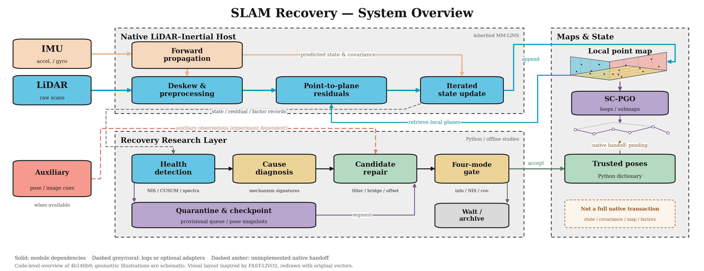
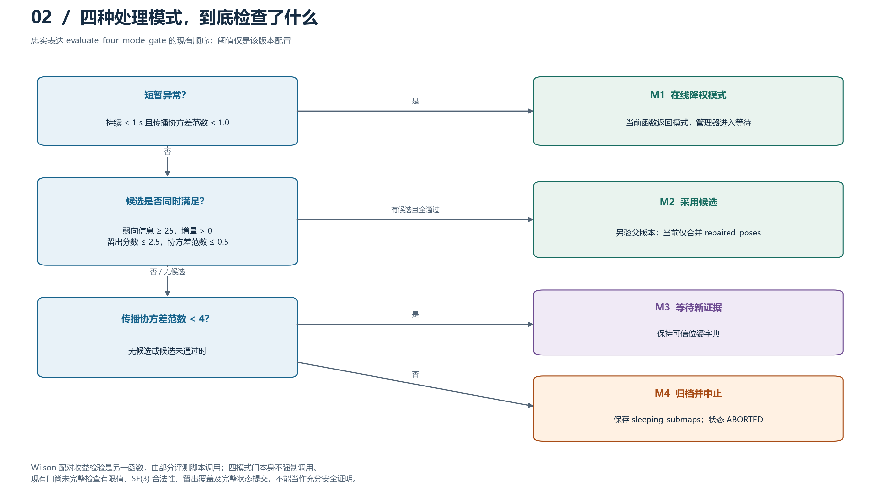
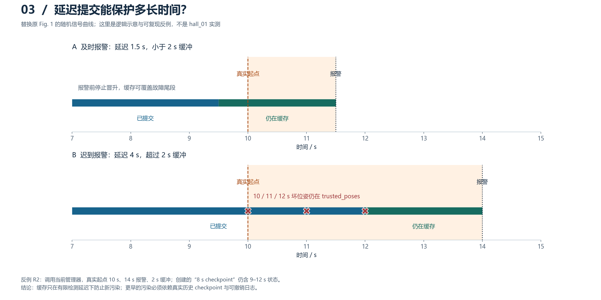
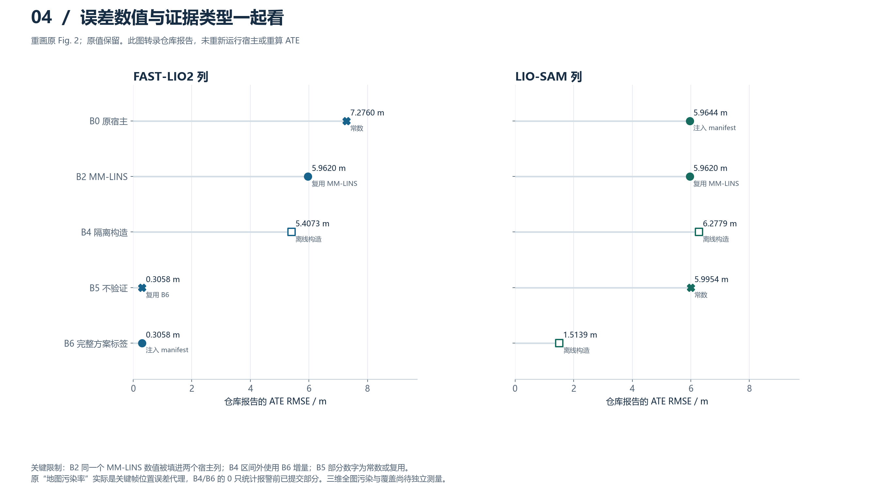
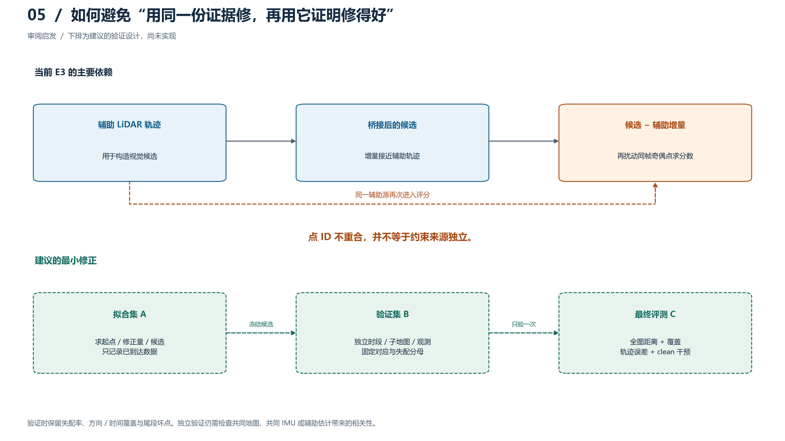
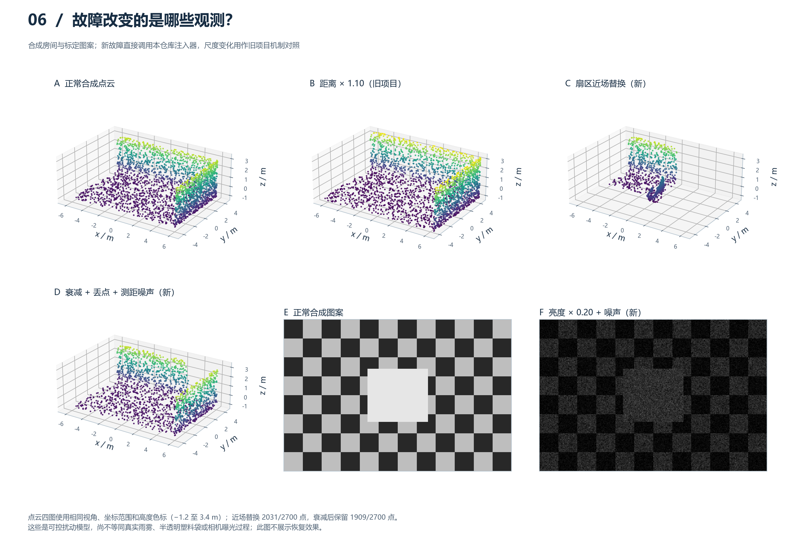
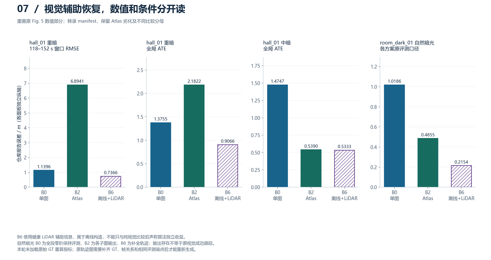

# 图示重绘与使用说明

日期 2026-11-05，源码版本 `4b140b9`。架构图按用户要求重新采用 FAST-LIVO2 风格：灰色虚线功能区、黑色轮廓、IMU 杏色、LiDAR 蓝色、辅助信息珊瑚色，配合可编辑地图与图结构示意。其余图的颜色含义见各图标签，颜色不是唯一提示。

每张图的 SVG 保留可编辑文字，PDF 用于排版，PNG 用于预览。原图、原 manifest 未覆盖。浏览器查看 SVG 需相应中文字体，PDF/PNG 可跨机器查看。

## 01 架构层级

参照 [FAST-LIVO2 原架构图](https://github.com/hku-mars/FAST-LIVO2/blob/main/pics/Framework.png) 的版式与配色语言，所有模块、箭头、地图平面和节点示意均重新绘制，没有粘贴原图素材。图内使用英文论文式排版，含义如下：上层是原生 LIO；下层依次是健康检测、原因诊断、候选修复与四模式门；右侧区分原生点地图/SC-PGO 与 Python 可信位姿字典。

灰色/珊瑚色虚线表示日志或可选适配依赖，琥珀色虚线表示尚未完成的原生交接，不代表已实现在线闭环。地图平面与节点仅为结构示意，并非实验点云或体素地图实现。上游 `IMAGE/Overview.png` 保留归属，不冒充本项目新贡献。绘图源文件为 [architecture_paper.py](architecture_paper.py)。

[SVG](figures/01_architecture.svg) · [PDF](figures/01_architecture.pdf)

## 02 四模式判断

阈值直接来自 `GateThresholds`。Wilson 不是四模式门内自动执行的检查，图注明确该边界。图不声称门已充分证明安全。

[SVG](figures/02_gate_logic.svg) · [PDF](figures/02_gate_logic.pdf)

## 03 延迟提交边界

上行为及时报警的逻辑示意，下行为本轮实际调用管理器复现的合成反例；所有时刻是诊断输入。替代旧 Fig.1 的随机 NIS 曲线，不将其标注为真实序列测量。

[SVG](figures/03_delay_boundary.svg) · [PDF](figures/03_delay_boundary.pdf)

## 04 误差与来源

数字逐项转录 E2 manifest。X 标记直接赋值/复用 B6，空心方块为离线构造，旁注给出来源。未绘“全图零污染”，因为原实现没有对完整三维地图作该测量。没有独立重复样本，不添加误差条。

[SVG](figures/04_ablation_provenance.svg) · [PDF](figures/04_ablation_provenance.pdf)

## 05 验证独立性

上排为当前依赖，下排为尚未实施的建议方案。即使点 ID 不同，共享辅助轨迹/地图仍可能造成统计依赖。

[SVG](figures/05_evidence_split.svg) · [PDF](figures/05_evidence_split.pdf)

## 06 故障机制示意

全部为合成说明，固定 seed=42；C、D、F 直接执行当前仓库注入器，B 为旧项目的径向尺度机制。四张点云使用相同视角、范围、颜色归一化；图像使用固定 0–255 色阶。颜色表示高度，不是 RGB 摄影纹理。参数和点数见 [fault_demo_parameters.json](figures/fault_demo_parameters.json)。

近场注入采用扇区替换、绝对法向投影和分母截断，没有模拟塑料透射/多回波。亮度在 uint8 图像上乘增益并加噪，没有实际相机 ISP、曝光反馈和模糊过程。它们适合可控机制实验，不能据此宣称真实物理退化完全等价。

[SVG](figures/06_fault_mechanisms.svg) · [PDF](figures/06_fault_mechanisms.pdf)

## 07 视觉辅助对照

只转录 manifest 的数值；没有重算真实轨迹或 ATE。窗口 RMSE、全局 ATE 和缺帧补全口径分开。B6 的完整输出不等于视觉成功跟踪全部帧。自然暗光 FAST-LIO2 参照在 manifest 为 0.1715 m、论文正文为 0.1697 m，仍有差异，故不强行选其中一个加入图中。

[SVG](figures/07_visual_transfer.svg) · [PDF](figures/07_visual_transfer.pdf)

## 来源与再生成

- [生成脚本](redraw_figures.py)
- [源数据表](figures/plotted_values.csv)
- [逐图源码与文件 SHA](figures/manifest.json)
- [代码反例](audit_review.py) / [结果](audit_results.json)

图示面向代码审阅与组会说明，未按指定期刊版面验收。进入论文前必须修复文中指出的证据问题，而非仅替换图片。
